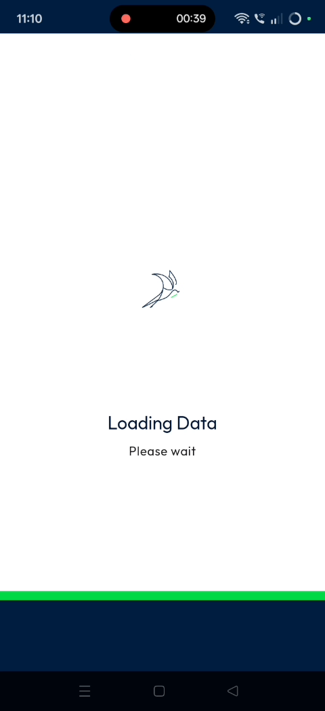

# App Launch - Login

### Launch the app and log in

Open the NFS Mobile app (**Nomadia Field Service**) on your device and sign in with your user account to access your day's interventions.

**Before you begin**, make sure you have:

* Your **User Id** and **Password**.
* The **URL server** of your NFS instance, provided by your site administrator.

#### Launch the app

1. On your device, find the **Nomadia Field Service** icon.
2. Tap the icon.

<figure><figcaption></figcaption></figure>

The login page opens. The app version is shown at the bottom of the screen.

#### Log in

1. Enter your **User Id**.
2. Enter your **Password**. Tap the eye icon to show or hide the characters you typed.
3. Check the **URL server**. For example: `https://dev-mobile.nomadia-app.com/ot`
4. Tap **Log in**.

<figure><figcaption></figcaption></figure>

5. Wait while the **Loading Data - Please wait** screen is displayed.

<figure><figcaption></figcaption></figure>

Once the data is loaded, the home page opens. It shows the date, a summary of the day's interventions (route, travel and intervention time), the list of your interventions and the navigation bar at the bottom of the screen.

#### Log in with your company account

If your company uses single sign-on, tap **Company login** instead of **Log in**.

<!-- REVIEW: the video does not show the Company login flow. Confirm how it works. -->

#### If the login fails

If the user ID or password is wrong, the message **Incorrect username or password** is displayed above the **Log in** button.

<figure><figcaption></figcaption></figure>

1. Tap the eye icon to display the password and check it.
2. Correct the password and tap **Log in** again.

If the problem continues, contact your site administrator.
