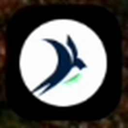
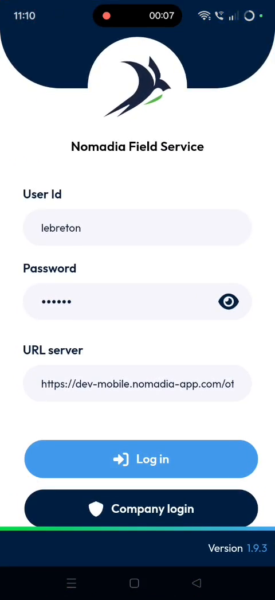
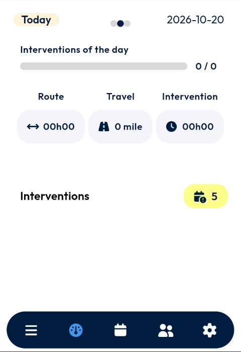
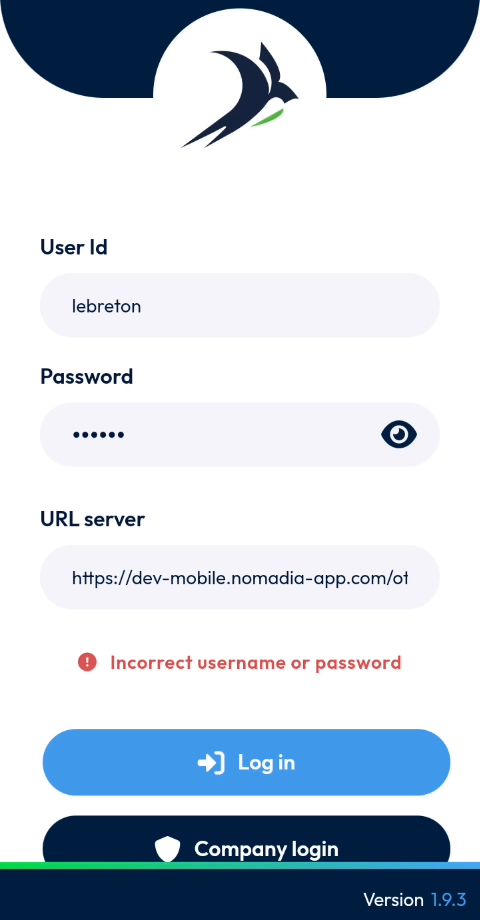

# App Launch

## Login

Open the NFS Mobile app (**Nomadia Field Service**) on your device and sign in to access your daily dashboard.

### Before you begin

* A device on which the NFS Mobile app is installed.
* Your **User Id** and **Password**.
* The **URL server** of your NFS instance, provided by your site administrator.

### Launch the app

1. On your device, find the **Nomadia Field Service** icon.
2. Tap the icon.

<figure><figcaption></figcaption></figure>

The login page opens. The app version is displayed at the bottom of the screen.

### Log in

1. In **User Id**, enter your user ID.
2. In **Password**, enter your password.
3. Check the address in **URL server**. For example: `https://dev-mobile.nomadia-app.com/ot`
4. Tap **Log in**.

<figure><figcaption></figcaption></figure>

The app loads your data, then the dashboard opens.


Tap the eye icon in the **Password** field to show or hide the characters you typed.


### The dashboard

After a successful login, the dashboard shows your day at a glance:

* **Today** and the date.
* **Interventions of the day** – a progress bar and the number of interventions completed out of those planned.
* **Route**, **Travel** and **Intervention** – the planned route time, travel distance and intervention time.
* **Interventions** – the number of interventions planned.
* The navigation bar at the bottom of the screen, to move between the app's pages.

<figure><figcaption></figcaption></figure>

### Log in with your company account

If your company uses single sign-on:

1. On the login page, tap **Company login**.
2. Follow the instructions on the screen.

<!-- REVIEW: the video does not show the Company login flow. Confirm the steps. -->

### Troubleshooting

If the user ID or password is wrong, the message **Incorrect username or password** is displayed above the **Log in** button.

<figure><figcaption></figcaption></figure>

1. Tap the eye icon to display your password and check it.
2. Correct the password.
3. Tap **Log in** again.

If the problem continues, contact your site administrator.
