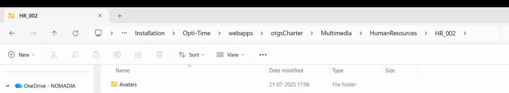
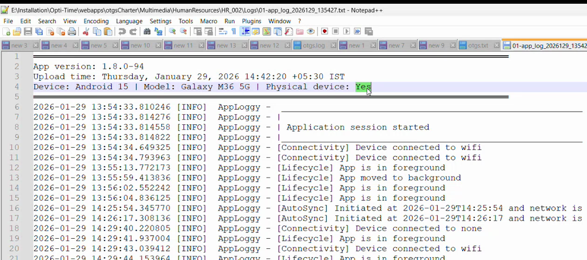

# App Logs Setup

Find the app logs that users send, and read their header and their lines.

## Overview

When a user sends the app logs, the file is stored on the server, in the folder of the user, next to the tracking logs. You open it to see what the app did before an error. See [Send the App Logs](../main-actions/send-app-logs.md).

## Find the log files

1. On the NFS server, open the **Multimedia** folder of the installation.
2. Open the **HumanResources** folder, then the folder of the user, named with the external reference, for example **HR_002**.
3. Open the **Logs** folder.

<figure><figcaption>
Folder of the user, with <strong>Logs</strong>
</figcaption></figure>

4. Open the file that starts with **app_log**, followed by the date and the time, for example **01-app_log_2026129_135427.txt**.

## Read a log file

<figure><figcaption>
Content of an app log file
</figcaption></figure>

Each file starts with a header:

| Line | Meaning |
| ---- | ------- |
| **App version** | The version of the app, for example **1.8.0-94**. |
| **Upload time** | The date and the time of the sending, with the time zone. |
| **Device** | The system and its version, the model, and whether it is a physical device. |

The lines that follow have a time, a level, such as **INFO** or **ERROR**, and the event. For an error of a request, the file shows the request and the response. The authentication data is not written.

## Things to know

* The files are sent only on demand. There is no automatic sending.
* The app log is limited to 2 MB and the tracking log to 4 MB. Each log keeps a current file and a previous file.
* There is no choice of log level yet.

<!-- REVIEW: confirm the exact folder name and the file name pattern on your server. The folder in the demo is E:\Installation\Opti-Time\webapps\otgsCharter\Multimedia\HumanResources\HR_002\Logs. -->

## Related topics

* [Send the App Logs](../main-actions/send-app-logs.md)
* [Location Logs Setup](location-logs-setup.md)
* [Application and Display Settings](application-and-display-settings.md)
