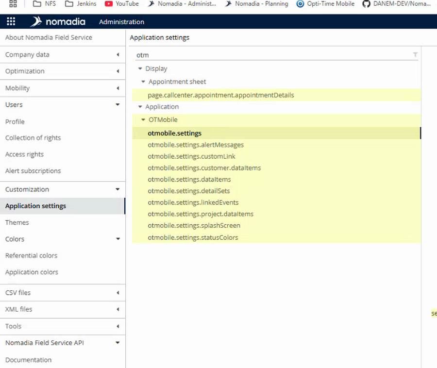

# Application Settings for NFS Mobile

Find and read the settings of NFS Mobile in the back office.

## Overview

The settings of NFS Mobile are grouped under **OTMobile** in the **Application settings** page of the Administration module. The main group is **otmobile.settings**.

## Open the settings

1. In the **Administration** module, in the left menu, open **Customization**, then tap **Application settings**.
2. In the filter at the top of the list, enter **otm**. The list shows only the groups that contain this text.
3. Under **Application**, open **OTMobile**, then select **otmobile.settings**.

<figure><figcaption>
OTMobile groups in the Application settings
</figcaption></figure>

The parameters of the selected group are displayed at the right. Each line shows the name of the parameter, its value, and a description.

## Groups of settings

| Group | Description |
| ----- | ----------- |
| **otmobile.settings** | The main settings of the app: actions available to the user, signatures, search and display. |
| **otmobile.settings.alertMessages** | The alert messages of the app. |
| **otmobile.settings.customLink** | Custom links. |
| **otmobile.settings.customer.dataItems** | Data items displayed for customers. |
| **otmobile.settings.dataItems** | Data items displayed for interventions. |
| **otmobile.settings.detailSets** | Sets of details. |
| **otmobile.settings.linkedEvents** | Linked events. |
| **otmobile.settings.project.dataItems** | Data items displayed for projects. |
| **otmobile.settings.splashScreen** | The start screen of the app. |
| **otmobile.settings.statusColors** | The colors of the statuses of interventions. |

<!-- REVIEW: the video names the groups but does not open them, except otmobile.settings. Confirm the purpose of each group and write its parameters. The descriptions above come from the group names only. -->

## Parameters of otmobile.settings

Among others, the group contains the following parameters.

| Parameter | Description |
| --------- | ----------- |
| **canFillClientReport** | Is it possible to fill a client report? |
| **canAddMissionsPhotos** | Is it possible to add photos to a mission? |
| **canAskUnavailabilities** | Is it possible to ask for unavailabilities? See [Unavailability Days Setup](unavailability-days-setup.md). |
| **numberAllowedDaysAgoToCreateUnavailabilities** | For how many days ago is it possible to create unavailabilities? See [Unavailability Days Setup](unavailability-days-setup.md). |
| **canAskOptimizedMissions** | Is it possible to ask for an optimized mission? |
| **canAskImmediateMissionsAround** | Is it possible to ask to optimize a mission around me? |
| **canReoptimizeDay** | Is it possible to ask to re-optimize a day? |
| **useCombinedMissions** | Treat missions as combined for a given day. |
| **displayRests** | Display the rests. It also controls the hotel nights. See [Hotel Nights Setup](hotel-nights-setup.md). |
| **useSurveyReports** | Fill survey reports. |
| **mandatoryMissionsPhotosNumber** | How many mandatory photos to take per mission. **0** means that photos are not mandatory. See [Required Photos Setup](required-photos-setup.md). |
| **hideRemarkTab** | Hide the **Remarks** tab. See [Remarks Tab Setup](remarks-tab-setup.md). |
| **agendaViewTime** | How times are displayed in the agenda view: **SCHEDULED** (default) shows the scheduled time, **ANNOUNCED** the announced time. |
| **cancelledStatus...** | When an intervention is cancelled with **Abandon**, its status is **SUSPENDED** instead of the usual **REMOVED** status. See [Abandoned Missions Setup](abandoned-missions-setup.md). |

For the settings of signatures, see [Signature Settings](signature-settings.md). For the search around settings, see [Search Around Settings](search-around-settings.md).

## Save the settings

1. Change the value of a parameter. A switch turns a parameter on or off, and a list lets you select a value.
2. Tap **Save** at the top right of the page. To cancel your changes, tap **Reset**.

<!-- REVIEW: the video does not save a change in the application settings. Confirm that a Save and a Reset button apply, and when the mobile users get the new values. -->

## Related topics

* [Mobile Configuration](README.md)
* [Signature Settings](signature-settings.md)
