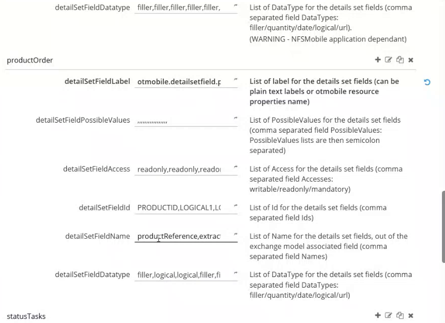
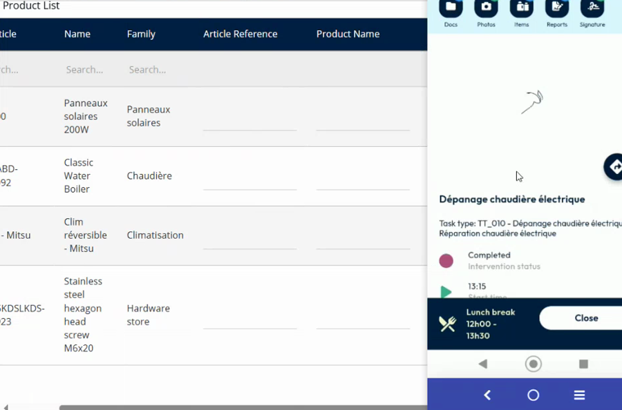

# Extra Item Fields Setup

## Overview

The items of an intervention use the **product order details** of NFS. They have fixed fields that the app already knows, such as the article reference, the ordered quantity and the unit price. You can add up to six **extra fields** of different types. NFS Mobile shows them on the **Details** page of each item, and the technician can edit them. See [View and Edit the Extra Fields of an Item](../intervention/edit-extra-item-fields.md).

## Before you begin

* You have access to the **Administration** module. See [Application Settings for NFS Mobile](application-settings.md).
* You know which information you want to show: a text, a link, a checkbox, a number or a date.

## Configure the extra fields

1. In the **Administration** module, open **Customization**, then **Application settings**.
2. Under **OTMobile**, select **otmobile.settings.detailSets**.
3. Find the **productOrder** set.

<figure><figcaption>
productOrder detail set
</figcaption></figure>

4. Add your extra fields at the end of each of these parameters, in the same order for all of them. Separate the values with commas.

| Parameter | Description |
| --------- | ----------- |
| **detailSetFieldName** | The name of the field in the exchange model. It links the field to a field of the product order details, for example **filler8**, **filler13**, **logical3**, **quantity5**, **date1**. |
| **detailSetFieldDatatype** | The type of the field: **filler** (text), **url** (link), **logical** (checkbox), **quantity** (number) or **date**. |
| **detailSetFieldLabel** | The label displayed under the value. Enter a plain text, or the name of a resource key of the app, for example **otmobile.detailsetfield.productOrder.filler8**. |
| **detailSetFieldId** | The identifier of the field, for example **FILLER8**, **LOGICAL3**, **QUANTITY5**, **DATETIME1**. |
| **detailSetFieldAccess** | The access of the technician: **readonly**, **writable** or **mandatory**. |
| **detailSetFieldPossibleValues** | The possible values of the field. Leave it empty if there is no list. |

5. Click **Save** at the top right of the page.

### Example

The demo adds six fields:

| Field | Type | Access | Label |
| ----- | ---- | ------ | ----- |
| filler8 | Text | Read-only | Test label 8 |
| filler13 | Text | Writable | Filler 13 |
| filler15 | Link (URL) | Writable | Filler 15 |
| logical3 | Checkbox | Writable | Logical 3 |
| quantity5 | Number | Writable | Quantity 5 |
| date1 | Date | Writable | Date 1 |

## Drop-down lists and mandatory fields

You can offer a list of values for a text field, and make fields mandatory.

1. In **detailSetFieldPossibleValues**, enter the values of the list for the field. Separate the values of a list with semicolons, and the fields with commas. Keep the same position as the field, and leave the other positions empty. For example, **Option 1;Option 2;Option 3** for the field **Filler 9**.
2. In **detailSetFieldAccess**, set the access of a field to **mandatory** instead of **writable**.
3. Click **Save**.

| Setting | Result in the app |
| ------- | ----------------- |
| A text field with possible values | The field is a drop-down list. The user taps **Choose a value** and selects one value. |
| Access **mandatory** | A red asterisk is displayed after the label. The user must fill in the field before finishing the intervention. |

The check applies only to the items that the technician used, which means that their quantity is not zero. See [Mandatory Fields and Drop-Down Lists on Items](../intervention/mandatory-and-list-item-fields.md).

## Show the fields in NFS

In NFS, the product order details of an appointment show the standard fields and your extra fields in the **Product List**. You can also add other fields that are not planned.

1. Open the appointment.
2. In the **Product List**, find the columns of your extra fields, for example **logical3**, **quantity5**, **date1**, **filler8** and **filler13**.
3. Enter the planned values for each product.

<figure><figcaption>
Product list of an appointment in NFS
</figcaption></figure>

## Check the result in the app

1. In NFS Mobile, refresh your data. See [Refresh Your Data](../main-actions/refresh-your-data.md).
2. Open an intervention, tap **Items**, then open an item.
3. Check that the extra fields are displayed, with a pencil icon on the writable ones once the intervention is started.


The extra fields use the filler, logical, quantity and date fields of the product order. Use fields that your company does not already use for another purpose.


<!-- REVIEW: the demo shows these parameters quickly and mentions that up to six extra fields can be configured. Confirm the exact limit, how to name the resource key for a label, and the identifier to use for each type. The helpdesk note of the feature lists the values used here. -->

## Related topics

* [View and Edit the Extra Fields of an Item](../intervention/edit-extra-item-fields.md)
* [Mandatory Fields and Drop-Down Lists on Items](../intervention/mandatory-and-list-item-fields.md)
* [Application Settings for NFS Mobile](application-settings.md)
* [Price Calculation Setup](price-calculation-setup.md)
