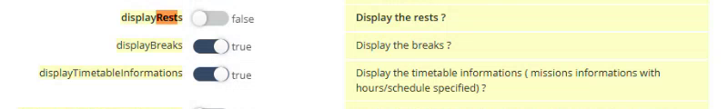

# Hotel Nights Setup

## Overview

A hotel night is an exceptional location of a mobile resource. The planner creates it in NFS, and NFS Mobile shows it in the calendar. See [Hotel Nights in the Calendar](../main-actions/calendar-hotel-nights.md).

## Assign a hotel to a technician

1. In NFS, open **Planning**, then **Exceptional locations**.
2. Select the **Mobile resource**, then click **New**.
3. Select the hotel that the technician uses as an address. The hotel is a location that you created before.
4. Select the **Period**: the start date and the end date.
5. Optionally, set the times of the start day and of the end day.
6. Save.

In the planning of NFS, the nights are displayed like the lunch break and the rest.

## Show or hide the rests and the hotel nights

1. In the **Administration** module, open **Customization**, then **Application settings**.
2. Under **OTMobile**, select **otmobile.settings**. See [Application Settings for NFS Mobile](application-settings.md).
3. Find **displayRests** and turn it on or off.

<figure><figcaption>
displayRests setting
</figcaption></figure>

4. Click **Save**, then ask the user to log out and log in again.

| displayRests | Calendar |
| ------------ | -------- |
| **true** | The agenda shows the rest periods and the hotel nights. |
| **false** | The agenda shows neither the rest periods nor the hotel nights. |

<!-- REVIEW: the demo shows the creation of the hotel night quickly. Confirm the steps and the names of the fields in Exceptional locations, and confirm that displayRests controls both the rests and the hotel nights. -->

## Related topics

* [Hotel Nights in the Calendar](../main-actions/calendar-hotel-nights.md)
* [Application Settings for NFS Mobile](application-settings.md)
