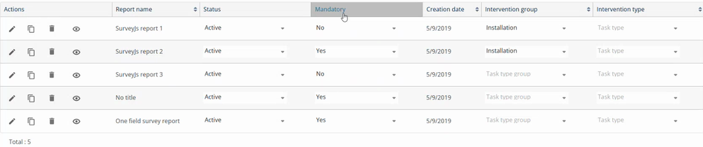

# Mandatory Reports Setup

Decide which survey reports a field user must complete before finishing an intervention.

## Overview

In the back office, each survey report has a **Mandatory** column. When it is **Yes**, the app marks the report as mandatory and blocks the end of the intervention until the user completes it. See [Complete the Mandatory Survey Reports](../intervention/mandatory-survey-reports.md).

This works like the mandatory signature and the mandatory photos. See [Signature Settings](signature-settings.md) and [Required Photos Setup](required-photos-setup.md).

## Before you begin

* You have access to the **Report** page of the back office.
* The survey reports exist in **Form Model**. You can create a new one or open an existing one.

## Make a report mandatory

1. In the back office, open **Report**, then the **Form Model** tab.
2. In the list, find the report, for example **SurveyJs report 2**.
3. In the **Mandatory** column, select **Yes**. Select **No** if the report is optional.

<figure><figcaption>
Form Model with the Mandatory column
</figcaption></figure>

| Column | Description |
| ------ | ----------- |
| **Report name** | The name of the survey report. |
| **Status** | **Active** or not. Only active reports are available. |
| **Mandatory** | **Yes** when the user must complete the report before finishing the intervention. |
| **Intervention group** | The group of interventions that the report applies to, for example **Installation**. Leave it empty to apply it to all. |
| **Intervention type** | The type of task that the report applies to. |

4. Tap or click away to save the value.

## Check the result in the app

1. In NFS Mobile, refresh your data. See [Refresh Your Data](../main-actions/refresh-your-data.md).
2. Open an intervention and tap **Reports**. The mandatory reports are marked with an orange circle.
3. Try to finish the intervention without completing them. The message **Please fill mandatory report fields to proceed** is displayed.


A report only appears in an intervention if its intervention group or its task type matches. A report with no group and no type appears in all the interventions.


<!-- REVIEW: confirm that the Mandatory value is saved when you select it (there is no save button in the video), and when users receive the change (at the next refresh or at the next login). Also confirm the effect of the intervention group and the intervention type. -->

## Related topics

* [Complete the Mandatory Survey Reports](../intervention/mandatory-survey-reports.md)
* [Required Photos Setup](required-photos-setup.md)
* [Signature Settings](signature-settings.md)
