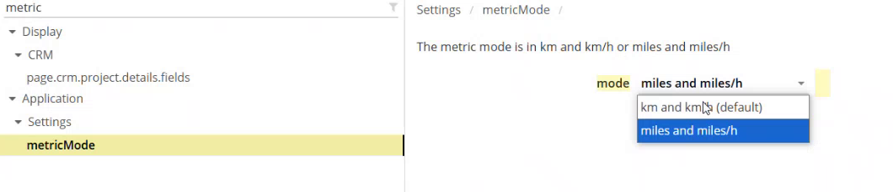

# Measurement Unit Setup

## Overview

The **metricMode** setting of the back office decides the unit of the estimated travel distance and time that NFS displays. NFS Mobile has its own **Measurement unit** choice, which each user sets in the app. See [Change the Measurement Unit](../main-actions/change-the-measurement-unit.md).

## Choose the unit in the back office

1. In the **Administration** module, open **Customization**, then **Application settings**.
2. In the filter at the top of the list, enter **metric**.
3. Under **Application**, open **Settings**, then select **metricMode**. The description is **The metric mode is in km and km/h or miles and miles/h**.

<figure><figcaption>
metricMode setting
</figcaption></figure>

4. In the **mode** list, select the unit:

| Value | Description |
| ----- | ----------- |
| **km and km/h** (default) | Distances in kilometers and speeds in kilometers per hour. |
| **miles and miles/h** | Distances in miles and speeds in miles per hour. |

5. Click **Save** at the top right of the page.

## Check the result in the app

1. In NFS Mobile, open **Settings**.
2. In **My Settings**, check **Measurement unit**. **Km** is the default.
3. Select **Miles** to see the distances of the app in miles.

<!-- REVIEW: the demo shows that the back office setting existed before and that the mobile app now has its own Measurement unit. Confirm whether the back-office value sets the default for the app, and whether the user choice overrides it. -->

## Related topics

* [Change the Measurement Unit](../main-actions/change-the-measurement-unit.md)
* [Application Settings for NFS Mobile](application-settings.md)
