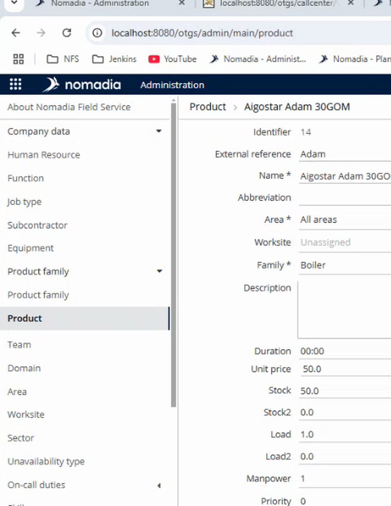

# Price Calculation Setup

Set the products and prices used by the Items page of an intervention.

## Overview

The **Items** page of an intervention lists products and calculates a total price. Each product is defined in the back office, with its unit price and its stock. The app multiplies the unit price by the quantity chosen by the user.

There are two ways to calculate the price:

| Way | Description |
| --- | ----------- |
| **Product catalog** | The app uses the unit price of each product, set in the back office. |
| **Custom external service** | The app sends the items to a web address that you define, and the service returns the prices. |

## Create or change a product

1. In the **Administration** module, open **Company data**, then **Product**.
2. Open a product, for example **Aigostar Adam 30GOM**.

<figure><figcaption>
Product form
</figcaption></figure>

3. Fill in the fields of the product.

| Field                  | Description                                                                                                                     |
| ---------------------- | ------------------------------------------------------------------------------------------------------------------------------- |
| **Name**               | The name displayed in the app. This field is mandatory.                                                                         |
| **External reference** | The reference of the product in another system, for example **Adam**.                                                           |
| **Area**               | The area where the product is available, for example **All areas**. This field is mandatory.                                    |
| **Family**             | The family of the product, for example **Boiler**. This field is mandatory. Product families are defined in **Product family**. |
| **Unit price**         | The price of one unit, for example **50.0**. The app uses it to calculate the price.                                            |
| **Stock**              | The quantity in stock, for example **50.0**.                                                                                    |
| **Duration**           | The duration of the product.                                                                                                    |

4. Save the product.

## Use a custom external service

1. In **Application settings**, open **OTMobile**, then **otmobile.settings**. See [Application Settings for NFS Mobile](application-settings.md).
2. Find the settings of the price calculation, and enter the address of your service in the custom URL.
3. Click **Save**.

The service now returns the detail of each item: the price without tax, the tax amount and the price with tax, and for the whole intervention the tax rate and the total. Before, it returned only the total.


The new behavior uses a different web service method. Change the value of the custom setting to the new one. It is in the configuration document of the price calculation that your team shared.


### Add the fields for the detail of each item

NFS Mobile saves the three amounts of each item in the product order details of the appointment. The set of details **productOrder** must have these three fields, mapped to **quantity5**, **quantity6** and **quantity7**:

| Field | Content |
| ----- | ------- |
| **quantity5** | The total without tax of the item. |
| **quantity6** | The tax amount of the item. |
| **quantity7** | The total with tax of the item. |

Without these fields, the app cannot send the prices of the items to NFS.


This feature needs a recent version of NFS in the back office and the latest version of the app.


<!-- REVIEW: the demo explains the fields and the new web service method but does not show the exact names of the custom setting and of the new value. Give them, and confirm the order of the three fields. -->

## Check the result in the app

1. In NFS Mobile, open an intervention and tap **Items**. The product is listed with its unit price, for example **Boiler - UP ET : €50.00**.
2. Choose a quantity, then tap the calculator button. The **Result** page shows the price. See [Calculate the Price of the Items](../intervention/calculate-item-prices.md).

## Related topics

* [Add Items to an Intervention](../intervention/add-items-to-an-intervention.md)
* [Calculate the Price of the Items](../intervention/calculate-item-prices.md)
* [Mobile Configuration](README.md)

