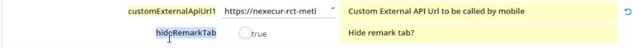

# Remarks Tab Setup

Show or hide the Remarks shortcut on the intervention page of the app.

## Overview

By default, the **Remarks** shortcut is displayed on the **Intervention** page once the intervention is started, and it stays displayed after it is finished. The **hideRemarkTab** setting lets you hide it. Its description is **Hide remark tab?**

| Value | Effect |
| ----- | ------ |
| Off (default) | The **Remarks** shortcut is displayed. The text entered by the user is sent to NFS with the intervention and appears in the visit report. |
| On (**true**) | The **Remarks** shortcut is hidden for the intervention. The user cannot enter remarks. |

The setting controls whether an intervention can have a general comment.

## Hide or show the Remarks tab

1. In the **Administration** module, open **Customization**, then **Application settings**.
2. Open **OTMobile**, then **otmobile.settings**. See [Application Settings for NFS Mobile](application-settings.md).
3. Scroll down to **hideRemarkTab**.

<figure><figcaption>
hideRemarkTab setting
</figcaption></figure>

4. Turn the switch on to hide the tab, or off to show it.
5. Tap **Save** at the top right of the page.

## Check the result in the app

1. In NFS Mobile, log out, then log in again.
2. Open an intervention and start it.
3. Look at the shortcuts at the top of the **Intervention** page. With the setting on, **Remarks** is not displayed. With the setting off, it is displayed.

See [Add Photos and Remarks](../intervention/photos-and-remarks.md#show-or-hide-the-remarks-tab).

<!-- REVIEW: the presenter shows that a remark entered while the tab was displayed is mapped to the visit report in NFS, and that a remark entered before the tab was hidden is not sent. Confirm the field of the appointment that receives the remark, and confirm the default value. -->

## Related topics

* [Add Photos and Remarks](../intervention/photos-and-remarks.md)
* [Application Settings for NFS Mobile](application-settings.md)
