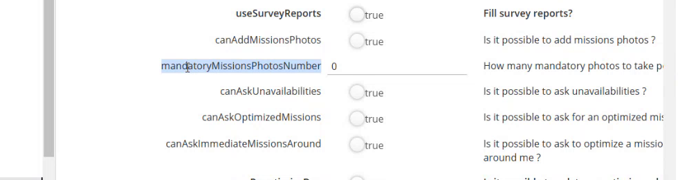

# Required Photos Setup

Require a minimum number of photos before a field user can finish an intervention.

## Overview

The **mandatoryMissionsPhotosNumber** setting does two things at once: it makes photos mandatory, and it sets the minimum number of photos. It works like the signature settings **workerMustSignMissions**, which make the signature mandatory. See [Signature Settings](signature-settings.md).

| Value | Effect |
| ----- | ------ |
| **0** (default) | Photos are not mandatory. The user can finish an intervention without a photo. |
| A number, for example **4** | The user must take at least this number of photos before finishing the intervention. |

## Set the number of photos

1. In the **Administration** module, open **Customization**, then **Application settings**.
2. Open **OTMobile**, then **otmobile.settings**. See [Application Settings for NFS Mobile](application-settings.md).
3. Find **mandatoryMissionsPhotosNumber**, under **canAddMissionsPhotos**. Its description is **How many mandatory photos to take per mission**.

<figure><figcaption>
mandatoryMissionsPhotosNumber setting
</figcaption></figure>

4. Enter the number of photos, for example **4**.
5. Tap **Save** at the top right of the page.


Photos can be taken only if **canAddMissionsPhotos** is turned on.


## Check the result in the app

1. In NFS Mobile, log out, then log in again. The new value is loaded at login.
2. Open an intervention in progress. The **Photos** shortcut shows an alert.
3. Open **Photos**. The page shows **Photos required: 0 / 4**.

See [Take the Required Photos](../intervention/required-photos.md).

<!-- REVIEW: confirm the position of the setting (it is listed after canAddMissionsPhotos in the demo), whether canAddMissionsPhotos must be on, and whether a refresh is enough instead of a new login. -->

## Related topics

* [Take the Required Photos](../intervention/required-photos.md)
* [Application Settings for NFS Mobile](application-settings.md)
* [Signature Settings](signature-settings.md)
