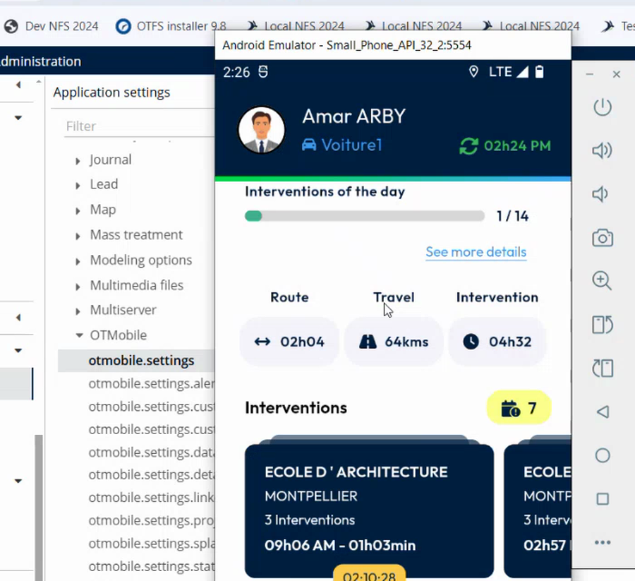

# Signature Settings

Set whether signatures are possible, mandatory and electronic.

## Overview

The signature settings decide what happens when a user finishes an intervention in NFS Mobile: whether the intervention can be signed, who must sign, and whether the signature is electronic.

## Open the signature settings

1. Open **otmobile.settings**. See [Application Settings for NFS Mobile](application-settings.md#open-the-settings).
2. Find the signature parameters.

<figure><figcaption>
Signature settings
</figcaption></figure>

## Parameters

| Parameter | Description |
| --------- | ----------- |
| **canSignMissions** | Is it possible to sign missions? |
| **customerMustSignMissions** | Is the signature of missions mandatory for customers? |
| **canSignMissionsByWorker** | Is it possible to sign missions for workers? |
| **workerMustSignMissions** | Is the signature of missions mandatory for workers? |
| **signatureFormat** | The format of the signatures. **PNG** is the default value. |
| **canUseElectronicSignature** | Is it possible to sign a mission electronically? |
| **mustUseElectronicSignature** | Is the electronic signature mandatory? |

Each parameter is a switch, set to **true** or **false**. **signatureFormat** is a list.

## Change a setting

1. Turn the switch of a parameter on or off.
2. Tap **Save** at the top right of the page.

When **canUseElectronicSignature** is on, the **Sign intervention** page of the app offers **Securely**. See [Sign an Intervention](../intervention/sign-an-intervention/README.md).

## Check the signatures

The signatures drawn in the app are stored with the intervention. In the back office, open the linked images of the appointment. Each signature is an image file, for example **WorkerSignature.png** and **_ClientSignature.png**, listed under the document kind **Report**.

<!-- REVIEW: the video shows the signature images in the back office but does not show how to open the linked images page. Confirm the path in the back office and add a screenshot. -->

## Related topics

* [Application Settings for NFS Mobile](application-settings.md)
* [Sign Securely](../intervention/sign-an-intervention/sign-securely.md)
