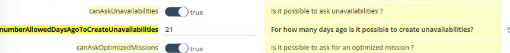

# Unavailability Days Setup

Allow field users to declare unavailabilities, and set how many days in the past they can go back.

## Overview

Two settings of **otmobile.settings** control the unavailabilities of NFS Mobile.

| Parameter | Description |
| --------- | ----------- |
| **canAskUnavailabilities** | Is it possible to ask unavailabilities? When it is **true**, the **Unavailabilities** option is available. |
| **numberAllowedDaysAgoToCreateUnavailabilities** | For how many days ago is it possible to create unavailabilities? It is also the number of past days that the calendar displays. |

## Set the number of past days

1. In the **Administration** module, open **Customization**, then **Application settings**.
2. Under **OTMobile**, select **otmobile.settings**. See [Application Settings for NFS Mobile](application-settings.md).
3. Find **canAskUnavailabilities** and check that the switch is **true**.
4. Find **numberAllowedDaysAgoToCreateUnavailabilities** and enter the number of days, for example **21**.

<figure><figcaption>
Unavailability settings
</figcaption></figure>

5. Click **Save** at the top right of the page.

## Check the result in the app

1. In NFS Mobile, log out and log in again.
2. Open **Menu**, then **Unavailabilities**, and tap the plus button.
3. In **Date period**, open the calendar. You can select a day up to the number of days that you set, for example 15 January on 5 February with 21 days.

See [Declare an Unavailability](../menu/unavailabilities/declare-an-unavailability.md).


The same number of days sets how far back the calendar shows your interventions and unavailabilities. See [See Your Unavailabilities in the Agenda](../menu/unavailabilities/see-unavailabilities-in-the-agenda.md).


<!-- REVIEW: confirm the default value and that the value 0 allows only today and the future. Confirm the setting that lets a user declare an unavailability at the same time as an appointment, which the presenter mentions. -->

## Related topics

* [Declare an Unavailability](../menu/unavailabilities/declare-an-unavailability.md)
* [Application Settings for NFS Mobile](application-settings.md)
