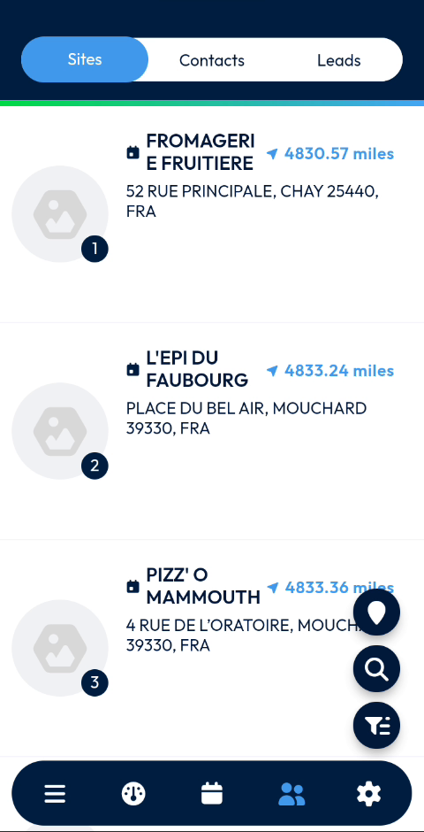

# Customer Directory

Find your customers' sites, check their details and act on them from the field.

## Overview

The **Customer Directory** lists the sites that you work with. From the directory, you can open a site, read its information, create an intervention for it, add photos and documents, and get directions.

The directory is organized in three tabs at the top of the screen: **Sites**, **Contacts** and **Leads**.

<figure><figcaption>
Customer Directory, Sites tab
</figcaption></figure>

This section covers:

| Topic | Description |
| ----- | ----------- |
| [Browse the Sites List](browse-the-sites-list.md) | Read the list of sites and open a site. |
| [View a Site](view-a-site.md) | Read the details of a site: address, information, planned interventions and documents. |
| [Create an Intervention for a Site](create-an-intervention-for-a-site.md) | Create an intervention from the menu of a site. |
| [Add Photos to a Site](add-photos-to-a-site.md) | Take or select photos for a site. |
| [Add Documents to a Site](add-documents-to-a-site.md) | Link documents, images and other files to a site. |
| [Get Directions to a Site](get-directions-to-a-site.md) | Open the route to a site in your navigation app. |

## Open the Customer Directory

1. In the navigation bar at the bottom of the screen, tap the **Contacts** icon (two people).
2. The **Customer Directory** opens on the **Sites** tab. The icon is highlighted in blue.

To use another tab, tap **Contacts** or **Leads** at the top of the screen.

<!-- REVIEW: the video only uses the Sites tab. Confirm what the Contacts and Leads tabs display and what you can do on them. Confirm also the name of this page in the app: the navigation bar icon is not labeled. -->

## Related topics

* [Dashboard](../main-actions/main-actions.md)
* [Create an Intervention](../intervention/create-an-intervention/README.md)
