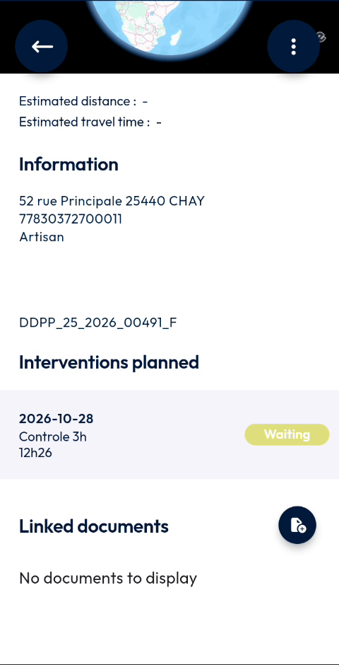
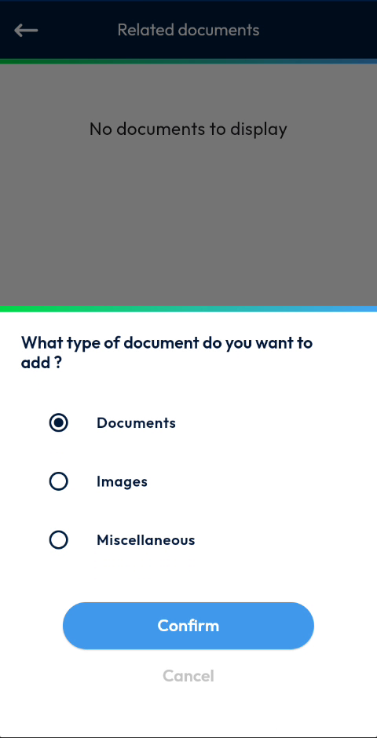
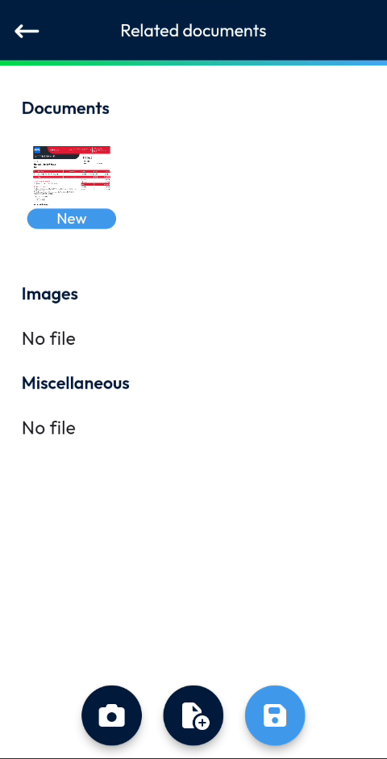
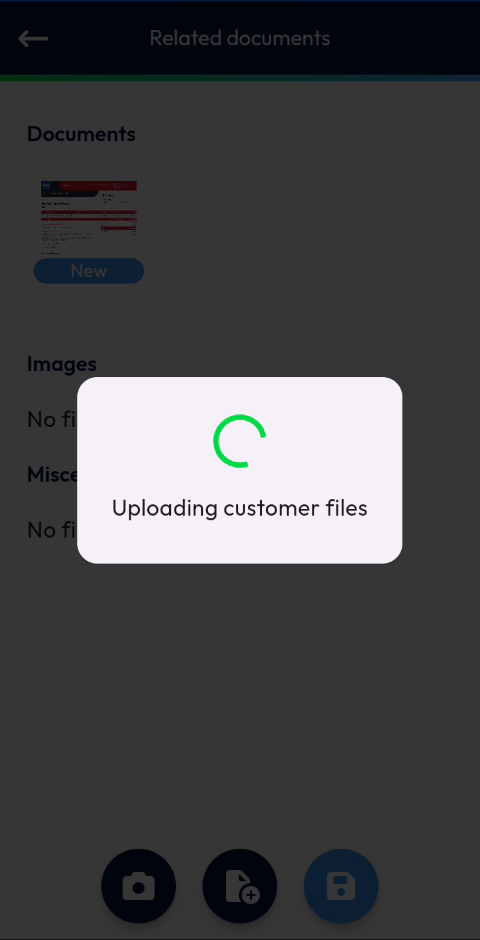
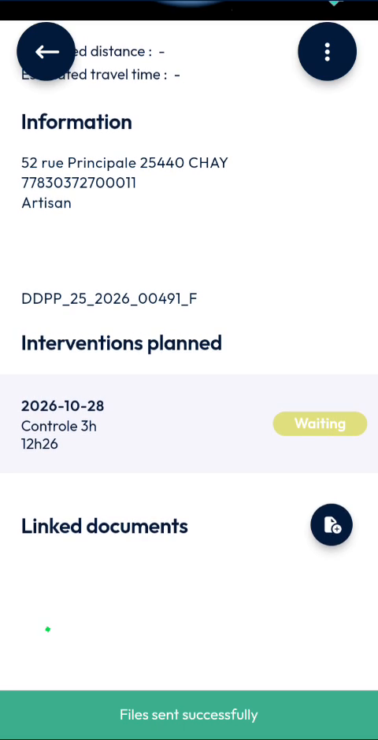

# Add Documents to a Site

Link documents, images and other files to a site.

## Overview

You can link files to a site, such as an invoice or a form. The files are sorted in three types: **Documents**, **Images** and **Miscellaneous**.

## Before you begin

* You have opened a site. See [View a Site](view-a-site.md).
* The file is available on your device or in your cloud storage.

## Open the related documents

1. On the site page, scroll down to **Linked documents**.
2. Tap the document button at the right of **Linked documents**.
3. The **Related documents** page opens. If the site has no document yet, the message **No documents to display** is displayed.

<figure><figcaption>
Related documents page without document
</figcaption></figure>

## Add a file

1. At the bottom of the screen, tap the file button with a plus sign. To take a photo, tap the camera button instead.
2. In the message **What type of document do you want to add?**, select the type: **Documents**, **Images** or **Miscellaneous**.

<figure><figcaption>
Document type message
</figcaption></figure>

3. Tap **Confirm**. To close the message without adding a file, tap **Cancel**.
4. In the file picker of your device, select the file, for example a PDF file.
5. The file appears in the list under its type, with the label **New**.

<figure><figcaption>
File added to the related documents
</figcaption></figure>

The types without file display **No file**.

## Save the documents

1. Tap the blue save button at the bottom of the screen.
2. Wait while the message **Uploading customer files** is displayed.

<figure><figcaption>
Uploading customer files
</figcaption></figure>

3. The message **Files sent successfully** is displayed on the site page.

<figure><figcaption>
Files sent successfully
</figcaption></figure>

<!-- REVIEW: confirm which file formats and sizes are accepted, and whether the documents are visible to the other users of the site. The video shows the success message but not the documents in the Linked documents area. -->

## Related topics

* [Add Photos to a Site](add-photos-to-a-site.md)
* [View a Site](view-a-site.md)
