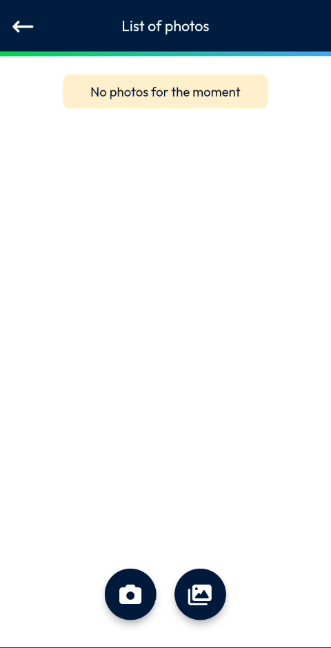
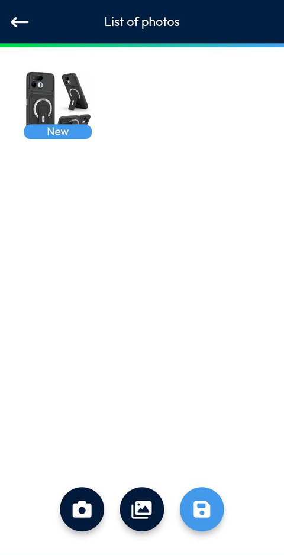
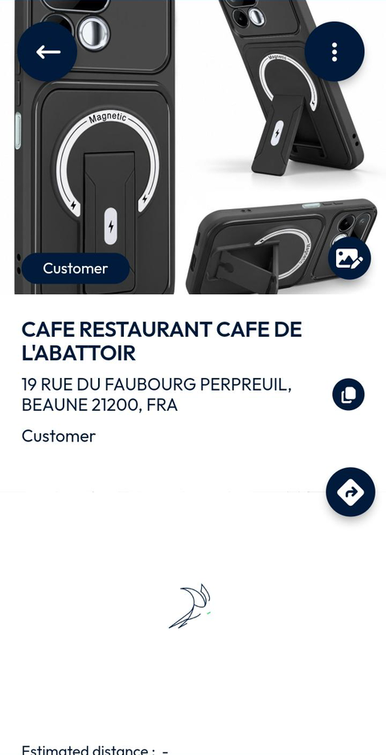
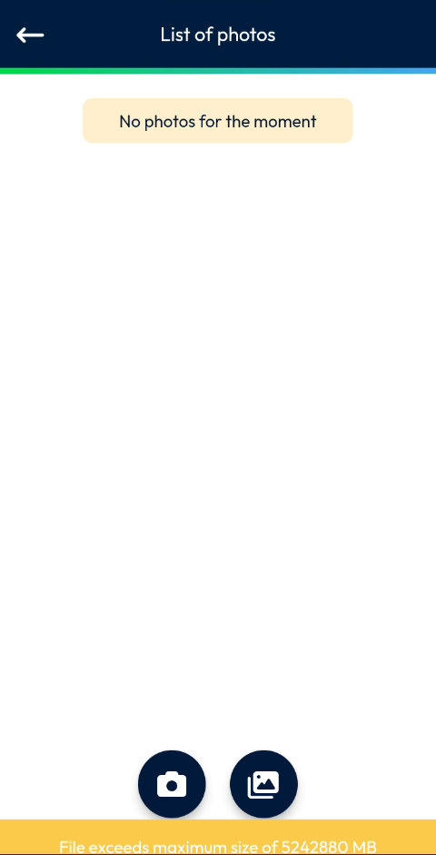

# Add Photos to a Site

## Overview

You can attach photos to a site, for example a photo of its entrance. The photos are listed on the **List of photos** page. Once saved, the photo is displayed at the top of the site page.

## Before you begin

* You have opened a site. See [View a Site](view-a-site.md).
* The app is allowed to use the camera of your device.

## Open the list of photos

1. On the site page, tap the photo button at the right of the photo of the site, above the **Customer** label.
2. The **List of photos** page opens. If the site has no photo yet, the message **No photos for the moment** is displayed.

<figure><figcaption>
List of photos
</figcaption></figure>

## Add a photo

1. At the bottom of the screen, tap the camera button to take a photo, or the gallery button to select an existing image.
2. Take the photo, then tap the check mark to keep it. Tap the cross to discard it. If you chose the gallery button, select the image.
3. The photo appears in the list with the label **New**. This label shows that the photo is not saved yet.

<figure><figcaption>
New photo in the list of photos
</figcaption></figure>

4. Tap the blue save button at the bottom of the screen.
5. Wait while the photo is sent. The site page opens.

The photo is displayed at the top of the site page, in place of the placeholder.

<figure><figcaption>
Site page with its photo
</figcaption></figure>


Tap the blue save button after you add the photo. Without it, the photo stays marked **New** and is not saved.


## If the photo is too large

If the file is too large, the message **File exceeds maximum size of 5242880 MB** is displayed at the bottom of the screen. Choose a smaller file.

<figure><figcaption>
File size message
</figcaption></figure>

To return to the site page without saving, tap the back arrow at the top left.

<!-- REVIEW: confirm the maximum file size and its unit (the message shows 5242880 MB), and what happens to a photo marked New when you leave the page without saving. Confirm also how to delete or replace a photo. -->

## Related topics

* [Add Documents to a Site](add-documents-to-a-site.md)
* [View a Site](view-a-site.md)
