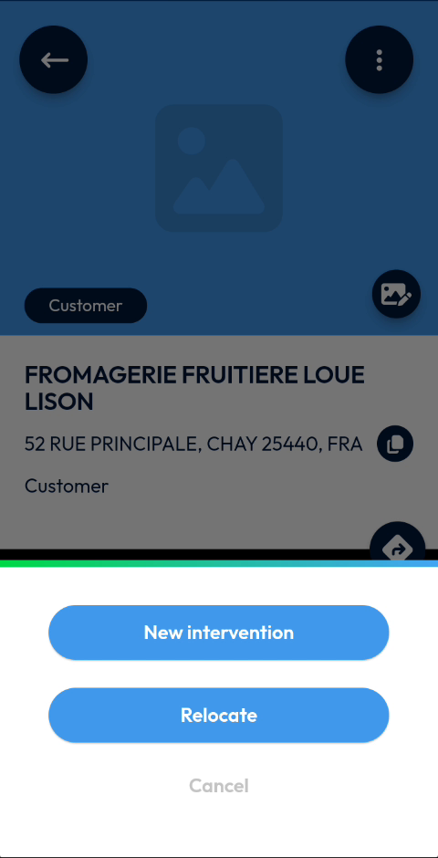
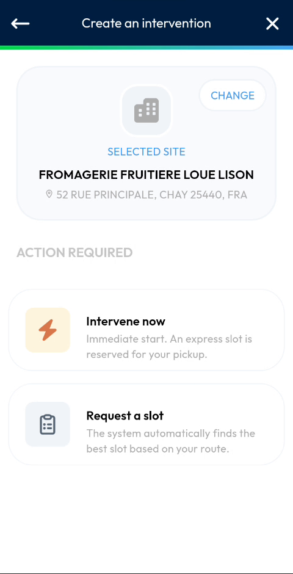

# Create an Intervention for a Site

## Overview

From the menu of a site, you can create an intervention directly for this site. The site is already selected when the **Create an intervention** page opens.

## Before you begin

* You have opened a site. See [View a Site](view-a-site.md).

## Create the intervention

1. At the top right of the site page, tap the three-dot icon.
2. In the menu, tap **New intervention**.

<figure><figcaption>
Menu of a site
</figcaption></figure>

3. The **Create an intervention** page opens, with the name and address of the site in **Selected site**.

<figure><figcaption>
Create an intervention page for the site
</figcaption></figure>

4. Tap **Intervene now** to start immediately, or **Request a slot** to let the system find a slot.

To close the menu without choosing an option, tap **Cancel**.

For the next steps, see [Intervene Now](../intervention/create-an-intervention/intervene-now.md) and [Request a Slot](../intervention/create-an-intervention/request-a-slot.md).

## Other options of the menu

The menu of a site also contains **Relocate**.

<!-- REVIEW: the video does not use Relocate. Confirm what it does (for example, correcting the position of the site). -->

## Related topics

* [View a Site](view-a-site.md)
* [Create an Intervention](../intervention/create-an-intervention/README.md)
