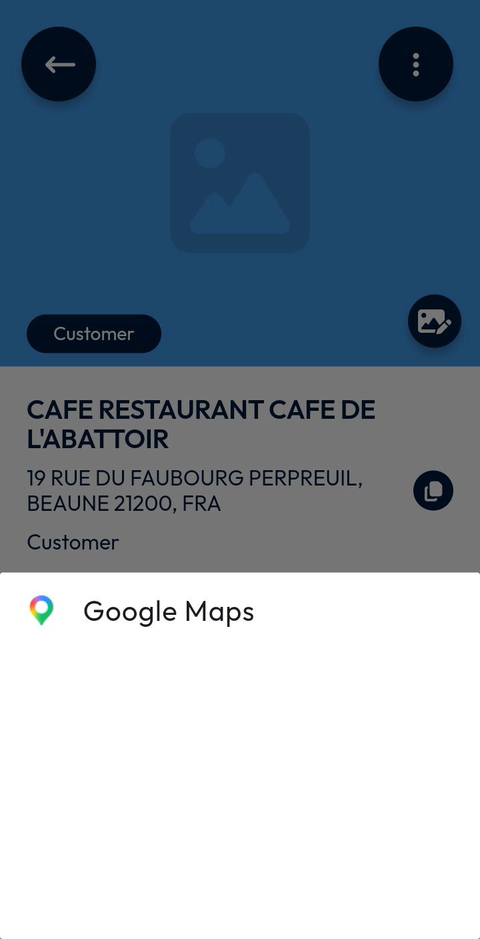
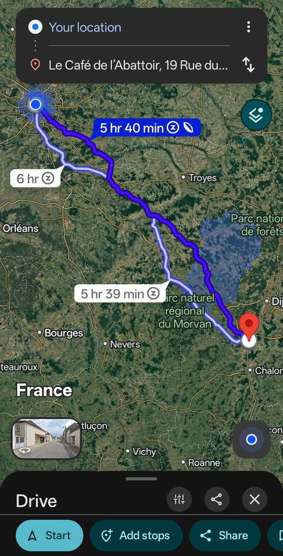

# Get Directions to a Site

Open the route to a site in your navigation app.

## Overview

The site page has a directions button. It opens your navigation app with the site as destination, so you can drive to the customer.

## Before you begin

* You have opened a site. See [View a Site](view-a-site.md).
* A navigation app is installed on your device, for example Google Maps.
* The location of your device is turned on.

## Get directions

1. On the site page, tap the directions button, a blue circle with an arrow, at the right of the map.
2. At the bottom of the screen, a list of the navigation apps available on your device is displayed. Tap your navigation app, for example **Google Maps**.

<figure><figcaption>
Choice of the navigation app
</figcaption></figure>

3. The navigation app opens with the route from **Your location** to the address of the site.

<figure><figcaption>
Route to the site in Google Maps
</figcaption></figure>

4. Check the route. The navigation app can show several routes, each with its travel time, for example **5 hr 40 min**.
5. Tap **Start** to begin the navigation, and follow the instructions of the navigation app.

In **Google Maps**, you can also tap **Add stops** to add a stop to the route, or **Share** to share it.

To come back to NFS Mobile, switch back to the app on your device.


The route screen belongs to your navigation app. Its layout can differ from one app and one version to another.


<!-- REVIEW: confirm whether the list of navigation apps shows several apps when more than one is installed, and whether NFS Mobile remembers your choice. -->

## Related topics

* [View a Site](view-a-site.md)
* [Customer Directory](README.md)
