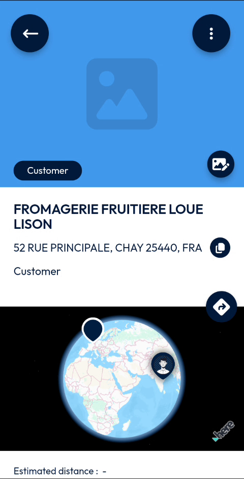
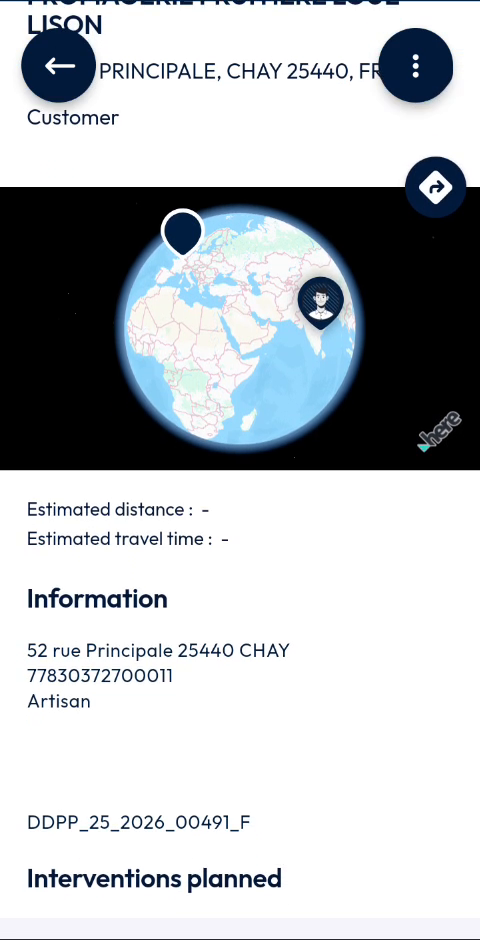
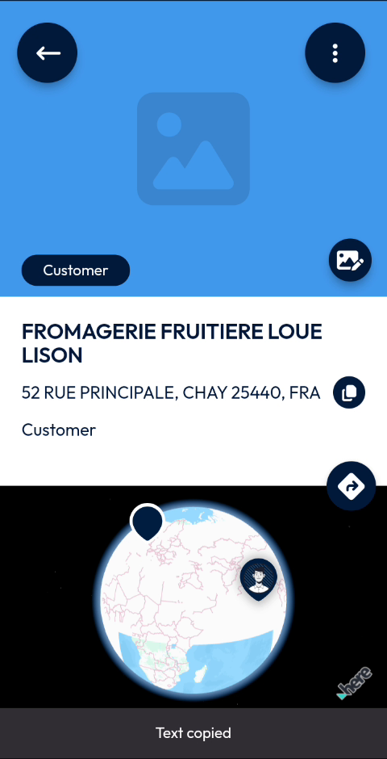

# View a Site

Read the details of a customer site.

## Overview

The page of a site gathers its address, its location on a map, its information, the interventions planned and its linked documents.

## Before you begin

* You have opened a site from the list. See [Browse the Sites List](browse-the-sites-list.md).

## Read the site page

<figure><figcaption>
Page of a site
</figcaption></figure>

The top of the page shows:

* The photo of the site. A placeholder is displayed when the site has no photo.
* The type of the site, for example **Customer**, in a label on the photo.
* The name of the site and its address.
* The back arrow at the top left, and the three-dot menu at the top right. See [Create an Intervention for a Site](create-an-intervention-for-a-site.md).
* The directions button. See [Get Directions to a Site](get-directions-to-a-site.md).
* A map that shows the site and your position.

Scroll down to read the rest of the page.

<figure><figcaption>
Information of a site
</figcaption></figure>

| Area | Description |
| ---- | ----------- |
| **Estimated distance** and **Estimated travel time** | The distance and the travel time between you and the site. |
| **Information** | The address of the site and other information about the customer, for example its identification number and its activity. |
| Reference | The reference of the site, for example **DDPP_25_2026_00491_F**. |
| **Interventions planned** | The interventions planned at the site, with their date, type, time and status, for example **2026-10-28**, **Controle 3h**, **12h26** and **Waiting**. |
| **Linked documents** | The documents linked to the site. See [Add Documents to a Site](add-documents-to-a-site.md). |

## Copy the address

1. At the right of the address, tap the copy icon.
2. The message **Text copied** is displayed at the bottom of the screen.

<figure><figcaption>
Text copied message
</figcaption></figure>

You can then paste the address in another app.

<!-- REVIEW: the video shows Estimated distance and Estimated travel time with a dash. Confirm when they are calculated. Confirm also the meaning of the reference and of the line under the address (identification number and activity). -->

## Related topics

* [Browse the Sites List](browse-the-sites-list.md)
* [Customer Directory](README.md)
