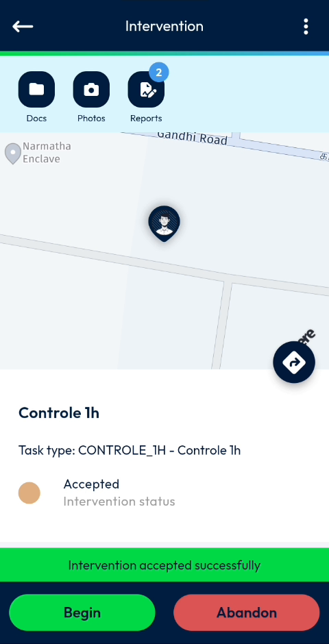
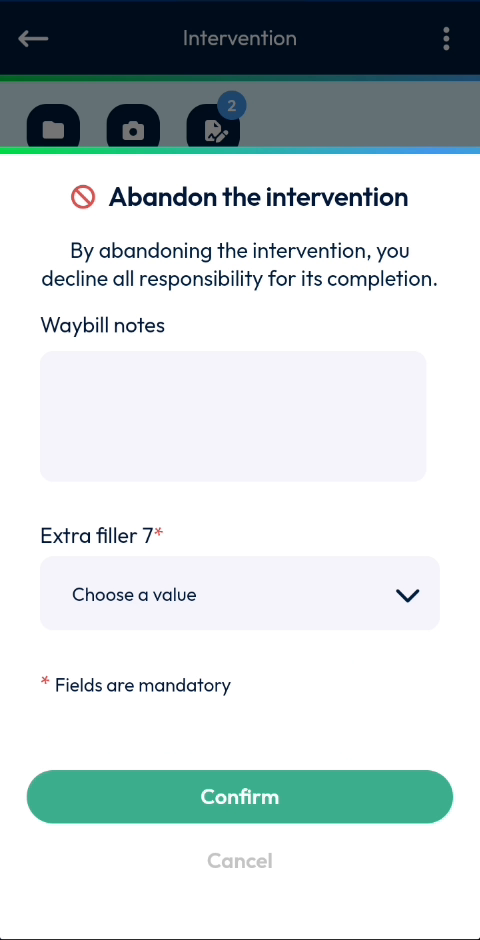
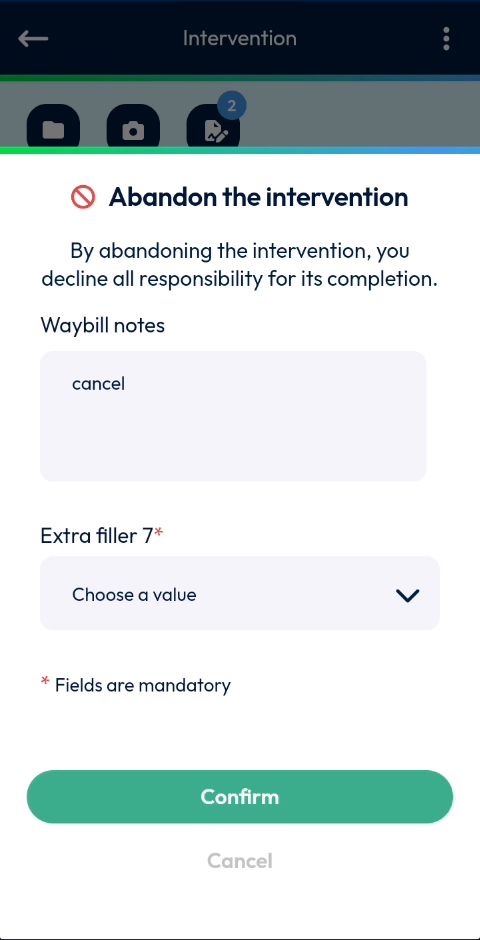
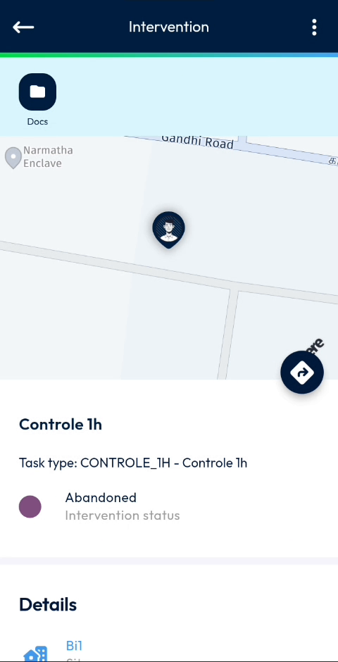

# Abandon an Intervention

Abandon an intervention that you cannot carry out.

## Overview

If you cannot carry out an intervention, you can abandon it. When you abandon an intervention, you decline all responsibility for its completion. You must give the reason in the abandon message. The status of the intervention changes to **Abandoned**.

## Before you begin

* The intervention is accepted. Its status is **Accepted**. See [Accept an intervention](../main-actions/calendar.md#accept-an-intervention).
* The intervention has not been started.

\r\nWhen you abandon an intervention, you decline all responsibility for its completion. Abandon an intervention only when you cannot carry it out.\r\n\r\n\r\n<!-- REVIEW: confirm whether an abandoned intervention can be reopened or started again, and whether an intervention already started can still be abandoned. The video only abandons an accepted intervention. -->

## Abandon the intervention

1. Open the intervention. See [Start an Intervention](start-an-intervention.md#open-the-intervention).
2. On the **Intervention** page, tap **Abandon**.

<figure><figcaption>
Intervention page with the Begin and Abandon buttons
</figcaption></figure>

3. In the **Abandon the intervention** message, read the text **By abandoning the intervention, you decline all responsibility for its completion.**

<figure><figcaption>
Abandon the intervention message
</figcaption></figure>

4. In **Waybill notes**, enter a comment, for example the reason why you abandon the intervention.

<figure><figcaption>
Waybill notes entered in the Abandon message
</figcaption></figure>

5. In **Extra filler 7**, tap **Choose a value**, then select a value in the list, for example **Fermeture définitive**. This field is mandatory.

<figure><figcaption>
Reason selected in Extra filler 7
</figcaption></figure>

6. Tap **Confirm**. To close the message without abandoning the intervention, tap **Cancel**.


Fields marked with an asterisk (*) are mandatory. You must fill them in before you can confirm.


<!-- REVIEW: the fields of the abandon message (Waybill notes, Extra filler 7) and their values are configured by your company. Confirm the real field names and the list of values. Confirm whether Waybill notes is mandatory. -->

## Check the result

1. Wait while the message **Sending request in progress – Please wait** is displayed.
2. The **Intervention** page shows the status **Abandoned**.

<figure><figcaption>
Abandoned intervention
</figcaption></figure>

On an abandoned intervention:

* The **Begin** and **Abandon** buttons are no longer displayed.
* Only the **Docs** shortcut remains at the top of the screen. The **Photos** and **Reports** shortcuts are no longer displayed.
* The **Details** of the intervention are still displayed below the status.

<!-- REVIEW: confirm that the sending message appears after Confirm and what your planner sees. The video shows the Abandon message and the final Abandoned status. -->

## Related topics

* [Start an Intervention](start-an-intervention.md)
* [Finish an Intervention](finish-an-intervention.md)
* [Calendar](../main-actions/calendar.md)
