# Add and Delete a Report During an Intervention

Add another report to an intervention, fill it in, and delete it if you added it by mistake.

## Overview

The **Reports** page lists the reports of the intervention. You can now add a report from this page, for example when you need a second maintenance report. You can add the same report several times, and each copy has its own answers. A report that you added and did not submit can be deleted.

## Before you begin

* The intervention is in progress. See [Start an Intervention](start-an-intervention.md).
* Your reports are in your device. See [Refresh Your Data](../main-actions/refresh-your-data.md).

## Open the list of reports

1. On the **Intervention** page, tap **Reports**.
2. The **Reports** page opens. Each line is a report, and a blue plus button is displayed at the bottom of the screen.

<figure>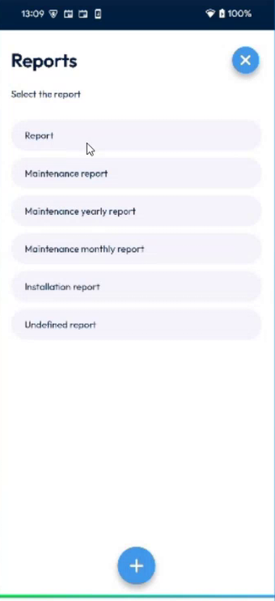<figcaption>
Reports page
</figcaption></figure>

## Add a report

1. On the **Reports** page, tap the blue plus button.
2. The **Add a report** page lists the reports that you can add.

<figure>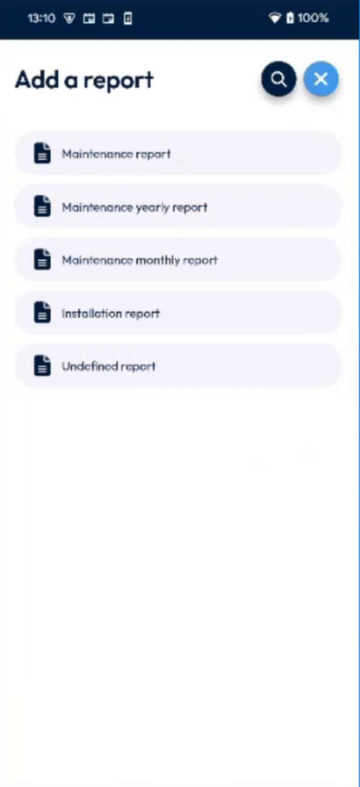<figcaption>
Add a report page
</figcaption></figure>

3. Tap a report, for example **Maintenance report**.
4. The report is added at the end of the list on the **Reports** page.

<figure>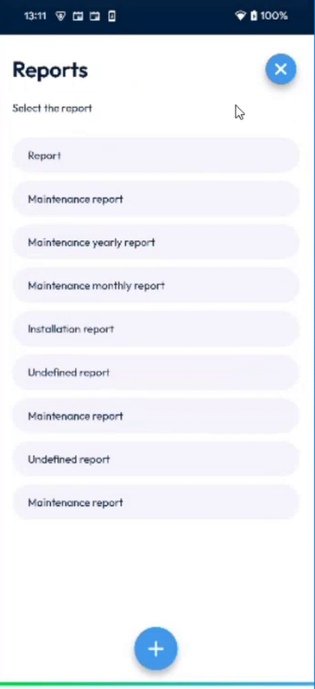<figcaption>
Report added to the list
</figcaption></figure>

The report that was already there, and the report that you added, have the same name. The added report is at the end of the list.

## Search for a report

1. On the **Add a report** page, tap the magnifier icon at the top right.

<figure>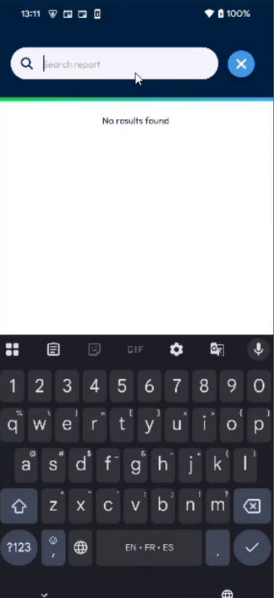<figcaption>
Search field
</figcaption></figure>

2. Type a part of the name, for example **repo**. The reports that match are listed, with the matching text in blue.

<figure><figcaption>
Search results
</figcaption></figure>

3. Tap the report that you want to add.

<figure>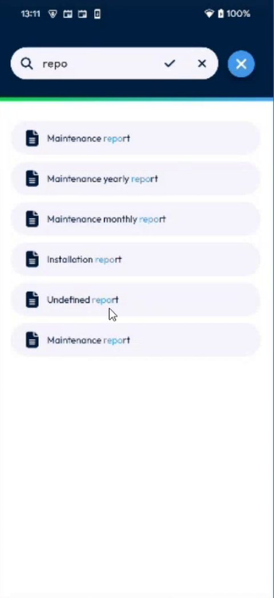<figcaption>
Report added
</figcaption></figure>

If nothing matches, the message **No results found** is displayed.

## Fill in the report

1. On the **Reports** page, tap the report that you added.
2. Answer the questions, then tap **Complete**.

<figure>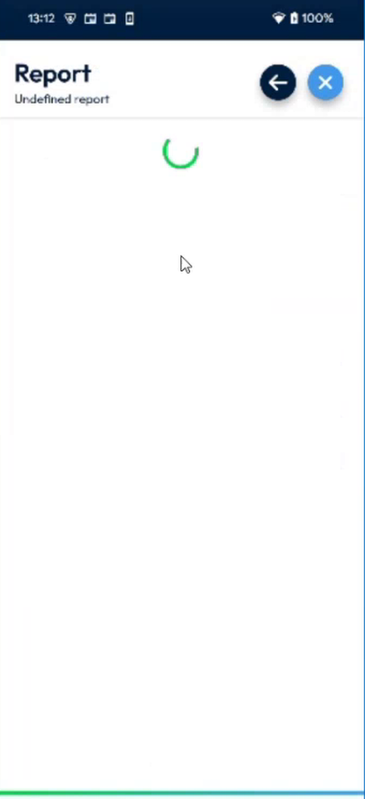<figcaption>
Report filled in
</figcaption></figure>

3. For a question with a list, tap the field and select a value, then tap **Ok**.

<figure>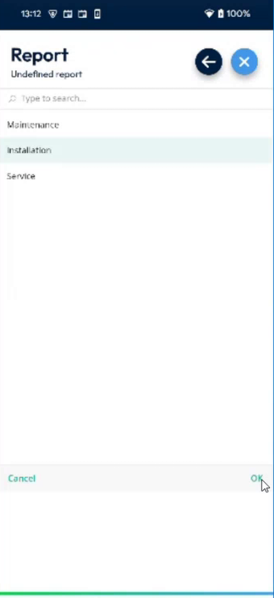<figcaption>
List of values
</figcaption></figure>

<figure>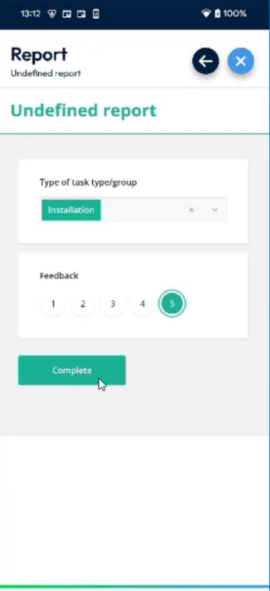<figcaption>
Report with a list and a feedback
</figcaption></figure>

4. The app goes back to the **Reports** page. A check mark appears next to the completed report.

<figure>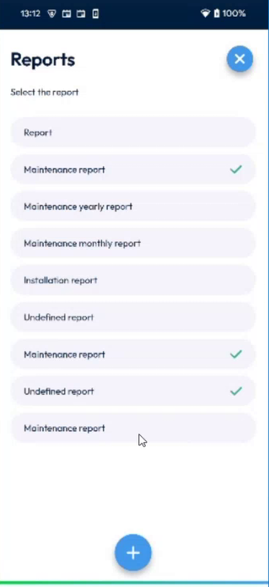<figcaption>
Completed reports
</figcaption></figure>

You can add the same report more than once and give different answers each time. Each copy is saved separately.

## Delete a report that you added

You can delete a report that you added and that is not completed yet.

1. On the **Reports** page, press the report for a long time.
2. The report is selected, and a red delete button replaces the plus button. Tap other added reports to select them too.

<figure>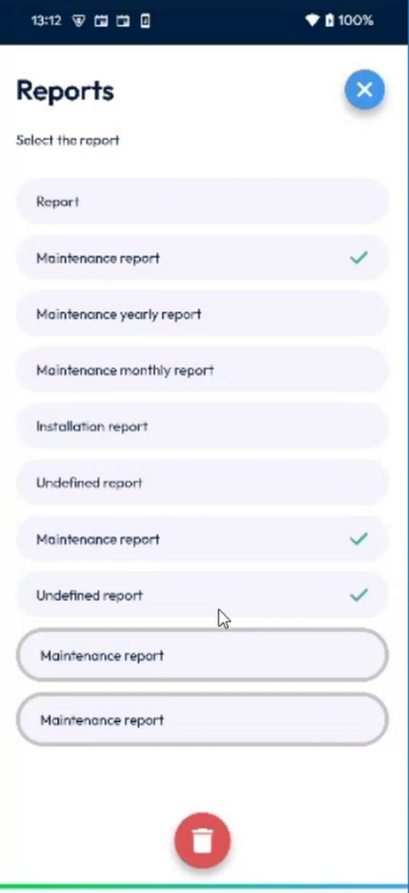<figcaption>
Reports selected
</figcaption></figure>

3. Tap the red delete button.
4. In **Delete report**, read **Are you sure you want to delete the selected reports?**, then tap **Confirm**. To keep them, tap **Cancel**.

<figure>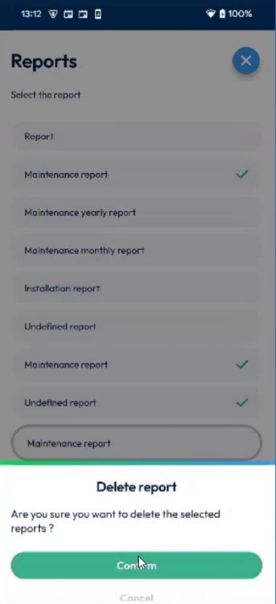<figcaption>
Delete report
</figcaption></figure>

5. The reports are removed from the list.

<figure>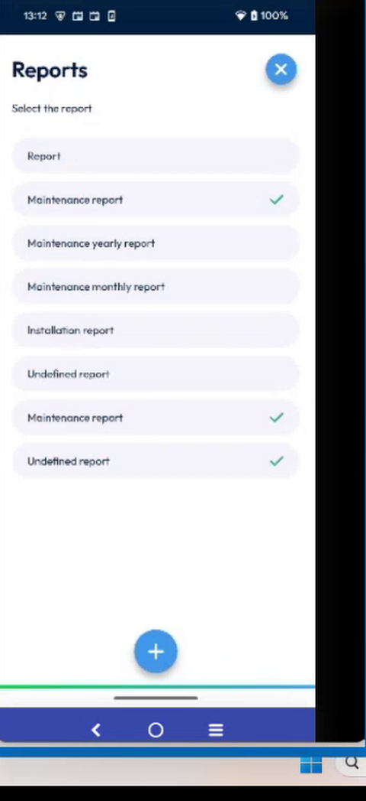<figcaption>
Reports after the deletion
</figcaption></figure>


You cannot delete a report that is already submitted, even if you added it from the app. You also cannot select the reports that came with the intervention.


## Finish the intervention

When you finish the intervention, the app sends all the completed reports, including the copies that you added. In NFS, each copy is a new answer with the same report template, with its own values.

<!-- REVIEW: the list of reports to add is not filtered yet. The app shows all the reports of the back office, not only those of the intervention group or the task type. The team asked the back office to send the report IDs of each intervention, and it is planned. Update this page when it is done. Also confirm how the PDF report in NFS shows two copies of the same report, because the team has no Word template to test it. -->

## Related topics

* [Fill in the Report](report.md)
* [Complete the Mandatory Survey Reports](mandatory-survey-reports.md)
* [Fill In Survey Forms Offline](fill-in-forms-offline.md)
* [Finish an Intervention](finish-an-intervention.md)
