# Add Files and Signatures to a Survey Report

## Overview

Some survey reports contain fields that accept files: photos from the camera or the gallery, videos, documents and signatures. The files that you add are sent to the back office with the report, and the images appear in the generated report.

## Before you begin

* The intervention is in progress. See [Start an Intervention](start-an-intervention.md).
* Your company has added a survey report with file or signature fields to the intervention. See [Fill in the Report](report.md).

## Open the survey report

1. On the **Intervention** page, tap **Reports**.
2. On the **Reports** page, tap the survey report, for example **File upload and Signatures**. If it is not in the list, tap the plus button to add it. See [Add and Delete a Report During an Intervention](add-a-report.md).

<figure>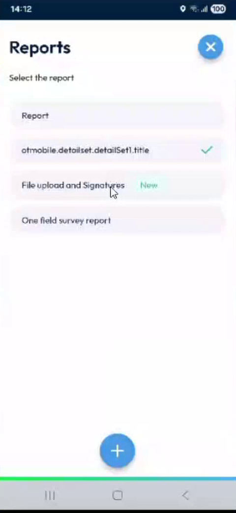<figcaption>
Reports page with the survey report
</figcaption></figure>

3. The survey report opens. Each file field shows a **Select File** button.

<figure>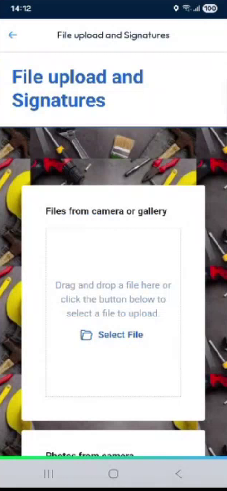<figcaption>
Survey report with an empty file field
</figcaption></figure>

## Add files to a field

1. In the file field, tap **Select File**.
2. Choose the source of the file, for example the gallery, then select one or more files. You can select several files at once.

<figure>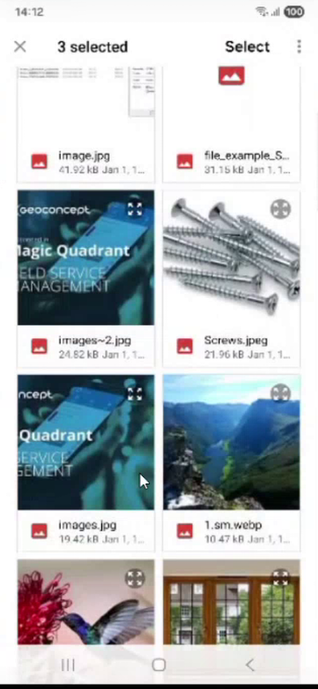<figcaption>
Selecting several files in the gallery
</figcaption></figure>

3. Wait while the files load. The field shows the first file and a counter, for example **3 of 5**.
4. Use the left and right arrows to browse the files of the field.

<figure>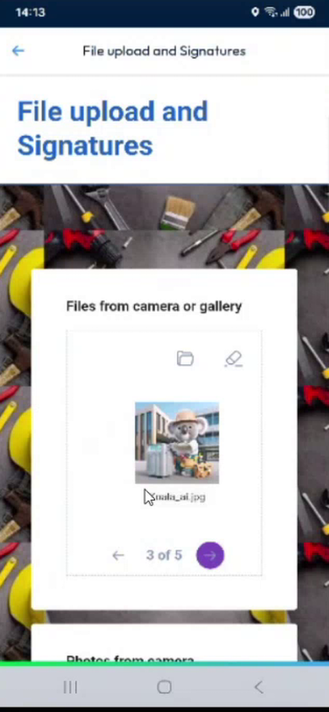<figcaption>
Field with five images
</figcaption></figure>

5. To add more files, tap **Select File** again. The counter shows the new total, for example **7 of 7**.

<figure>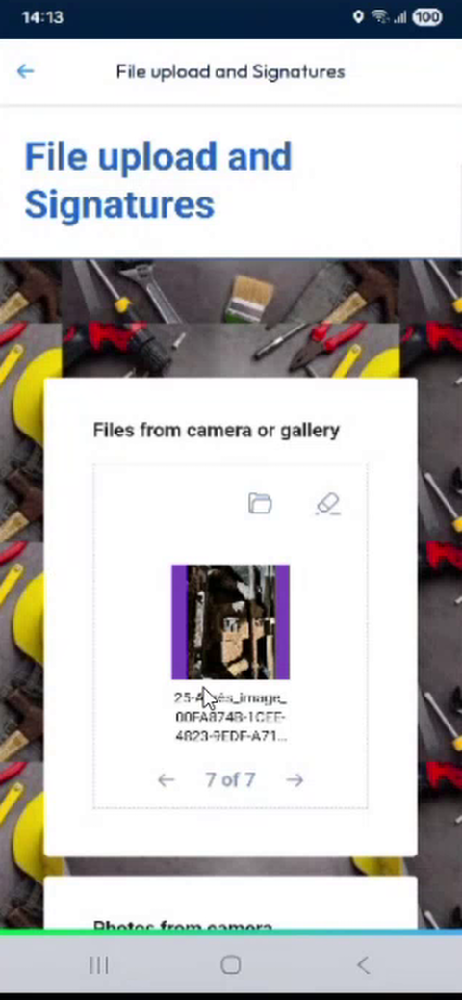<figcaption>
Field with seven images
</figcaption></figure>

Depending on the field, you can also add videos and documents, alone or together with images.

<figure>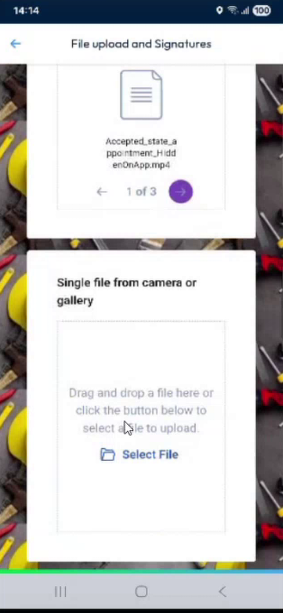<figcaption>
Field with a document, an image and a video
</figcaption></figure>


**Image formats**: You can add images in different formats, such as JPG, PNG, WEBP, GIF or HEIC from an iPhone. The app converts them to JPG and reduces their size, in the same way as the photos of the intervention. For example, an image of about 8.5 MP is sent in a much smaller size.



**File types**: The app does not restrict the type of file that you add. Your company can set the accepted file types for each field.


## Add a signature

1. Scroll to a **Signature** field.
2. Draw the signature with your finger in the box.

<figure>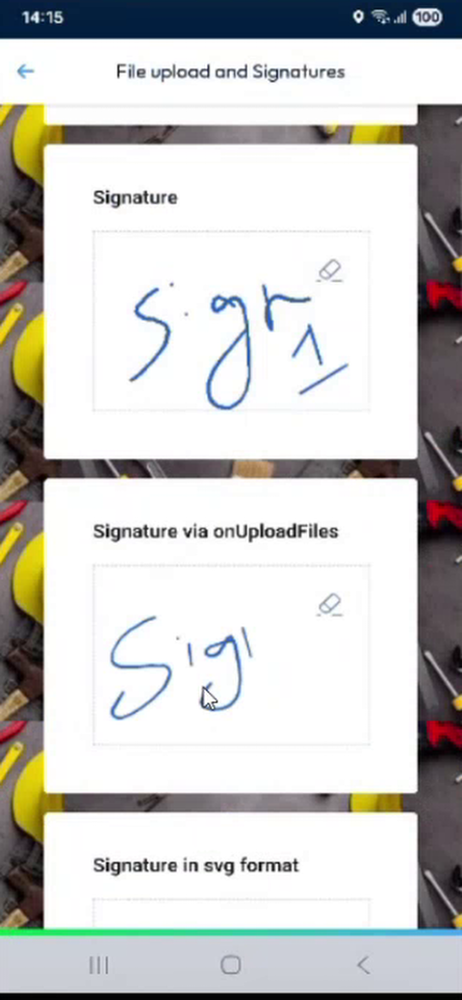<figcaption>
Signature fields
</figcaption></figure>

The format in which the signature is stored, for example SVG, depends on how your company set up the field.

## Complete the survey report

1. Fill in the other fields. Fields marked with an asterisk (*) are mandatory.
2. Return to the **Reports** page. A check mark shows the report that you completed.

<figure>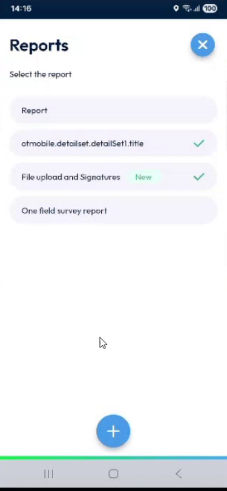<figcaption>
Reports page with the survey report completed
</figcaption></figure>

If the survey report is mandatory, you must complete it before you finish the intervention. See [Complete the Mandatory Survey Reports](mandatory-survey-reports.md).

## Send the files

The files are not sent when you complete the survey report, because you can still reopen it and change it. They are sent when you complete the intervention.

1. Finish the intervention. If your company requires photos, the app asks you to take them first. See [Take the Required Photos](required-photos.md).
2. If a photo is too blurry, the **Review Images** page asks you to select the images to keep or remove. Tap the bin to remove them, or the check mark to keep them and continue.

<figure>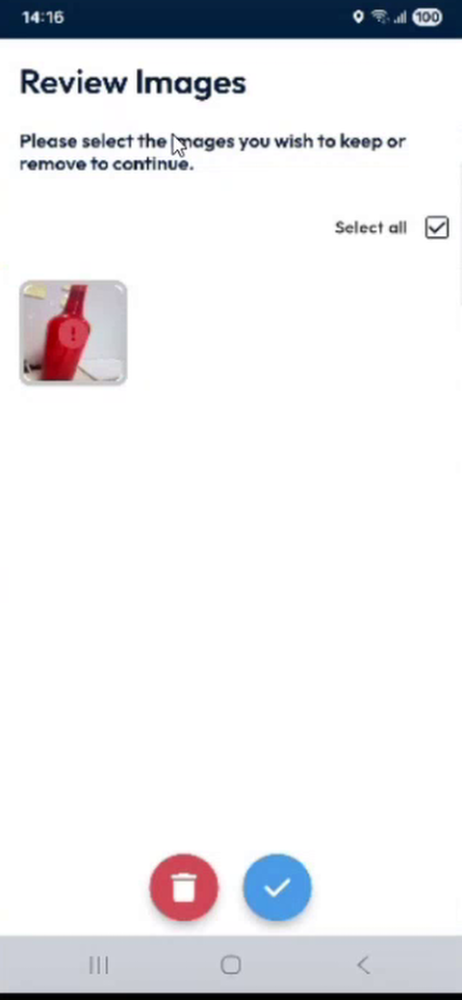<figcaption>
Review Images page
</figcaption></figure>

3. Wait while **Sending data in progress** is displayed. The app sends, in this order, the files of the survey report, the values of the survey report, the photos and files of the intervention, and then the status of the intervention.

<figure>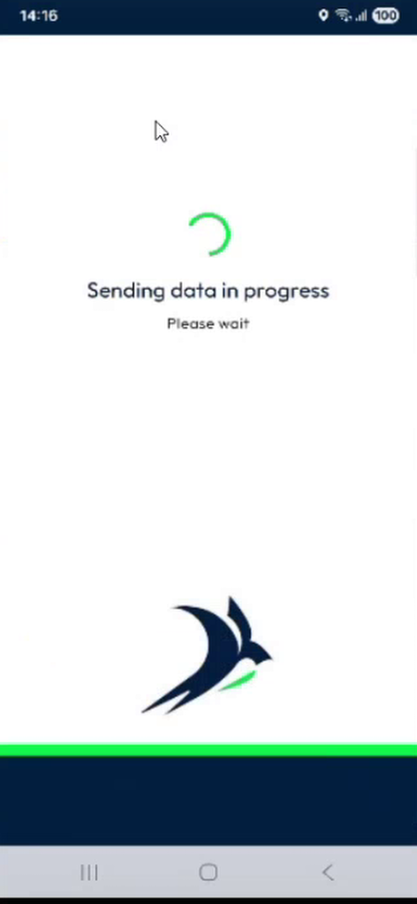<figcaption>
Sending data in progress
</figcaption></figure>

4. The message **Intervention completed successfully** is displayed.

<figure>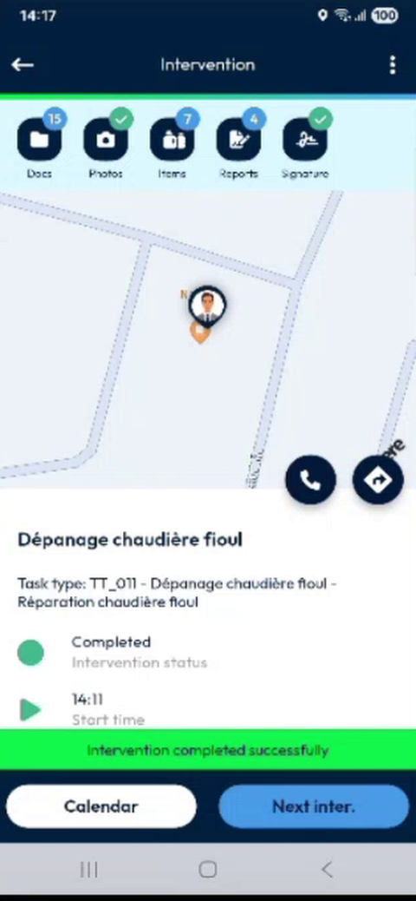<figcaption>
Intervention completed
</figcaption></figure>


You can add files and signatures without a network. The app sends them when it is connected again. See [Fill In Survey Forms Offline](fill-in-forms-offline.md).


## In the back office

After the intervention is completed, the files of the survey report are stored in the multimedia folder of the intervention, in the document type for form report files. Signatures are stored there too. In a generated report, only the images of the file fields are shown, if the report template includes them. Videos, documents and signatures are not shown in the report, but they are in the folder.

<!-- REVIEW: confirm the function of the eraser icon in a file field, which sources are offered (camera, gallery, other), the exact name of the back-office document type and folder, and whether this feature is enabled for every company. -->

## Next steps

* [Finish an Intervention](finish-an-intervention.md)

## Related topics

* [Fill in the Report](report.md)
* [Complete the Mandatory Survey Reports](mandatory-survey-reports.md)
* [Fill In Survey Forms Offline](fill-in-forms-offline.md)
* [Add Photos and Remarks](photos-and-remarks.md)