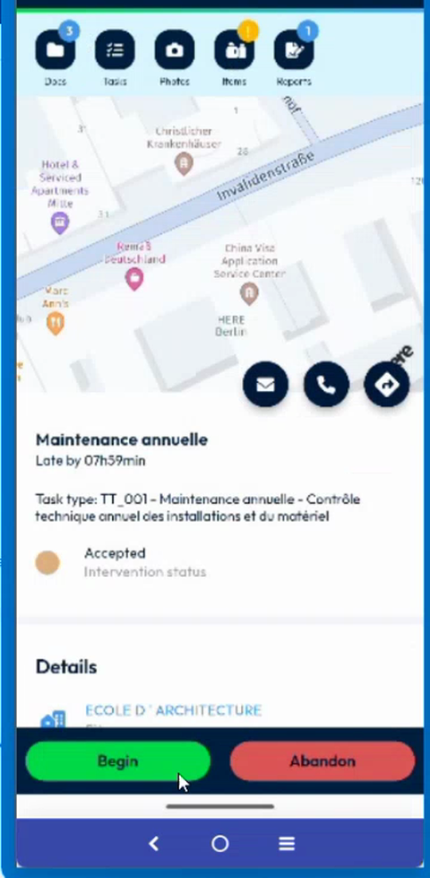
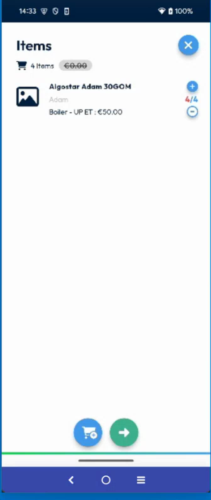
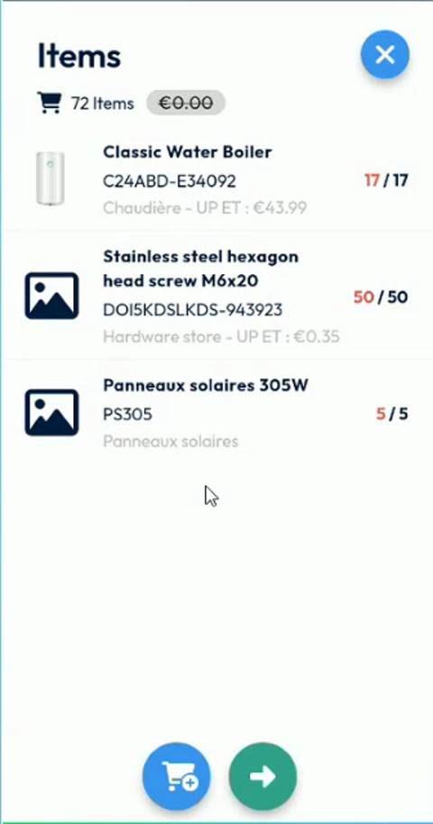
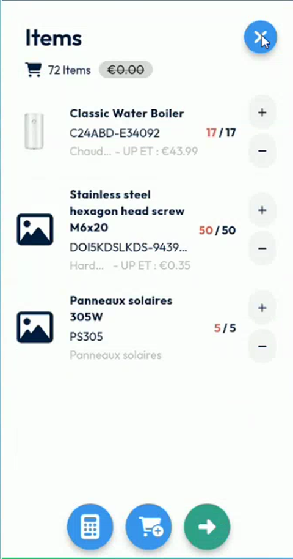
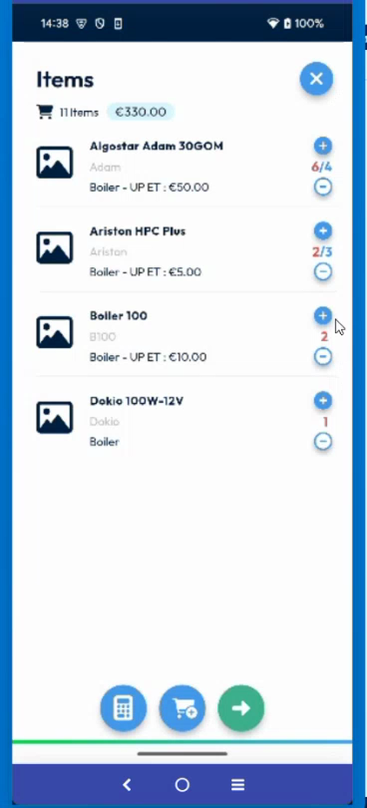
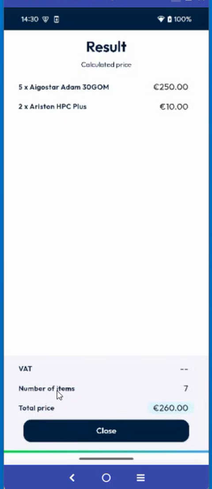
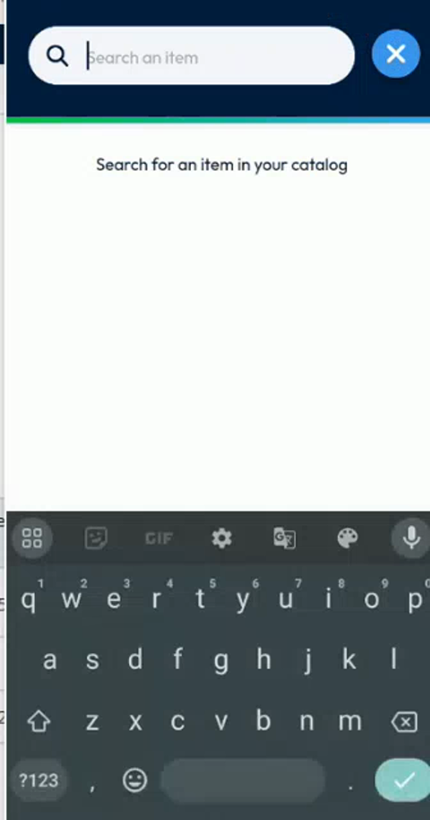
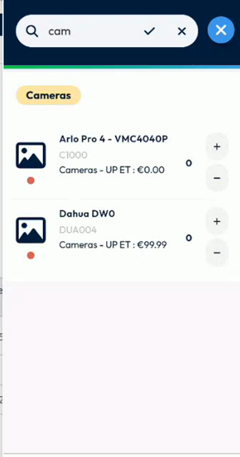
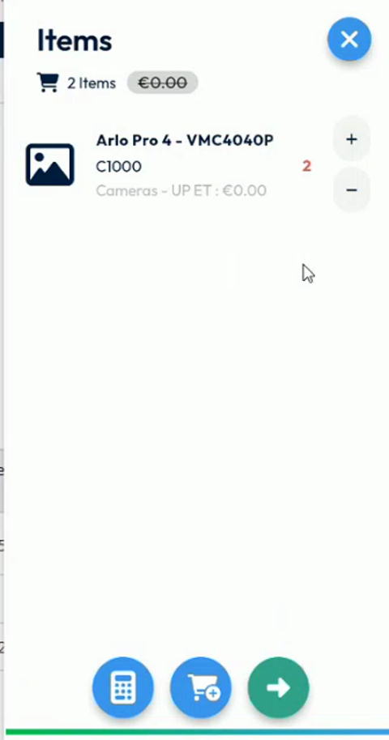

# Add Items to an Intervention

Record the items that you use or sell during an intervention, and check their price.

## Overview

The **Items** page lists the products linked to an intervention. You choose the quantity of each item, and NFS Mobile calculates the total price. A number on the **Items** icon shows how many items the intervention contains.

## Before you begin

* The intervention is open. See [Start an Intervention](start-an-intervention.md#open-the-intervention).

## Open the Items page

1. On the **Intervention** page, tap **Items** in the icons at the top.

<figure><figcaption>
Intervention with the Items icon
</figcaption></figure>

2. The **Items** page opens. It shows the number of items and the total price, for example **11 items** and **€330.00**.

<figure><figcaption>
Items page with one item
</figcaption></figure>

For each item, the list shows:

* The name of the item, for example **Aigostar Adam 30GOM**.
* The make and the type, for example **Boiler - UP ET : €50.00**, with the unit price.
* The quantity, at the right of the item.

Before the intervention is started, the list shows the items without the plus and minus buttons.

<figure><figcaption>
Items page before the intervention is started
</figcaption></figure>

Once the intervention is started, a plus and a minus button appear at the right of each item, and a barcode icon appears under the photo of each item that has a serial number.

<figure><figcaption>
Items page of an intervention in progress
</figcaption></figure>

## Change the quantities

The plus and minus buttons were redesigned. Each button has its own tap zone, so a tap on the buttons no longer opens the product sheet by mistake.

1. Tap the plus button at the right of an item to add one.
2. Tap the minus button to remove one.
3. Check the quantity displayed at the right of the item, for example **17 / 17**, and the total price at the top of the page.

| You tap | Result |
| ------- | ------ |
| The plus or the minus button | The quantity increases or decreases. |
| The quantity number | Nothing happens. |
| The name or the photo of the item | The **Details** page opens. See [View the Details of an Item](view-item-details.md). |

<figure><figcaption>
Items page with several items
</figcaption></figure>

To remove an item completely, see [Remove an Item](remove-an-item.md). To record a barcode or QR code for an item, see [Scan or Enter a Serial Number](scan-a-serial-number.md).

<!-- REVIEW: confirm the meaning of the two numbers displayed under the plus button, for example 6/4 and 2/3. They may be the quantity used and the quantity planned. -->

## Calculate the price

The price is calculated only when you tap the calculator button, once the intervention is started. For the detail of each item, the tax, and the custom price service, see [Calculate the Price of the Items](calculate-item-prices.md).

1. At the bottom of the screen, tap the calculator button.
2. Wait while the message **Calculating current price** is displayed.
3. The **Result** page opens. It lists each item with its quantity and its price, for example **5 x Aigostar Adam 30GOM – €250.00**.

<figure><figcaption>
Result page with the calculated price
</figcaption></figure>

At the bottom of the page, check:

| Field | Description |
| ----- | ----------- |
| **VAT** | The amount of VAT. |
| **Number of items** | The total number of items, for example **7**. |
| **Total price** | The total price, for example **€260.00**. |

4. Tap **Close** to return to the **Items** page.

## Search the catalog

1. At the bottom of the screen, tap the cart button to open the catalog.
2. The search bar is displayed with the keyboard. The page shows **Search for an item in your catalog**.

<figure><figcaption>
Search in the catalog
</figcaption></figure>

3. Type the name or a part of the name of the item, for example **cam**.
4. Tap the check mark to start the search. The items found are listed under their family, for example **Cameras**, with their reference and their unit price.

<figure><figcaption>
Search results
</figcaption></figure>

## Add items from the catalog

1. In the list of results, tap the plus button of an item to add one.
2. Add the quantity that you need. The quantity at the right of the item increases.
3. Tap the green arrow button to validate.
4. The **Items** page shows the item that you added, with its quantity, for example **2**, and the counter at the top shows **2 Items**.

<figure><figcaption>
Item added to the intervention
</figcaption></figure>

<!-- REVIEW: the video shows the catalog only briefly. Confirm the function of each button at the bottom of the screen (calculator, cart and green arrow) and of the filter and search buttons, and when the price of the intervention is sent to NFS. -->

## Related topics

* [View the Details of an Item](view-item-details.md)
* [Scan or Enter a Serial Number](scan-a-serial-number.md)
* [Remove an Item](remove-an-item.md)
* [Price Calculation Setup](../configuration/price-calculation-setup.md)
* [Fill in the Report](report.md)
* [Finish an Intervention](finish-an-intervention.md)
