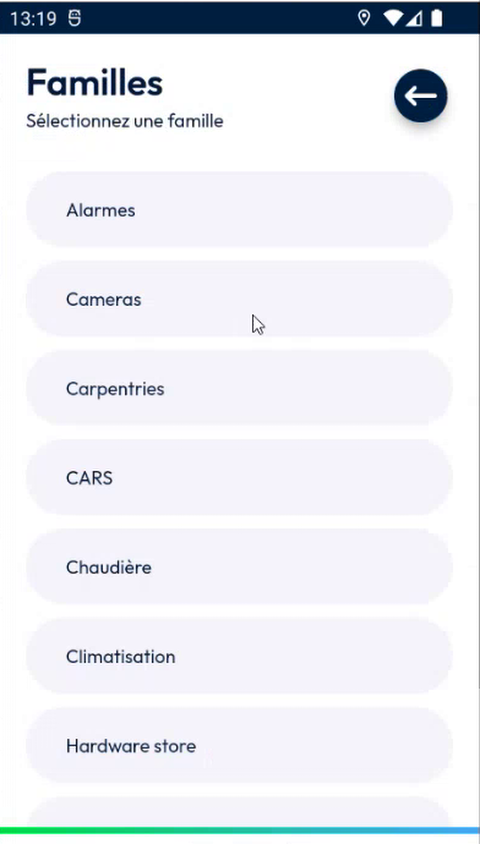
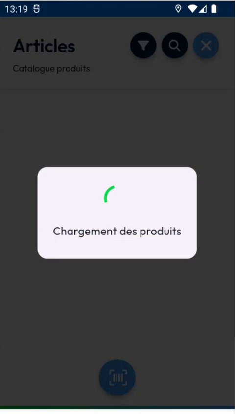
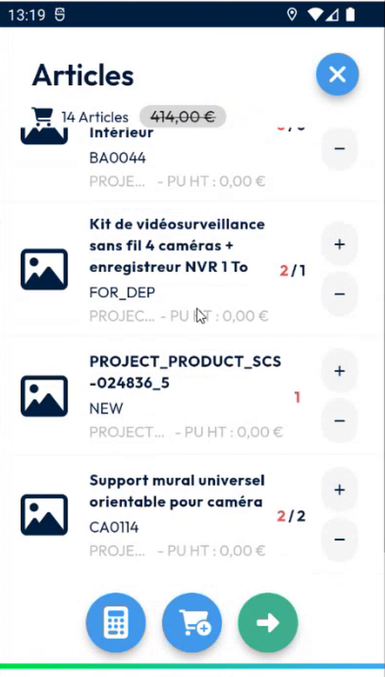
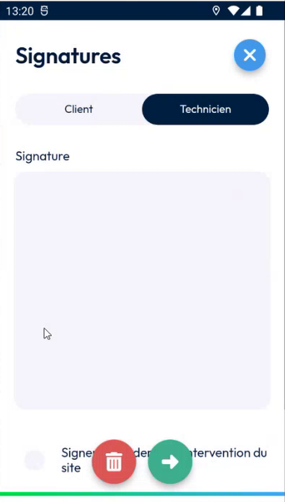
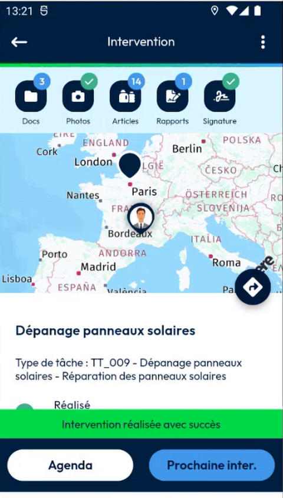

# Calculate the Price of the Items

Calculate the price of each item and the total of the intervention, with the tax.

## Overview

The **Items** page can calculate a price for each item in two ways:

* From the **product catalog**: the app multiplies the unit price of each product by its quantity.
* From a **custom external service**: the app sends the items to a web address that your company defines, and gets the prices back. For each item, the service now returns the price without tax, the tax amount and the price with tax, and for the intervention the tax rate and the total. Before, it returned only the total.

The calculation no longer starts by itself when you open the intervention. It starts only when you tap the calculator button.

## Before you begin

* The intervention is in progress. The calculator button appears once you start it. See [Start an Intervention](start-an-intervention.md).
* The intervention has items. See [Add Items to an Intervention](add-items-to-an-intervention.md).
* Your administrator has set up the price calculation. See [Price Calculation Setup](../configuration/price-calculation-setup.md).

## Open the items

1. On the **Intervention** page, tap **Items**.
2. The **Articles** page lists the items, with the number of articles and the total price at the top.

<figure><figcaption>
Articles page of an intervention in progress
</figcaption></figure>

## Calculate the price

1. At the bottom of the screen, tap the calculator button.
2. Wait while **Calculating the price** is displayed. The app sends the request to your price service.

<figure><figcaption>
Calculating the price
</figcaption></figure>

3. The **Result** page opens. For each item, it shows the quantity, the name, and the prices: the price without tax (**HT**), the tax (**TVA**) and the price with tax (**TTC**). The labels follow the language of your device.

<figure><figcaption>
Result page with the detail of each item
</figcaption></figure>

At the bottom of the page, check:

| Field | Description |
| ----- | ----------- |
| **TVA** | The tax rate, for example **20 %**. |
| **Number of articles** | The total number of articles, for example **12**. |
| **Price total** | The total price with tax. |

4. Tap **Close** to return to the **Articles** page. The total price is displayed at the top.

## Recalculate after a change

When you change the items, the price that you calculated is no longer valid, and the app shows it struck out.

1. Add or remove items, or change a quantity.

<figure><figcaption>
The price is struck out after a change
</figcaption></figure>

2. Tap the calculator button again.

<figure><figcaption>
New result with 13 articles
</figcaption></figure>

3. To add an item that was not planned, tap the cart button, filter by product family, and choose the product. See [Add Items to an Intervention](add-items-to-an-intervention.md#search-the-catalog).

<figure><figcaption>
Product families
</figcaption></figure>

<figure><figcaption>
Loading the products
</figcaption></figure>

4. Tap the calculator button once more. In the example, the intervention planned 12 articles, and the technician added two, so the result shows 14 articles.

<figure><figcaption>
Items added to the intervention
</figcaption></figure>

<figure><figcaption>
Result with 14 articles
</figcaption></figure>


If you finish the intervention with a struck-out price, the app does not send any price to NFS, because the price is not valid. Always recalculate after a change, and before you finish.


## Finish the intervention

1. Have the intervention signed and add the photos, if your company requires them. See [Sign an Intervention](sign-an-intervention/README.md).

<figure><figcaption>
Signature
</figcaption></figure>

2. Tap **Finish**, then **Confirm**.

<figure><figcaption>
Finish the intervention
</figcaption></figure>

3. Wait for the message that confirms that the intervention is completed.

<figure><figcaption>
Intervention completed
</figcaption></figure>

## What NFS receives

When you finish the intervention, the app sends the prices to NFS:

* The **total with tax** and the **total without tax** of the appointment.
* For each item that has a price, three amounts, saved in its product order details: the total without tax, the tax amount and the total with tax.

An item for which the service returned no price, for example an item added in the app, has **0** in these fields.

The calculation works offline like the other data of the intervention. If there is no network when you finish, the data is kept and sent when the network is back.

<!-- REVIEW: the demo checks the values in NFS in the product list, and the three amounts of each item are mapped to the fields quantity5, quantity6 and quantity7. Confirm the meaning of each (without tax, tax amount, with tax), and whether the price is also recalculated automatically when you remove an item. The team said it is not, today. -->

## Related topics

* [Add Items to an Intervention](add-items-to-an-intervention.md)
* [Price Calculation Setup](../configuration/price-calculation-setup.md)
* [Finish an Intervention](finish-an-intervention.md)
