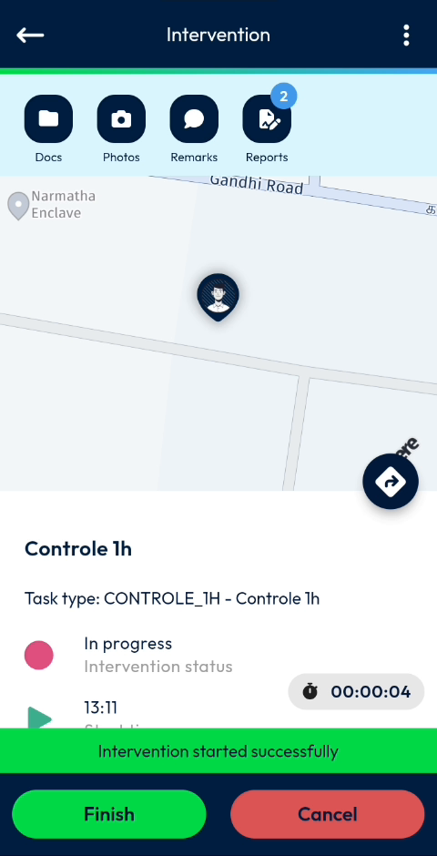
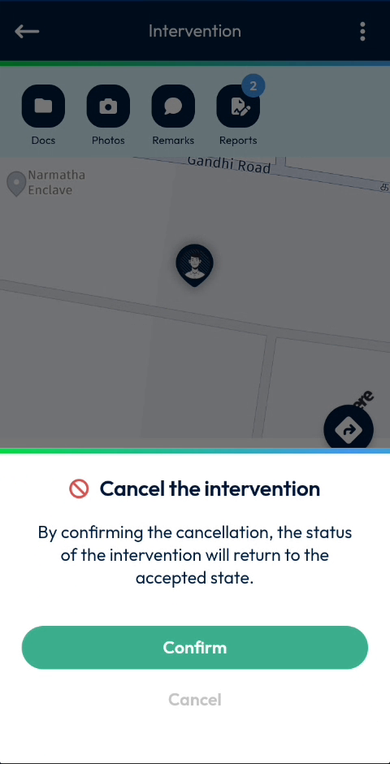
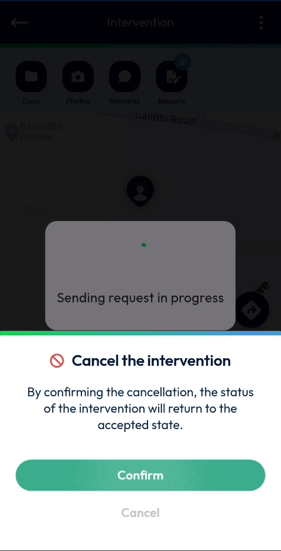
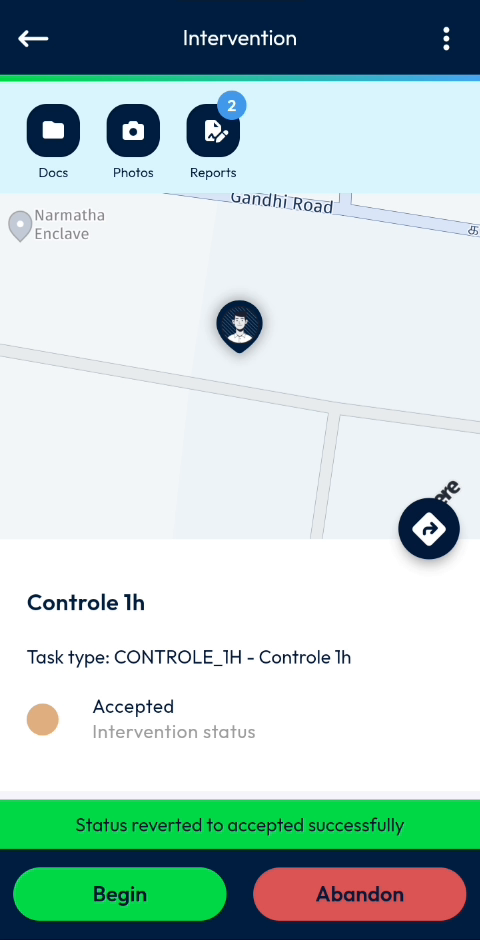

# Cancel an Intervention

Cancel an intervention that you have started and return it to the accepted state.

## Overview

If you started an intervention by mistake, or you cannot carry on with it, you can cancel it. Cancelling an intervention does not delete it: its status returns from **In progress** to **Accepted**. You can then start the intervention again, or [abandon it](abandon-an-intervention.md).

## Before you begin

* The intervention is in progress. See [Start an Intervention](start-an-intervention.md).

## Cancel the intervention

1. Open the intervention. The status is **In progress** and a timer shows how long it has lasted.
2. On the **Intervention** page, tap **Cancel**.

<figure><figcaption>
Intervention in progress with the Finish and Cancel buttons
</figcaption></figure>

3. In the **Cancel the intervention** message, read the text **By confirming the cancellation, the status of the intervention will return to the accepted state.**
4. Tap **Confirm**. To close the message and keep the intervention in progress, tap **Cancel**.

<figure><figcaption>
Cancel the intervention message
</figcaption></figure>

5. Wait while the message **Sending request in progress** is displayed.

<figure><figcaption>
Sending request in progress
</figcaption></figure>

## Check the result

The message **Status reverted to accepted successfully** is displayed. The **Intervention** page shows the status **Accepted**, and the **Begin** and **Abandon** buttons are displayed again.

<figure><figcaption>
Intervention returned to the accepted state
</figcaption></figure>


The **Cancel** button on the **Intervention** page is displayed only while the intervention is in progress. For an accepted intervention that you cannot carry out, use **Abandon**. See [Abandon an Intervention](abandon-an-intervention.md).


<!-- REVIEW: confirm what happens to the timer, the report, the photos and the remarks already entered when an intervention is cancelled. The video shows the Reports shortcut still showing 2 after the cancellation, but does not show the report content. -->

## Related topics

* [Start an Intervention](start-an-intervention.md)
* [Finish an Intervention](finish-an-intervention.md)
* [Abandon an Intervention](abandon-an-intervention.md)
