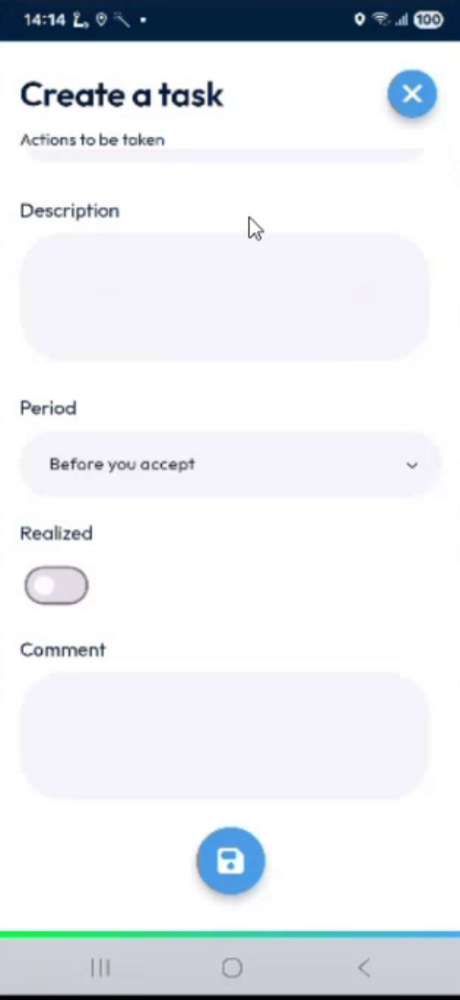
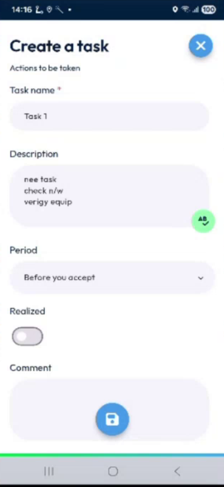
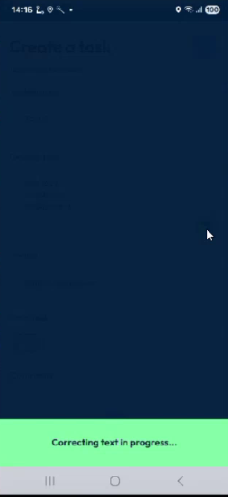
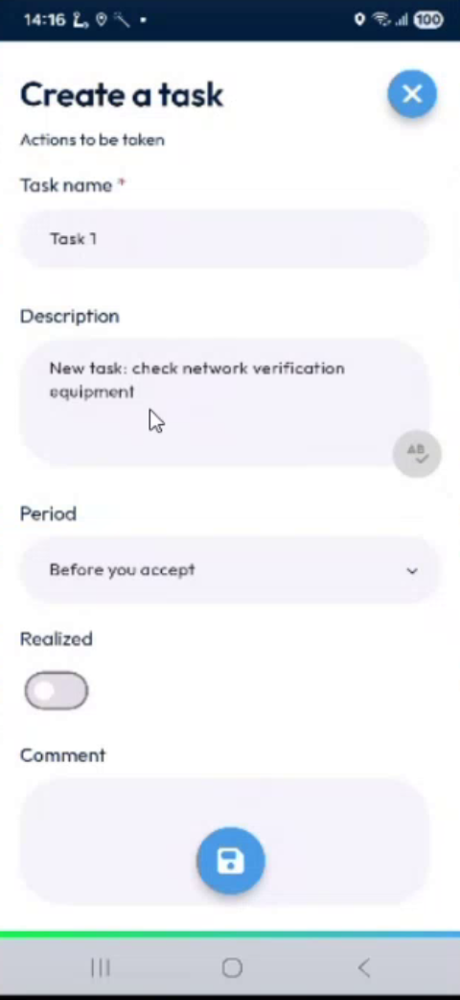
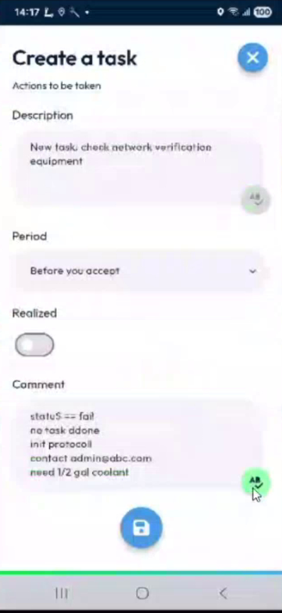
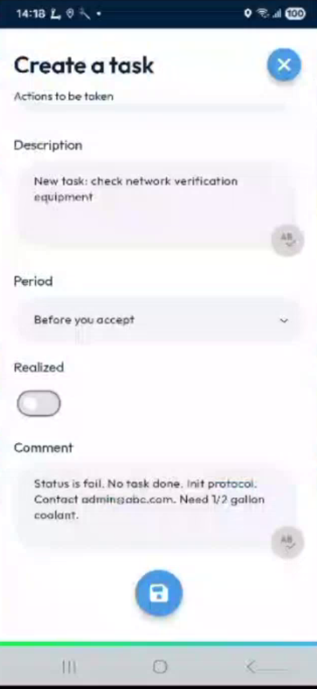
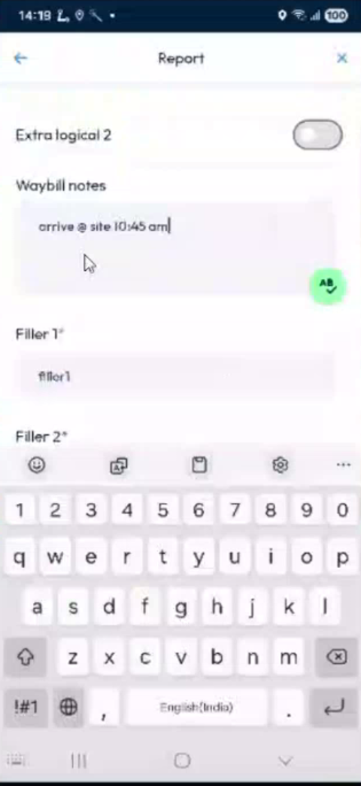
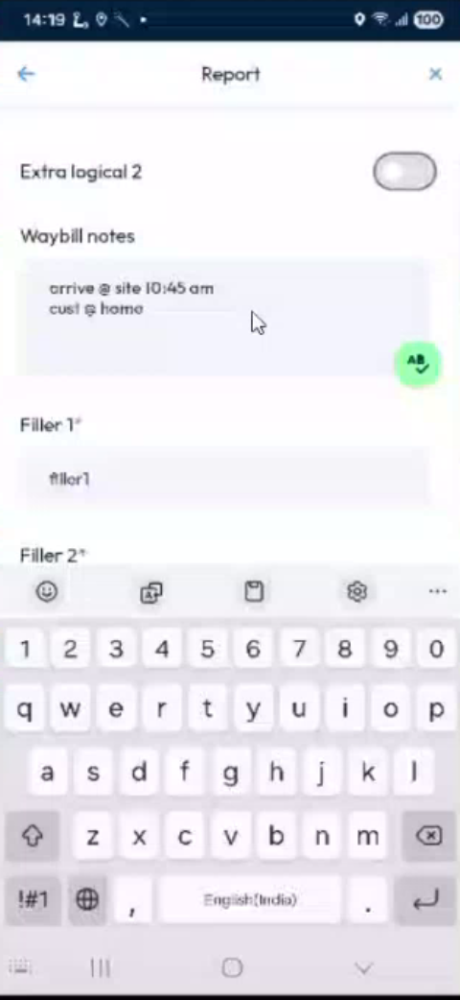
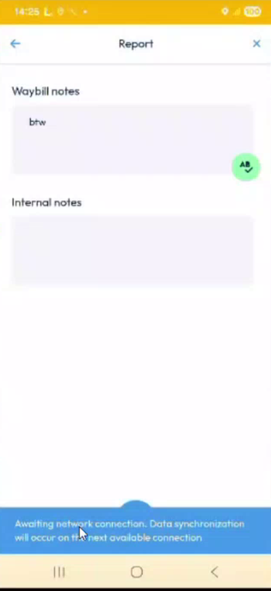

# Correct Your Text with AI

## Overview

The **AB** button corrects the spelling of your text and improves it. It is available in the text fields that you fill in during an intervention:

* The **Description** and the **Comment** of a new task.
* The text fields of the report, for example **Waybill notes** and **Internal notes**.
* The **Remarks** page. See [Add Photos and Remarks](photos-and-remarks.md).

The text is corrected by an AI service. The service works in English, French, Spanish, Italian and German.

## Before you begin

* The field contains text. When a field is empty, the button is not displayed.
* Your device has a network. Without a network, see [Correct a text without a network](#correct-a-text-without-a-network).

<figure><figcaption>
Empty field: no button
</figcaption></figure>

## Correct a text

1. In a text field, enter your text.
2. Tap the **AB** button at the right of the field.

<figure><figcaption>
Description field with the AB button
</figcaption></figure>

3. The message **Correcting text in progress...** is displayed.

<figure><figcaption>
Correcting text in progress
</figcaption></figure>

4. The corrected text replaces your text in the field, and the button turns gray.

<figure><figcaption>
Corrected description
</figcaption></figure>

The service corrects the spelling and the abbreviations, and writes the text as a sentence. For example, **n/w** becomes **network**, **gal** becomes **gallon**, and a symbol such as the approximation sign becomes the word **approximately**. An e-mail address is kept as you wrote it.

<figure><figcaption>
Comment before the correction
</figcaption></figure>

<figure><figcaption>
Comment after the correction
</figcaption></figure>

## Correct the text of a report

1. On the **Intervention** page, tap **Reports**, then open the report. See [Fill in the Report](report.md).
2. Enter your text in a text field, for example **Waybill notes**.

<figure><figcaption>
Waybill notes before the correction
</figcaption></figure>

3. Tap the **AB** button. The corrected text is displayed.

<figure><figcaption>
Waybill notes after the correction
</figcaption></figure>

## Correct the text again

After a correction, the button stays gray. If you change the text, the button is available again, and you can tap it to correct the new text.

## Correct a text without a network

1. Enter your text and tap the **AB** button.
2. The message **Awaiting network connection. Data synchronization will occur on the next available connection.** is displayed.

<figure><figcaption>
Awaiting network connection
</figcaption></figure>

3. Keep working. When the network is back, the app first asks the service to correct the text, then it updates the intervention with the corrected text.

## In the back office

When you complete the intervention, the corrected text is sent to the back office. For example, the corrected description and comment of a new task are displayed in the task.

<!-- REVIEW: confirm in which common fields the button is available, whether the text is replaced without a confirmation, and how the administrator turns the feature on or off. -->

## Related topics

* [Add Photos and Remarks](photos-and-remarks.md)
* [Fill in the Report](report.md)
* [Keep the Task Comment When You Scan by Hand](task-comment-and-manual-scan.md)
* [Edit, Reset or Delete a Task](edit-reset-or-delete-a-task.md)