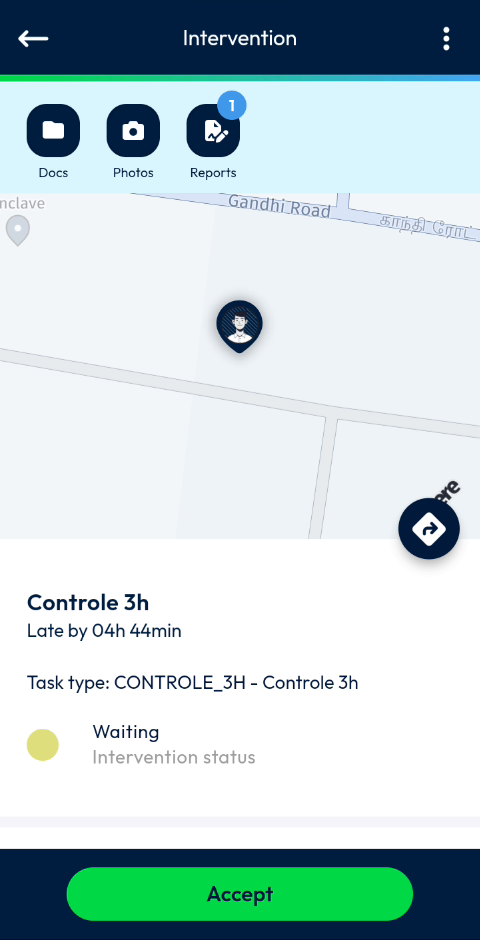
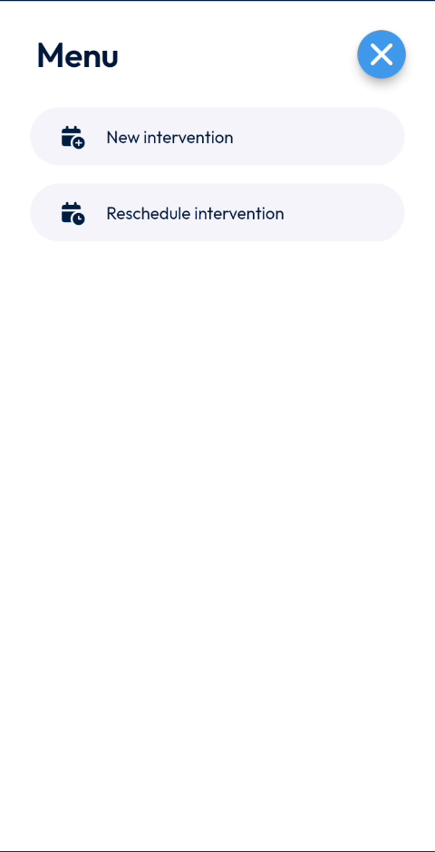
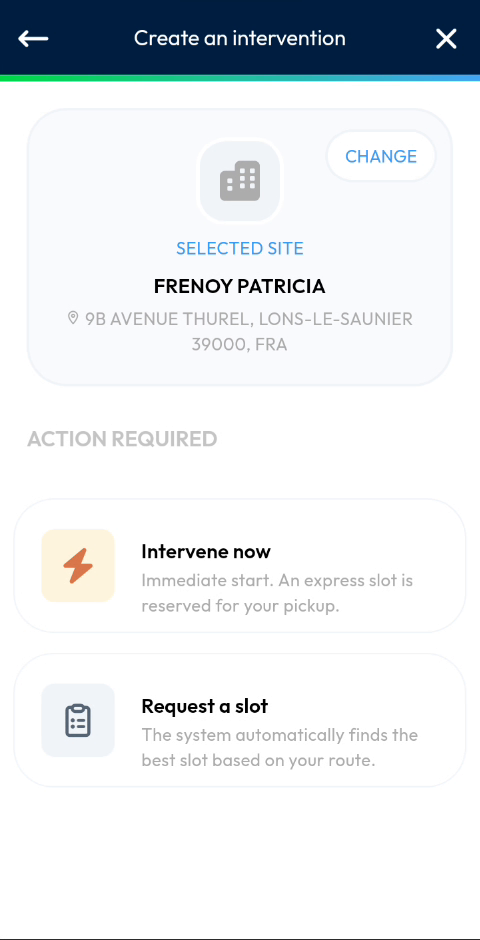

# Create an Intervention

Create a new intervention on the spot, from the Intervention page.

## Overview

You can create an intervention yourself when a visit was not planned. You choose the site, then either start the intervention immediately or ask the system to find a slot.

This section covers:

| Topic | Description |
| ----- | ----------- |
| [Choose the Site](choose-the-site.md) | Change the site of the new intervention. |
| [Intervene Now](intervene-now.md) | Fill in the intervention and start it immediately. |

## Open the Create an intervention page

1. Open an intervention. See [Start an Intervention](../start-an-intervention.md#open-the-intervention).

<figure><figcaption>
Intervention page
</figcaption></figure>

2. At the top right of the **Intervention** page, tap the three-dot icon. The **Menu** opens.

<figure><figcaption>
Intervention menu
</figcaption></figure>

3. Tap **New intervention**.
4. The **Create an intervention** page opens.

To close the **Menu** without choosing an option, tap the blue cross.

## Read the Create an intervention page

<figure><figcaption>
Create an intervention page
</figcaption></figure>

The page shows:

* **Selected site** – the site of the new intervention, with its name and address. Tap **CHANGE** to choose another site. See [Choose the Site](choose-the-site.md).
* **Action required** – the two ways to create the intervention.

| Action | Description |
| ------ | ----------- |
| **Intervene now** | Start immediately. An express slot is reserved for your pickup. See [Intervene Now](intervene-now.md). |
| **Request a slot** | The system automatically finds the best slot based on your route. |

To leave the page without creating an intervention, tap the cross at the top right. To go back, tap the back arrow at the top left.

<!-- REVIEW: the video does not use Request a slot. Confirm how it works and what happens after it. -->

## Related topics

* [Reschedule an Intervention](../reschedule-an-intervention.md)
* [Start an Intervention](../start-an-intervention.md)
