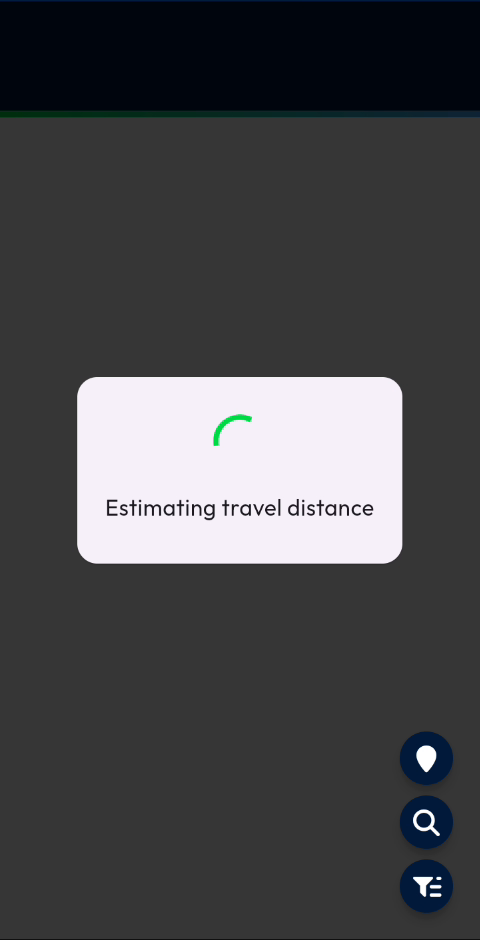
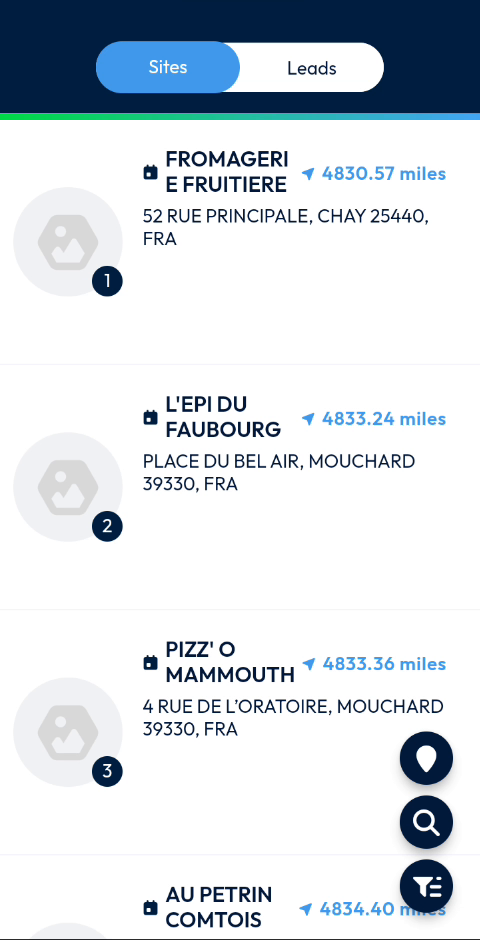
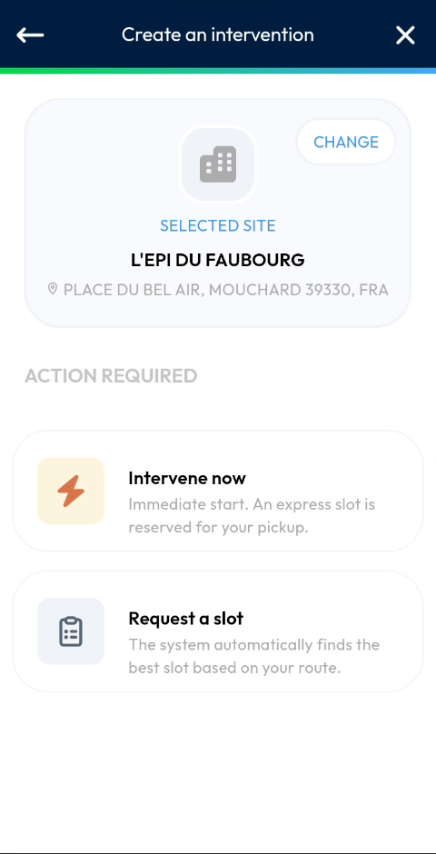

# Choose the Site

Change the site of the intervention that you create.

## Overview

When you create an intervention, a site is already selected. You can replace it with another site from a list that is sorted by distance from your position.

## Before you begin

* The **Create an intervention** page is open. See [Create an Intervention](README.md#open-the-create-an-intervention-page).

## Change the site

1. On the **Create an intervention** page, tap **CHANGE** in the **Selected site** area.
2. Wait while the message **Estimating travel distance** is displayed.

<figure><figcaption>
Estimating travel distance
</figcaption></figure>

3. In the list, find the site. The **Sites** tab is displayed.

<figure><figcaption>
List of sites
</figcaption></figure>

4. Select the site.

The **Create an intervention** page displays the new site in **Selected site**.

<figure><figcaption>
New site selected
</figcaption></figure>

## Read the list of sites

For each site, the list shows:

* The rank of the site in the list.
* The name of the site.
* The distance from your position, in miles, for example **4833.24 miles**.
* The address of the site.

Use the buttons at the right of the screen to work with the list:

* The map pin button.
* The magnifying glass button, to search.
* The filter button.

<!-- REVIEW: confirm the function of the map pin, search and filter buttons, the content of the Leads tab, and how a site is selected (tap on the site). The video does not show them. -->

## Related topics

* [Create an Intervention](README.md)
* [Intervene Now](intervene-now.md)
