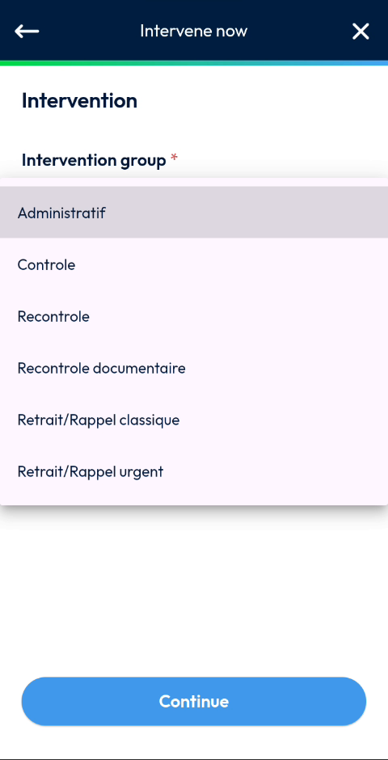
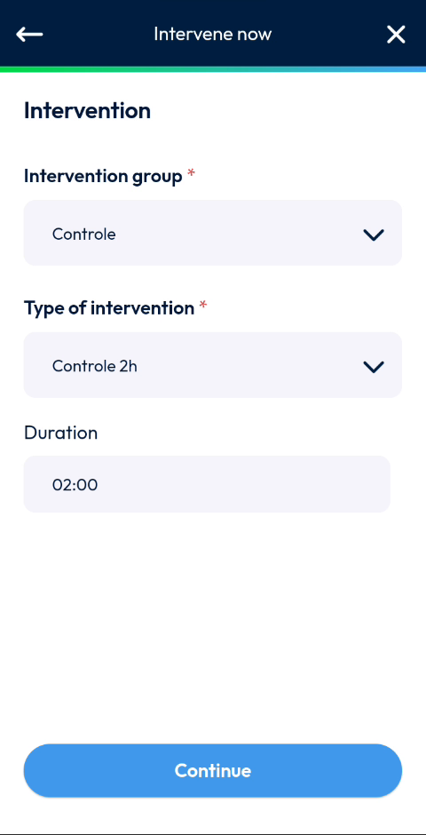
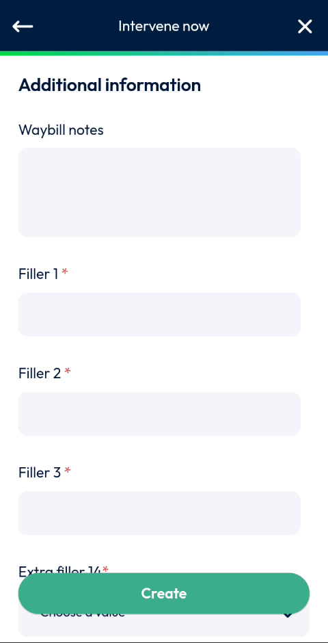
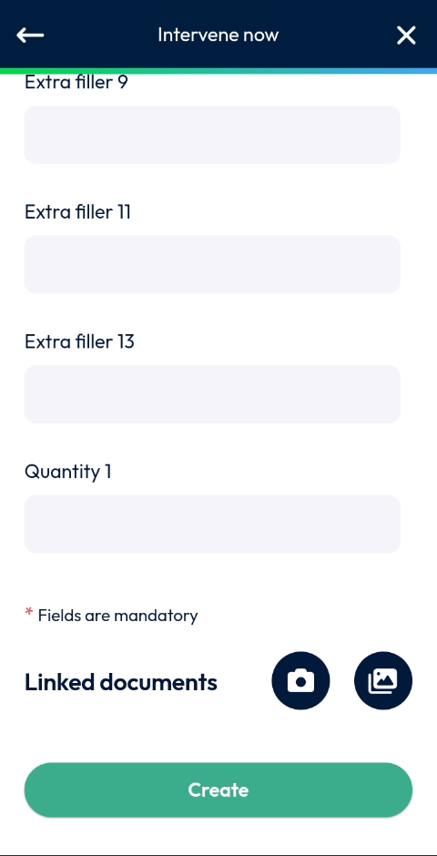
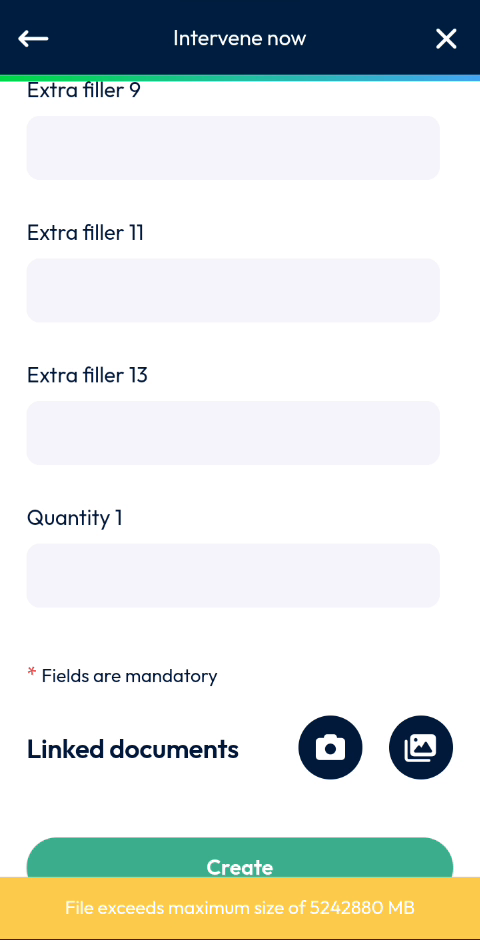
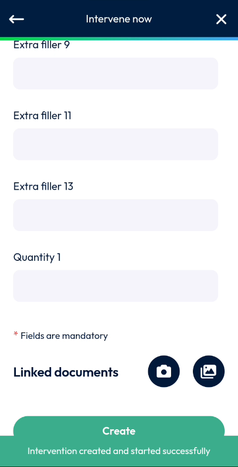

# Intervene Now

Create an intervention and start it immediately.

## Overview

Use **Intervene now** when you are already at the site and want to start the intervention without waiting for a slot. You describe the intervention, fill in the additional information, add documents if needed and create it.

## Before you begin

* The **Create an intervention** page is open and the site is correct. See [Create an Intervention](README.md) and [Choose the Site](choose-the-site.md).

## Choose the type of intervention

1. On the **Create an intervention** page, tap **Intervene now**.
2. On the **Intervene now** page, in **Intervention group**, tap the list and select a group, for example **Controle**.

<figure><figcaption>
List of intervention groups
</figcaption></figure>

3. In **Type of intervention**, tap the list and select a type, for example **Controle 2h**. The **Duration** of the intervention is displayed.

<figure><figcaption>
Type of intervention and duration
</figcaption></figure>

4. Tap **Continue**.

The fields marked with an asterisk (*) are mandatory.

## Fill in the additional information

1. On the **Additional information** page, in **Waybill notes**, enter your notes.
2. Fill in the mandatory fields. In the video, they are **Filler 1**, **Filler 2**, **Filler 3**, **Extra filler 14** and **Extra filler 1**.
3. For a field with a list, tap the field and select a value, for example **Restauration** or **Fromagerie** in **Extra filler 14**.
4. Fill in the other fields if needed: **Logical 1**, **Filler 5**, **Extra filler 8**, **Extra filler 9**, **Extra filler 11**, **Extra filler 13** and **Quantity 1**.

<figure><figcaption>
Additional information page
</figcaption></figure>

<!-- REVIEW: the fields (Filler, Extra filler, Quantity) are configured by your company. Confirm their real names and which ones are mandatory. -->

## Add linked documents

1. At the bottom of the page, in **Linked documents**, tap the camera button to take a photo, or the gallery button to select a file.

<figure><figcaption>
Linked documents
</figcaption></figure>

2. Take the photo, then tap the check mark to keep it. Tap the cross to discard it.

If the file is too large, the message **File exceeds maximum size of 5242880 MB** is displayed. Choose a smaller file.

<figure><figcaption>
File size message
</figcaption></figure>

<!-- REVIEW: confirm the maximum file size and its unit. The message in the video shows 5242880 MB. -->

## Create the intervention

1. Tap **Create**.
2. Wait while the message **Sending request in progress** is displayed.
3. The message **Intervention created and started successfully** is displayed.

<figure><figcaption>
Intervention created and started successfully
</figcaption></figure>

The intervention is created and started. To go on with it, see [Fill in the Report](../report.md), [Add Photos and Remarks](../photos-and-remarks.md) and [Finish an Intervention](../finish-an-intervention.md).

## Related topics

* [Create an Intervention](README.md)
* [Start an Intervention](../start-an-intervention.md)
