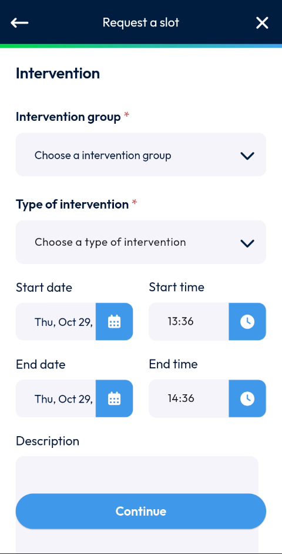
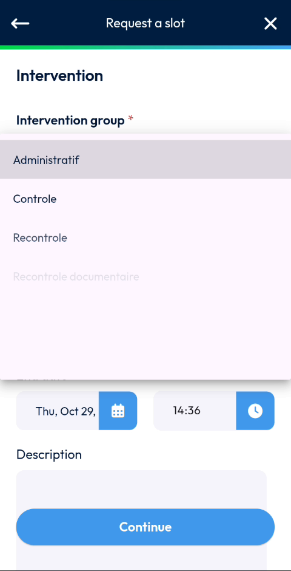
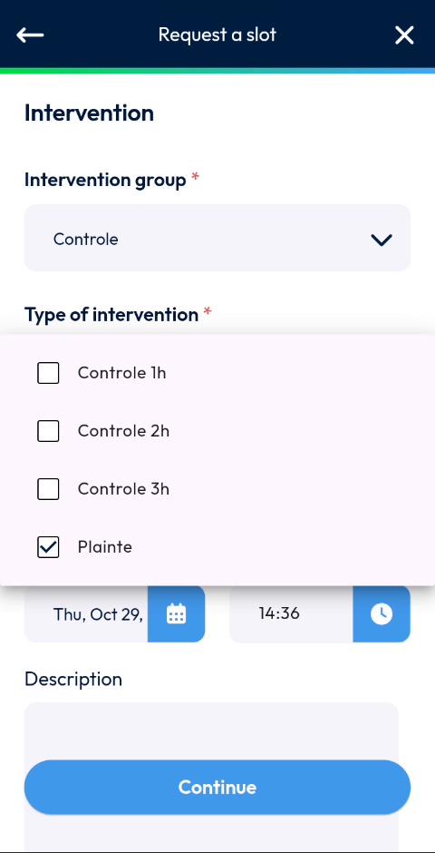
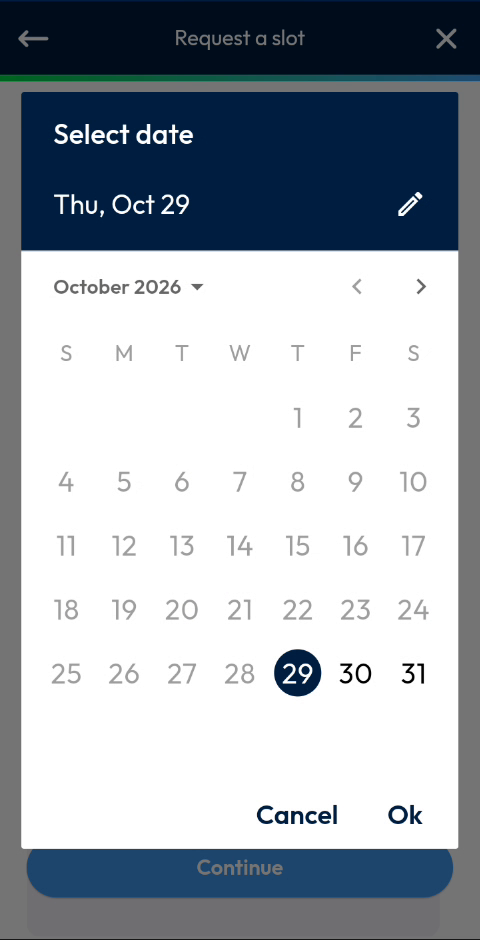
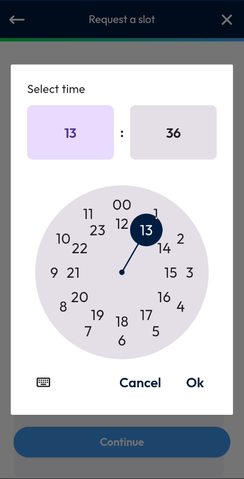
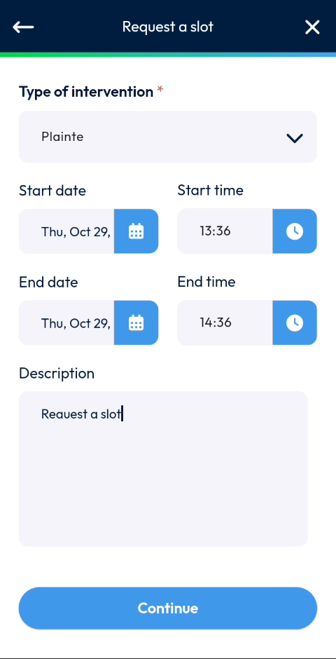
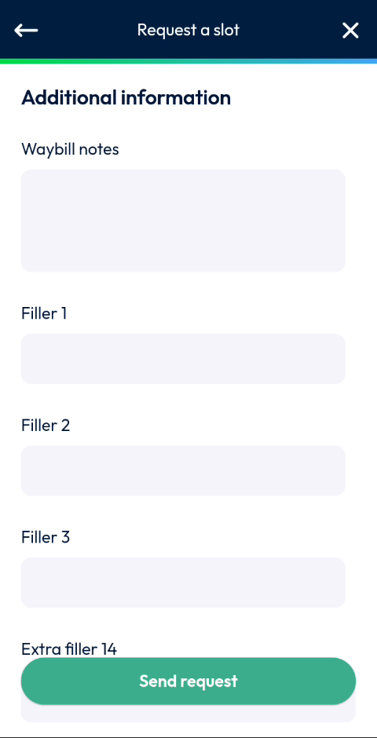
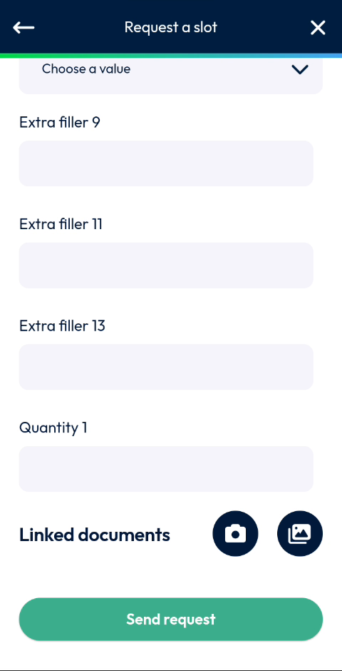
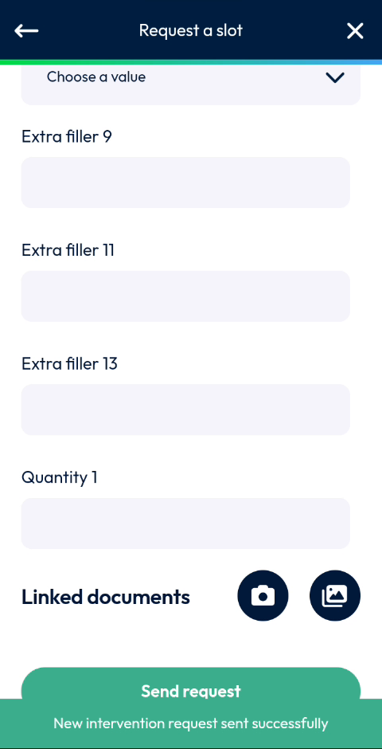

# Request a Slot

Ask the system to find the best slot for a new intervention.

## Overview

Use **Request a slot** when the intervention does not have to start immediately. You describe the intervention and the period in which it can be done. The system then automatically finds the best slot, based on your route.

## Before you begin

* The **Create an intervention** page is open and the site is correct. See [Create an Intervention](README.md) and [Choose the Site](choose-the-site.md).

## Describe the intervention

1. On the **Create an intervention** page, tap **Request a slot**.
2. On the **Request a slot** page, in **Intervention group**, tap the list and select a group, for example **Controle**.

<figure><figcaption>
Request a slot page
</figcaption></figure>

<figure><figcaption>
List of intervention groups
</figcaption></figure>

3. In **Type of intervention**, tap the list and select one or more types, for example **Plainte**. A check mark shows the selected types.

<figure><figcaption>
List of types of intervention
</figcaption></figure>

The fields marked with an asterisk (*) are mandatory.

## Set the period

The period is the time window in which the intervention can take place. By default, it starts today at the current time and lasts one hour.

1. In **Start date**, tap the calendar icon, select the date in the **Select date** window, then tap **Ok**.

<figure><figcaption>
Select date window
</figcaption></figure>

2. In **Start time**, tap the clock icon, select the time in the **Select time** window, then tap **Ok**. Select the hour first, then the minutes.

<figure><figcaption>
Select time window
</figcaption></figure>

3. In **End date** and **End time**, set the end of the period in the same way.


To type a date or a time instead, tap the pencil icon or the keyboard icon in the window.


## Add a description

1. In **Description**, enter a description of the request, for example **Request a slot**.

<figure><figcaption>
Description entered
</figcaption></figure>

2. Tap **Continue**.

## Fill in the additional information

1. On the **Additional information** page, in **Waybill notes**, enter your notes.
2. Fill in the other fields: **Filler 1**, **Filler 2**, **Filler 3**, **Extra filler 14**, **Logical 1**, **Extra filler 1**, **Filler 5**, **Extra filler 8**, **Extra filler 9**, **Extra filler 11**, **Extra filler 13** and **Quantity 1**.
3. For a field with a list, tap the field and select a value.

<figure><figcaption>
Additional information page
</figcaption></figure>

4. If needed, in **Linked documents**, tap the camera button to take a photo, or the gallery button to select a file.

<!-- REVIEW: the fields (Filler, Extra filler, Quantity) are configured by your company. Confirm their real names and which ones are mandatory. The video leaves them empty. -->

## Send the request

1. Scroll down and tap **Send request**.

<figure><figcaption>
Send request button
</figcaption></figure>

2. The message **New intervention request sent successfully** is displayed.

<figure><figcaption>
New intervention request sent successfully
</figcaption></figure>

The request is sent to the system. It does not start an intervention. To start an intervention immediately, see [Intervene Now](intervene-now.md).

<!-- REVIEW: confirm what happens after the request is sent: where the slot appears, who validates it, and where the app returns to. The video ends right after the success message. Confirm also whether the Type of intervention list accepts several types and how Start and End time are used to find the slot. -->

## Related topics

* [Create an Intervention](README.md)
* [Intervene Now](intervene-now.md)
* [Reschedule an Intervention](../reschedule-an-intervention.md)
