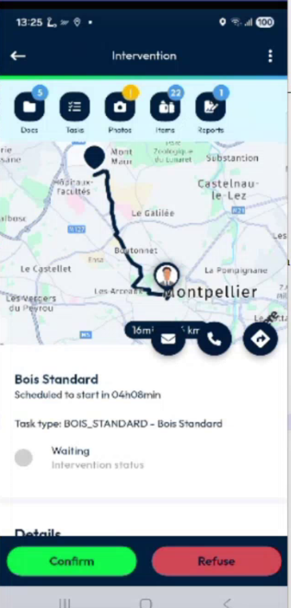
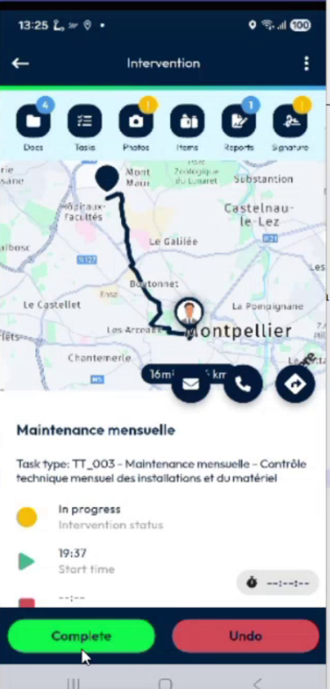
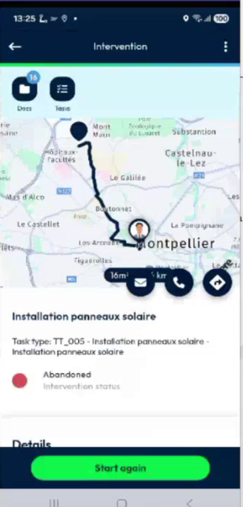
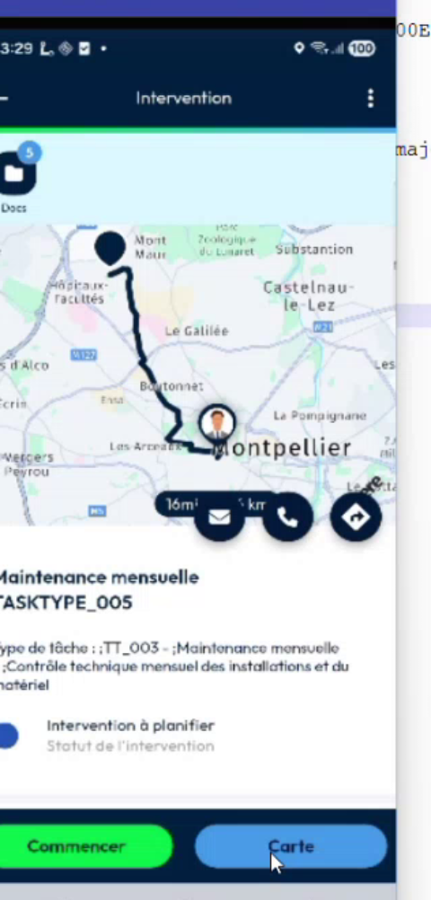
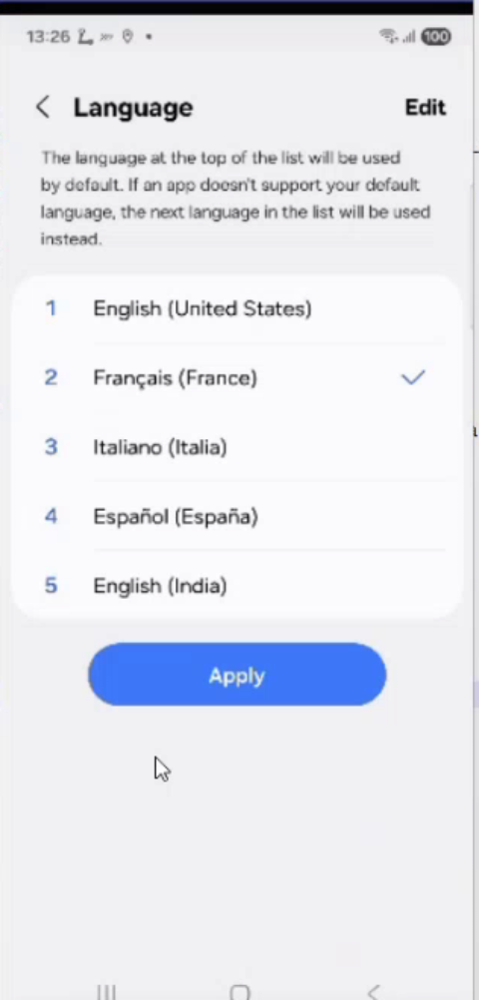
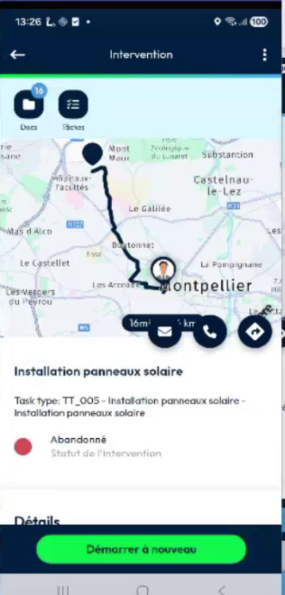
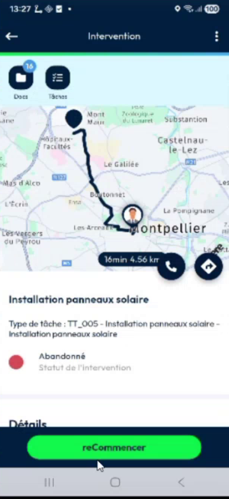
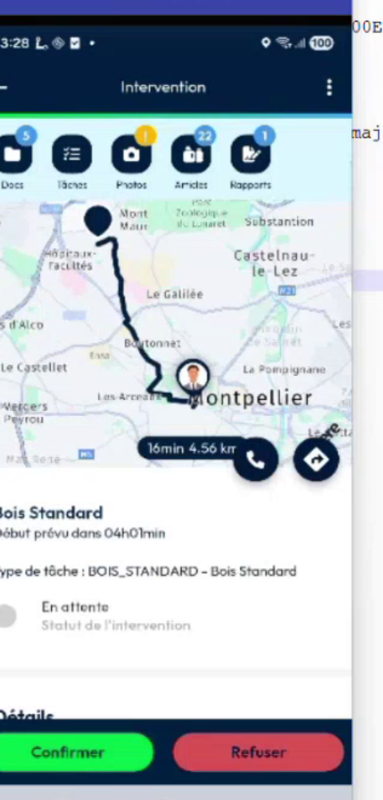

# Customized Appointment Button Labels

## Overview

The buttons at the bottom of an intervention start, accept, finish or cancel it. Your company can rename them. For example, **Accept** can become **Confirm**, and **Finish** can become **Complete**. The actions stay the same.

## Before you begin

* Your administrator has changed the labels. See [Button Labels Setup](../configuration/button-labels-setup.md).
* You logged in after the change.

## See the customized labels

1. Open an intervention that you did not accept yet. The buttons show the labels of your company, for example **Confirm** and **Refuse**.

<figure><figcaption>
Confirm and Refuse buttons
</figcaption></figure>

2. Open an intervention in progress. The buttons are, for example, **Complete** and **Undo**.

<figure><figcaption>
Complete and Undo buttons
</figcaption></figure>

3. Open an abandoned or cancelled intervention. The button is, for example, **Start again**.

<figure><figcaption>
Start again button
</figcaption></figure>

4. For a requested intervention that you plan, the plan button also shows your company label.

<figure><figcaption>
Customized plan button
</figcaption></figure>

When your administrator did not change a label, the app shows its default label.

## Change the language of the labels

The app receives the labels in the language of your device when you log in, and keeps them in the app. If you change the language of your device, the buttons keep the default labels until you log in again.

<figure><figcaption>
Language of the device
</figcaption></figure>

1. Change the language of your device, then return to the app. The texts are translated, but a button without a label in this language shows its default label.

<figure><figcaption>
Default label in French
</figcaption></figure>

2. Log out, then log in again. The app receives the labels in the new language.

<figure><figcaption>
Customized label in French
</figcaption></figure>

<figure><figcaption>
Customized Confirm and Refuse in French
</figcaption></figure>

Labels can be set in English, French and Italian.

<!-- REVIEW: confirm the list of the labels that can be changed, since the team plans a reference list, and whether the labels of the statuses, for example Accepted, can be changed in the same way. -->

## Related topics

* [Start an Intervention](start-an-intervention.md)
* [Finish an Intervention](finish-an-intervention.md)
* [Restart an Abandoned Intervention](restart-an-abandoned-intervention.md)
* [Button Labels Setup](../configuration/button-labels-setup.md)