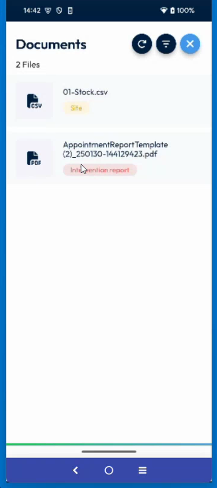

# View the Documents of an Intervention

Open the files linked to an intervention.

## Overview

The **Docs** icon of the intervention gives access to the documents linked to it, such as a stock file or the report of the intervention. A number on the icon shows how many documents there are.

## Before you begin

* The intervention is open. See [Start an Intervention](start-an-intervention.md#open-the-intervention).

## Open the documents

1. On the **Intervention** page, tap **Docs** in the icons at the top. See [Add Items to an Intervention](add-items-to-an-intervention.md#open-the-items-page).
2. The **Documents** page opens. It shows the number of files, for example **2 Files**.

<figure><figcaption>
Documents page
</figcaption></figure>

For each file, the list shows its name, for example **01-Stock.csv** or **AppointmentReportTemplate**, and a label that gives its origin:

| Label | Description |
| ----- | ----------- |
| **Site** | The file belongs to the site of the intervention. |
| **Intervention report** | The file is a report of the intervention. |

3. Tap a file to open it.

The buttons at the top right of the page are the refresh button, the filter button and the close button. To close the page, tap the close button.

<!-- REVIEW: the video shows the list but does not open a file. Confirm how a file opens, the function of the refresh and filter buttons, and whether the signed report appears here after a secure signature. -->

## Related topics

* [Sign Securely](sign-an-intervention/sign-securely.md)
* [Add Photos and Remarks](photos-and-remarks.md)
