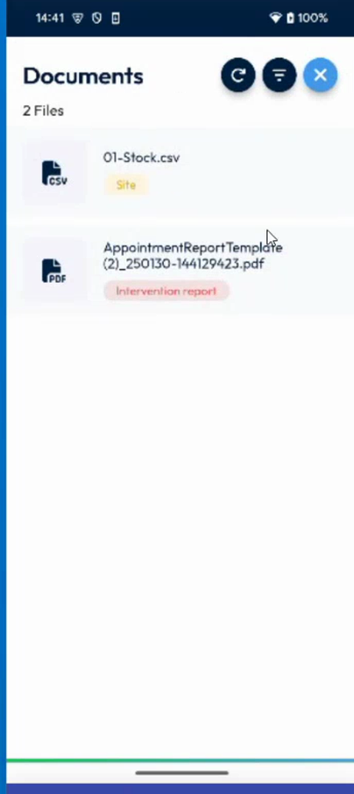
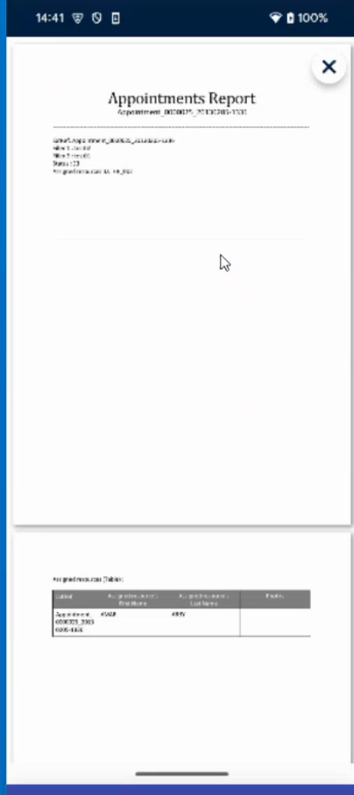
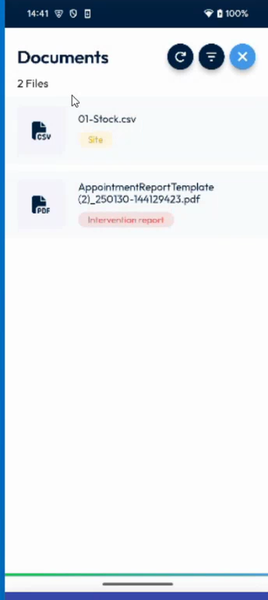

# View the Documents of an Intervention

## Overview

The **Docs** icon of the intervention gives access to the documents linked to it, such as a stock file or the report of the intervention. A number on the icon shows how many documents there are.

## Before you begin

* The intervention is open. See [Start an Intervention](start-an-intervention.md#open-the-intervention).

## Open the documents

1. On the **Intervention** page, tap **Docs** in the icons at the top. See [Add Items to an Intervention](add-items-to-an-intervention.md#open-the-items-page).
2. The **Documents** page opens. It shows the number of files, for example **2 Files**.

<figure><figcaption>
Documents page
</figcaption></figure>

For each file, the list shows its name, for example **01-Stock.csv** or **AppointmentReportTemplate**, and a label that gives its origin:

| Label | Description |
| ----- | ----------- |
| **Site** | The file belongs to the site of the intervention. |
| **Intervention report** | The file is a report of the intervention. |

The buttons at the top right of the page are, from left to right, the refresh button, the filter button and the close button.

## Open a report

1. In the list, tap the file that has the label **Intervention report**, for example **AppointmentReportTemplate**.
2. The report opens as a document, for example **Appointments Report**. It shows the appointment, its status and a table of the appointment resources.

<figure><figcaption>
Appointments Report
</figcaption></figure>

3. Scroll down to read the whole report.
4. To close the report, tap the cross at the top right.

## Refresh the list

1. On the **Documents** page, tap the refresh button, the first button at the top right.
2. The list is reloaded. A report that has just been generated, for example after a signature, then appears in the list.

<figure><figcaption>
Refresh button of the Documents page
</figcaption></figure>

To refresh all your data, see [Refresh Your Data](../main-actions/refresh-your-data.md).

<!-- REVIEW: the video shows the Documents page and the report, but does not tap the refresh and filter buttons. Confirm that refresh reloads the list, what the filter button does, and whether the report is generated by the app after the signature or by the back office. -->

## Related topics

* [Sign an Intervention](sign-an-intervention/README.md)
* [Sign by Hand](sign-an-intervention/sign-by-hand.md)
* [Sign Securely](sign-an-intervention/sign-securely.md)
* [Add Photos and Remarks](photos-and-remarks.md)
