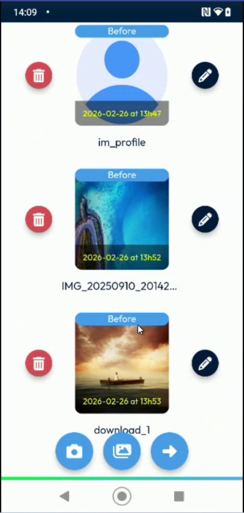
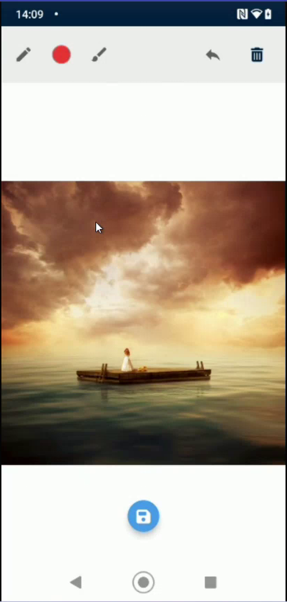
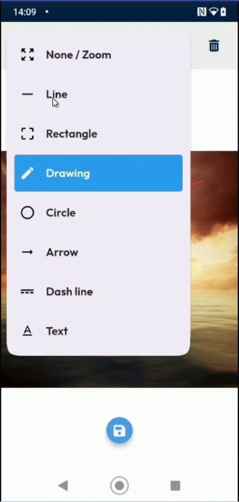
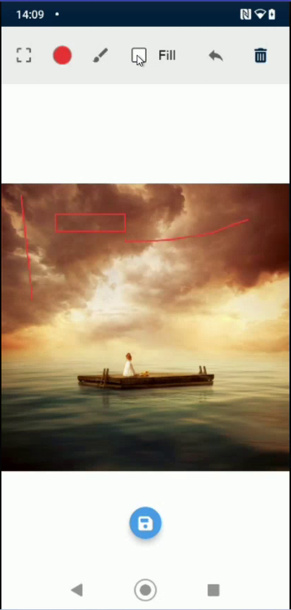
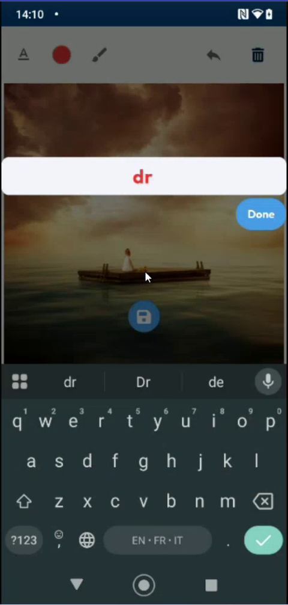
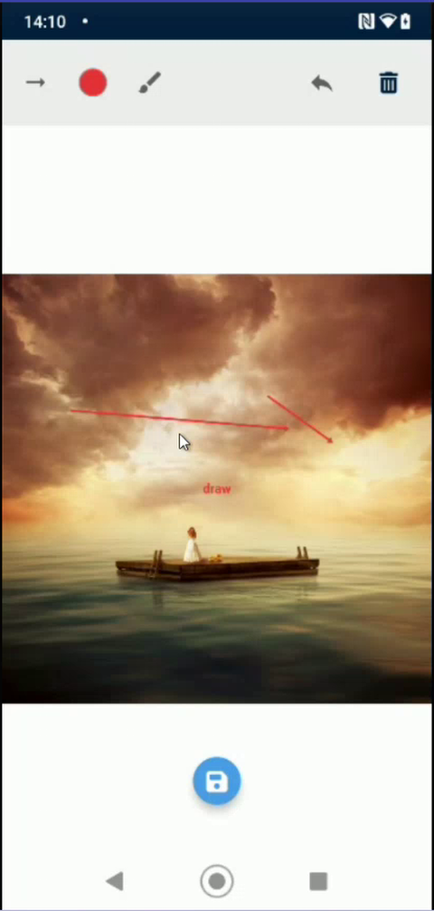
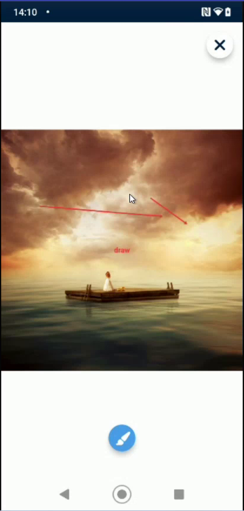

# Draw on a Photo

## Overview

You can annotate a photo of an intervention with lines, shapes, arrows and text, for example to point out a fault or mark an area. The annotated photo replaces the original in the intervention.

## Before you begin

* The intervention contains at least one photo. See [Add Photos and Remarks](photos-and-remarks.md).

## Open the photo editor

1. On the **Intervention** page, tap **Photos**.
2. On the **Photos/Videos** page, tap the pencil icon next to the photo that you want to edit.

<figure><figcaption>
Photos/Videos page with the pencil icons
</figcaption></figure>

3. The photo opens. Tap the brush button at the bottom of the screen to start editing.

<figure><figcaption>
Photo with the brush button
</figcaption></figure>

The editor shows a toolbar at the top of the screen. From left to right it contains the tool menu, the color, the brush, the **Fill** option (for shapes), the undo button and the bin icon that clears the drawing.

<figure><figcaption>
Photo editor toolbar
</figcaption></figure>

## Choose a tool

1. Tap the tool menu at the top left of the toolbar.
2. Tap the tool that you want to use:

| Tool | What it does |
| --- | --- |
| **None / Zoom** | Moves and zooms the photo without drawing. |
| **Line** | Draws a straight line. |
| **Rectangle** | Draws a rectangle. |
| **Drawing** | Draws freehand. |
| **Circle** | Draws a circle. |
| **Arrow** | Draws an arrow. |
| **Dash line** | Draws a dashed line. |
| **Text** | Adds a text on the photo. |

<figure><figcaption>
Tool menu
</figcaption></figure>

3. To change the color, tap the color circle in the toolbar and pick a color.

## Draw a line or a shape

1. Choose **Line**, **Rectangle**, **Drawing**, **Circle**, **Arrow** or **Dash line**.
2. Drag your finger on the photo to draw.
3. For a shape, select **Fill** in the toolbar to fill it with the color. Clear **Fill** to draw only the outline.

<figure><figcaption>
Lines and shapes drawn on a photo
</figcaption></figure>

## Add a text

1. Choose **Text** in the tool menu.
2. Tap the photo where you want the text.
3. Type your text with the keyboard, then tap **Done**.

<figure><figcaption>
Text entry on a photo
</figcaption></figure>

4. To move the text, drag it on the photo.


You cannot change the size of the text.


<figure><figcaption>
Photo with a text and an arrow
</figcaption></figure>

## Undo or clear your drawing

* Tap the undo button to remove the last element that you added.
* Tap the bin icon to clear the whole drawing.

## Save the photo

1. Tap the save button at the bottom of the screen.
2. The edited photo appears on the **Photos/Videos** page in place of the original.

<figure><figcaption>
Edited photo in the list
</figcaption></figure>

<!-- REVIEW: confirm that the edited photo replaces the original (not kept as a copy), the function of the brush and pencil buttons, and whether the edited photo is sent with the intervention. -->

## Next steps

* [Finish an Intervention](finish-an-intervention.md)

## Related topics

* [Add Photos and Remarks](photos-and-remarks.md)
* [Take the Required Photos](required-photos.md)