# View and Edit the Extra Fields of an Item

See and update the additional information that your company adds to an item, such as a link, a checkbox, a number or a date.

## Overview

On the **Details** page of an item, the app always shows the standard fields, such as the stock, the reference and the unit price. Your administrator can add **extra fields** to the items of the intervention. These fields show more information to the technician, and the technician can update most of them. Each field has a type, so the app offers the right way to enter the value.

The values that you enter are sent to NFS with the intervention and appear in the product list of the appointment.

## Before you begin

* The intervention contains items. See [Add Items to an Intervention](add-items-to-an-intervention.md).
* Your administrator has set up the extra fields. See [Extra Item Fields Setup](../configuration/extra-item-fields-setup.md).
* To edit a field, you have started the intervention. Before the start, the fields are only displayed. See [Start an Intervention](start-an-intervention.md).

## View the extra fields

1. On the **Intervention** page, tap **Items**.
2. Tap the name or the photo of an item.
3. On the **Details** page, scroll down. The extra fields are listed after the **Unit price**, each with its value and its label under the value.

<figure>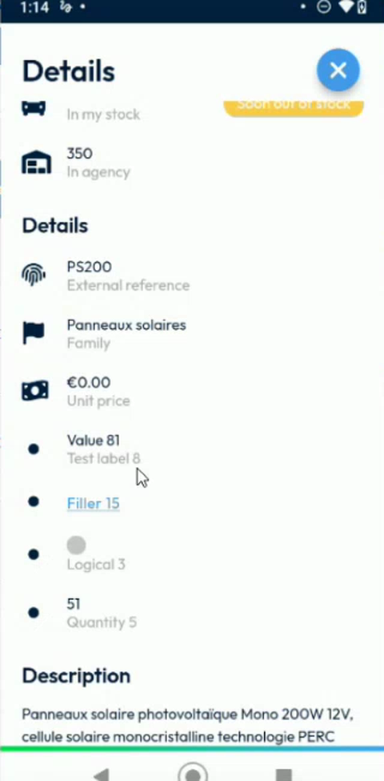<figcaption>
Extra fields before the start: no edit icon
</figcaption></figure>

A field that has no value shows **To be defined**.

## Edit an extra field

Once the intervention is started, a blue pencil icon appears at the right of each field that you can edit.

<figure>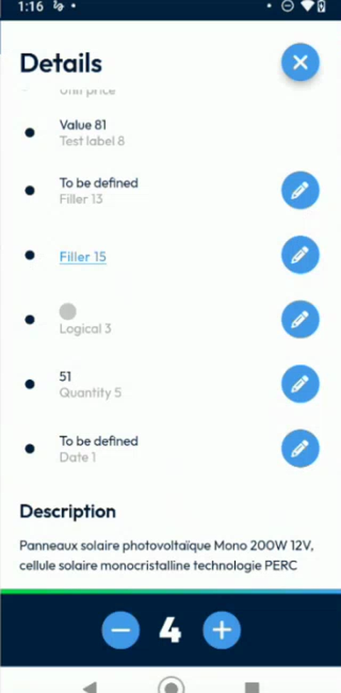<figcaption>
Extra fields of an intervention in progress
</figcaption></figure>

1. Tap the pencil icon of a field.
2. The **Modify information** page opens with the label of the field.
3. Enter the value. The page adapts to the type of the field:

| Type of field | What the page shows |
| ------------- | ------------------- |
| **Text** | The keyboard, with a text field. |
| **Number** (quantity) | The numeric keyboard. |
| **Checkbox** (logical) | A switch that you turn on or off. |
| **Date** | A date field. Tap the calendar icon, select a day, then tap **Ok**. |
| **Link** (URL) | Not edited on this page. See [Open a link](#open-a-link). |
| **Drop-down list** | A list of values. See [Mandatory Fields and Drop-Down Lists on Items](mandatory-and-list-item-fields.md). |

<figure>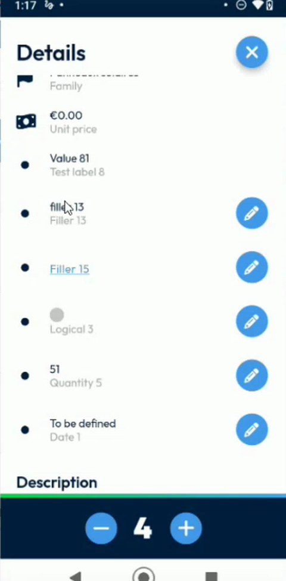<figcaption>
Text field
</figcaption></figure>

<figure>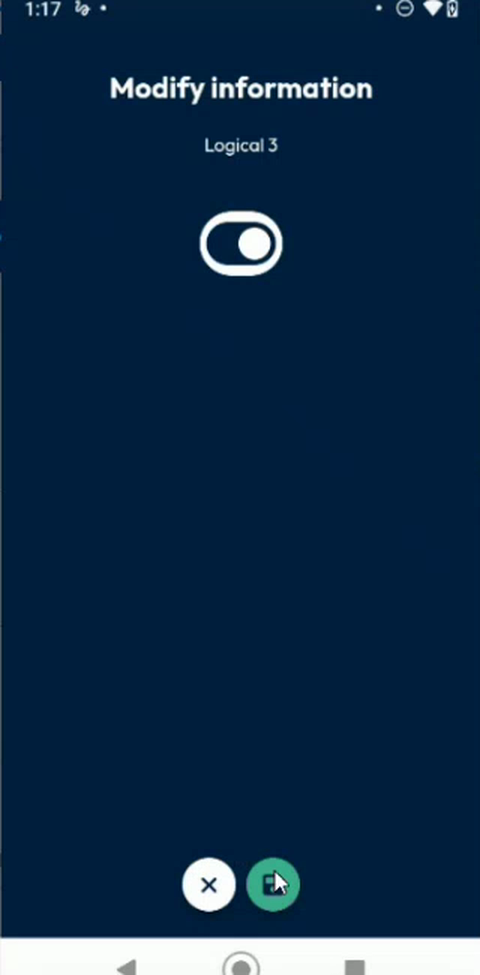<figcaption>
Checkbox field
</figcaption></figure>

<figure>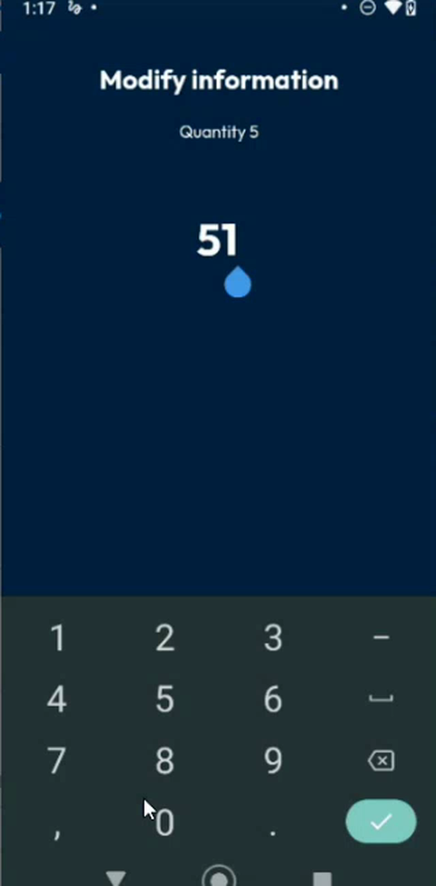<figcaption>
Number field
</figcaption></figure>

<figure>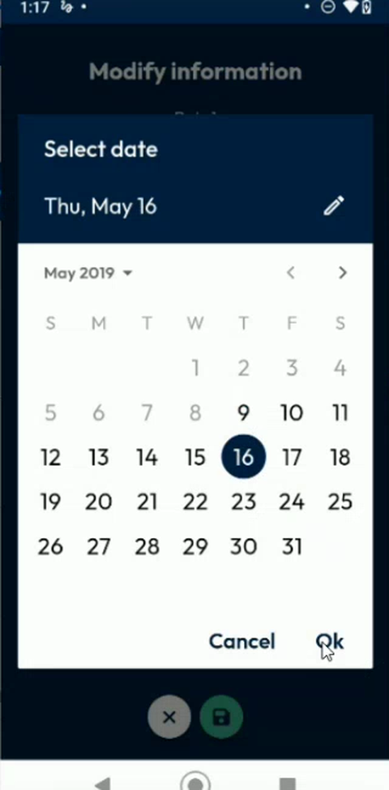<figcaption>
Date field
</figcaption></figure>

4. Tap the green save button at the bottom of the page. To leave without saving, tap the cross.
5. The **Details** page shows the new value.

<figure>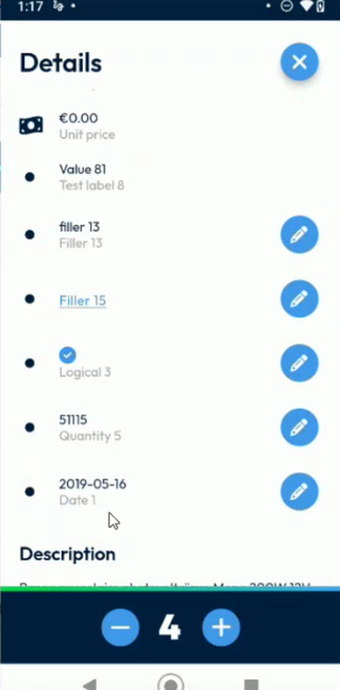<figcaption>
Updated extra fields
</figcaption></figure>


A field that your administrator set as read-only has no pencil icon. You can see its value but not change it.


## Open a link

A link field is displayed in blue.

1. Tap the link, for example **Filler 15**.
2. The app opens the link in your external browser.

<figure>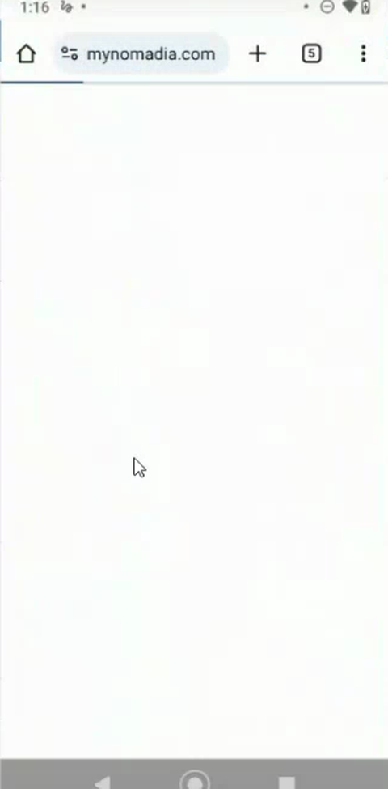<figcaption>
Link opened in the browser
</figcaption></figure>

## Fill in the extra fields of a new item

The extra fields are also available for an item that you add yourself.

1. On the **Items** page, tap the cart button to open the catalogue, then add the item. See [Add Items to an Intervention](add-items-to-an-intervention.md#search-the-catalog).

<figure>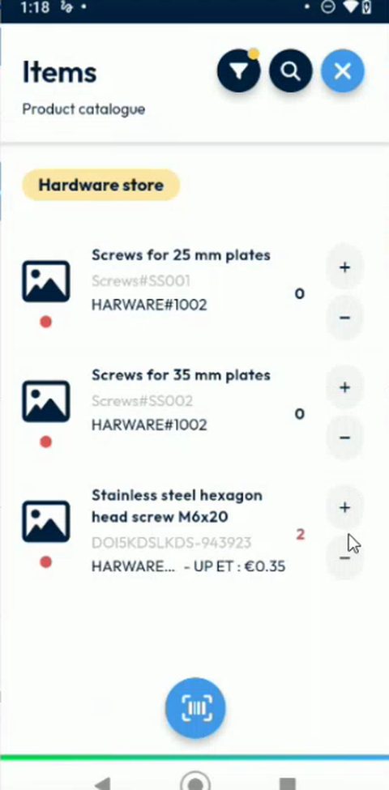<figcaption>
Product catalogue
</figcaption></figure>

2. Tap the new item to open its **Details** page.
3. Tap the pencil icon of an extra field, enter the value, then save.

<figure>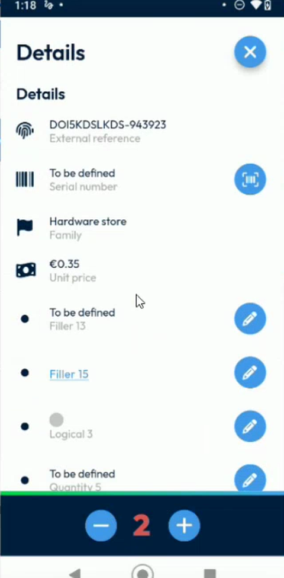<figcaption>
Extra field of an item added in the app
</figcaption></figure>

## Check the result in NFS

1. Finish the intervention. See [Finish an Intervention](finish-an-intervention.md).
2. In NFS, refresh the appointment.
3. In the **Product List**, the columns of the extra fields show the values that you entered. An item that you added in the app is a new line.

<figure>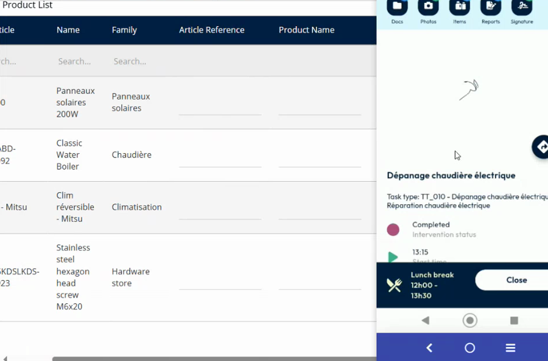<figcaption>
Product list of the appointment in NFS
</figcaption></figure>

<!-- REVIEW: confirm that the quantity and the other values appear in the Delivered Qty. and in the extra columns after the intervention is finished, and whether a link field can be edited in the app. In the demo, the link is configured as read-only text, and it opens in the browser. -->

## Related topics

* [Add Items to an Intervention](add-items-to-an-intervention.md)
* [View the Details of an Item](view-item-details.md)
* [Scan or Enter a Serial Number](scan-a-serial-number.md)
* [Mandatory Fields and Drop-Down Lists on Items](mandatory-and-list-item-fields.md)
* [Extra Item Fields Setup](../configuration/extra-item-fields-setup.md)
