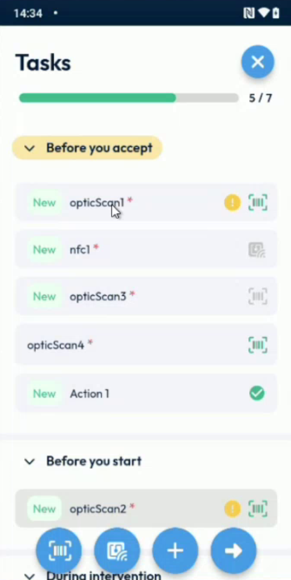
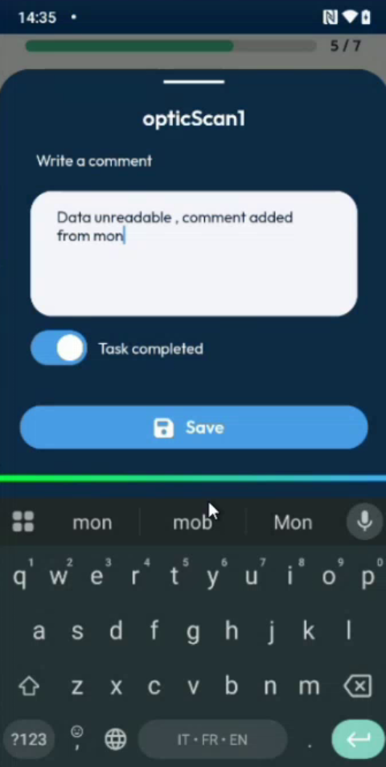
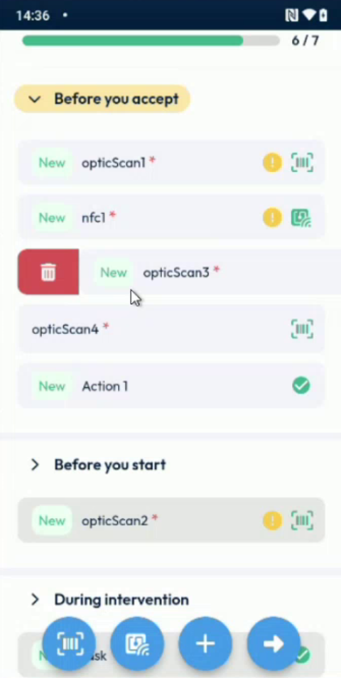
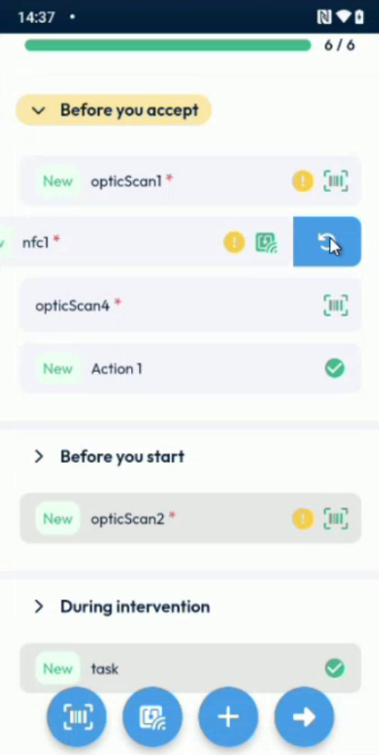

# Edit, Reset or Delete a Task

## Overview

On the **Tasks** page, you can change the comment of a task, complete it, reset it so that it is not completed any more, and delete it.

## Before you begin

* You are on the **Tasks** page of an intervention. See [Scan a Task Code](scan-a-task-code.md).

<figure><figcaption>
Tasks page
</figcaption></figure>

## Write or change the comment of a task

1. Press the task for a long time.
2. In **Write a comment**, enter the comment, for example **Data unreadable**.
3. If the task is not completed, you can turn on **Task completed** to complete it with your comment. A task that is already completed keeps **Task completed** turned on, and you cannot turn it off here.
4. Tap **Save**.

<figure><figcaption>
Comment of a task
</figcaption></figure>

The comment is saved in the task. It is sent to the back office when you complete the intervention.

## Delete a task

1. Swipe the task to the right. A red area with a bin icon appears.
2. Tap the bin icon. The task is deleted.

<figure><figcaption>
Task being swiped to delete
</figcaption></figure>

You can delete a task that is completed and a task that is not completed.

## Reset a task

Reset a completed task to make it not completed again. The comment of the task is emptied.

1. Swipe the completed task to the left.
2. Tap the **Reset** button.

<figure><figcaption>
Reset button of a task
</figcaption></figure>


You cannot reset a task that is not completed. Swipe it to the right to delete it.


<!-- REVIEW: confirm whether a task that your planner created in the back office can be reset, and whether a confirmation message is displayed before a deletion or a reset. -->

## Next steps

* [Finish an Intervention](finish-an-intervention.md)

## Related topics

* [Scan a Task Code](scan-a-task-code.md)
* [Keep the Task Comment When You Scan by Hand](task-comment-and-manual-scan.md)
* [Correct Your Text with AI](correct-your-text-with-ai.md)