# Fill In Survey Forms Offline

Open, fill in and update survey forms at any stage of the intervention, even when your device has no network.

## Overview

Some reports of an intervention are survey forms. They have several pages and field types, such as choices, a file upload, a list, a date and a signature. Two improvements make them easier to use in the field:

* You can open and complete the survey forms **before you start** the intervention. Before, you had to start it first.
* The forms work **offline**. You can open, fill in and complete them without a network. The data is sent when you synchronize.

You can also reopen a form that you completed, and change its values.

## Before you begin

* Your reports are in your device. Refresh your data while you have a network. See [Refresh Your Data](../main-actions/refresh-your-data.md).
* The app is allowed to access the photos of your device, if a form has a file upload field.

## Open the survey forms

When your device is offline, the app displays a yellow banner: **You are offline. No interaction will be lost**.

<figure>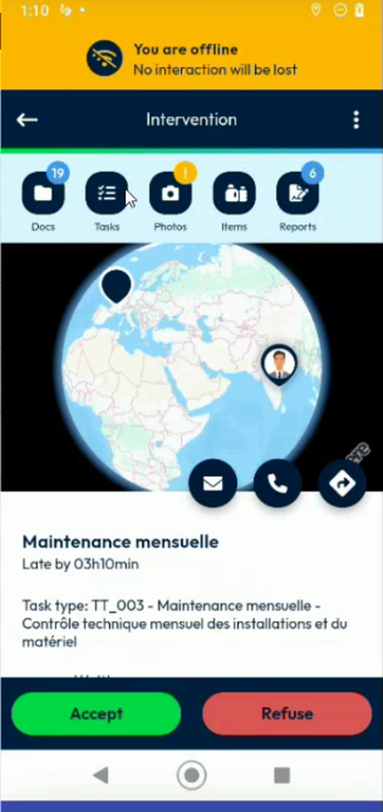<figcaption>
Intervention opened offline
</figcaption></figure>

1. Open the intervention. It can be **Waiting**, **Accepted** or **In progress**.
2. Tap **Reports**.
3. In **Select the report**, tap a survey form, for example **SurveyJs report 1**.

<figure>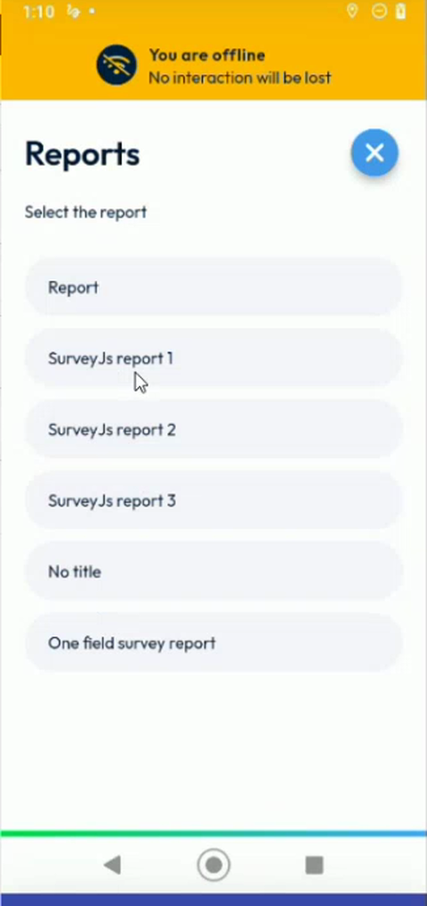<figcaption>
List of reports
</figcaption></figure>

## Fill in a survey form

1. Answer the questions. A red asterisk marks a mandatory question.

<figure>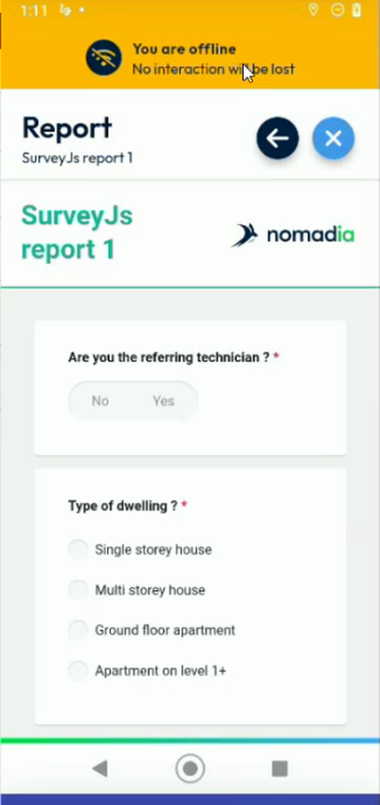<figcaption>
Survey form
</figcaption></figure>

2. For a file upload field, tap **Select File**, then choose an image in your gallery. If the app asks for the access, tap **Allow**.

<figure>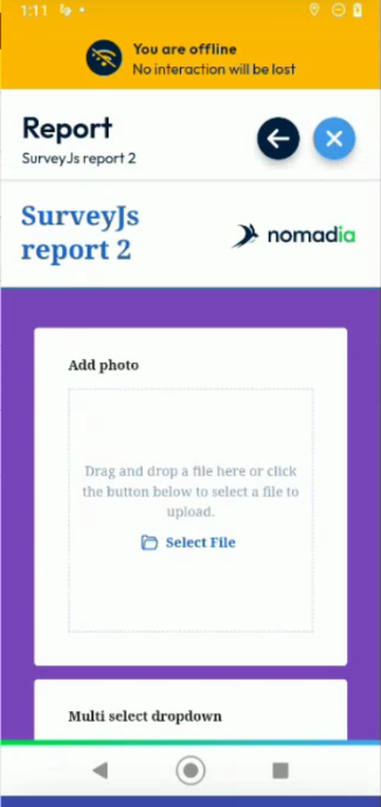<figcaption>
File upload field
</figcaption></figure>

3. For a list or a date, tap the field and choose a value.
4. Tap **Complete** or **Next** at the end of the form.
5. The message **Thank you for completing the survey** is displayed. Tap the green arrow button to continue.

<figure>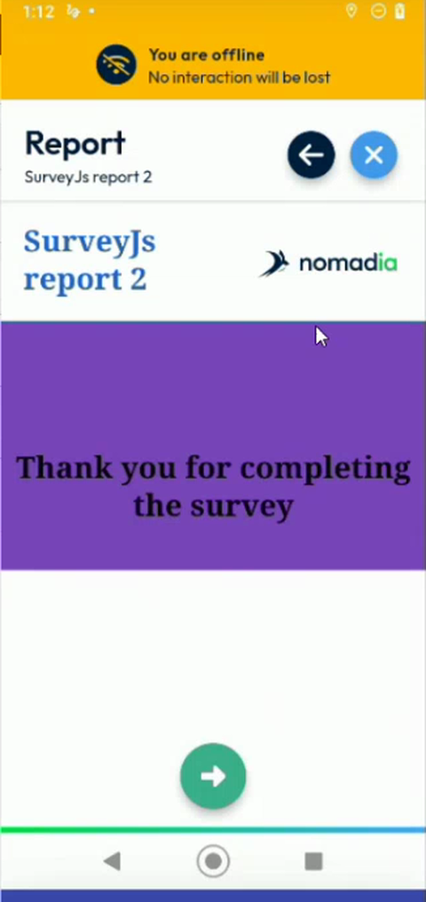<figcaption>
Survey completed
</figcaption></figure>

6. The next form opens. Repeat the steps for each form. To leave a form, tap the back arrow.

When a form is complete, a check mark appears next to it in the list of reports.

<figure>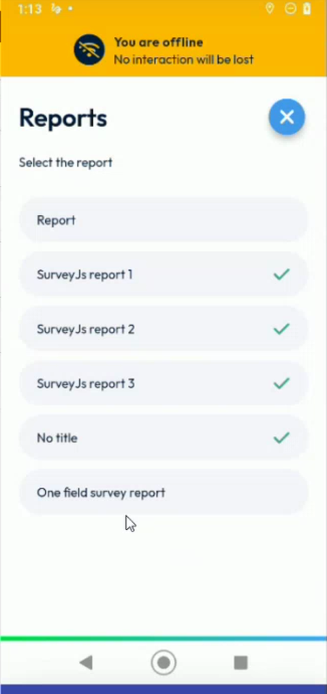<figcaption>
Reports with a check mark
</figcaption></figure>

## Complete the forms at any time

You can do the steps of the intervention in the order that suits you. In the demo, two forms are completed before accepting the intervention, two before starting it, and the last one before finishing it.

1. Complete some forms while the intervention is **Waiting**.
2. Accept the intervention. See [Accept an intervention](../main-actions/calendar.md#accept-an-intervention).

<figure>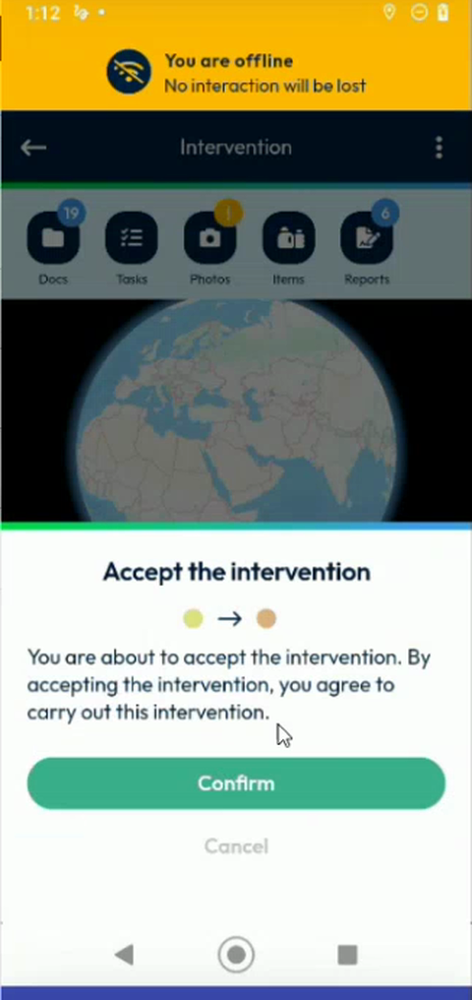<figcaption>
Accept the intervention, offline
</figcaption></figure>

3. Complete other forms.
4. Start the intervention. See [Start an Intervention](start-an-intervention.md).
5. Complete the last form, then finish the intervention.

## Change a completed form

1. In the list of reports, tap a form with a check mark.
2. Change the values.

<figure>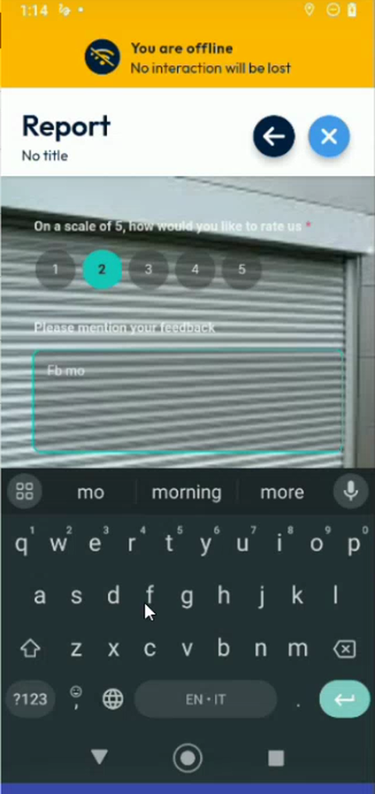<figcaption>
Form reopened to modify it
</figcaption></figure>

3. Tap **Complete**.

The new values replace the previous ones.

## Finish the intervention offline

1. Fill in the report, take the photos and have the intervention signed, as usual. See [Fill in the Report](report.md) and [Sign an Intervention](sign-an-intervention/README.md).
2. Tap **Finish**, then **Confirm**.
3. The message **Waiting for a network connection** is displayed. The intervention is **Completed** in the app, and the data is kept in your device.

<figure>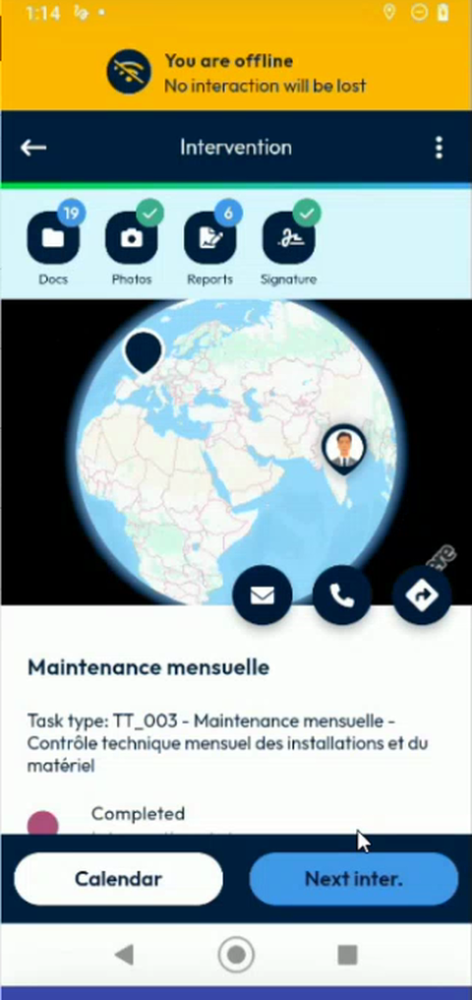<figcaption>
Intervention completed offline
</figcaption></figure>

## Send the data when you have a network

1. When your device is connected again, go back to the dashboard.
2. Tap the synchronization icon. The message **Synchronization in progress** is displayed.

<figure>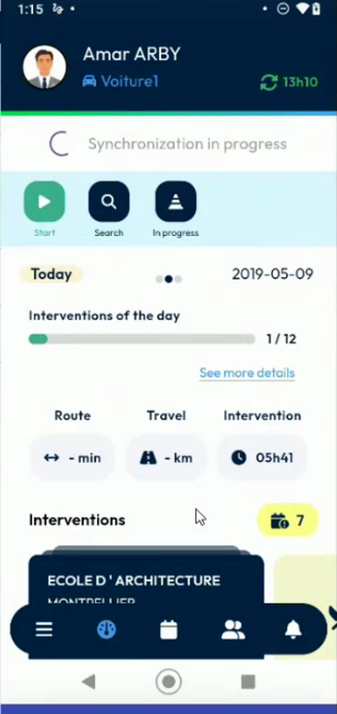<figcaption>
Synchronization in progress
</figcaption></figure>

3. Wait for **Synchronization successful**.

<figure>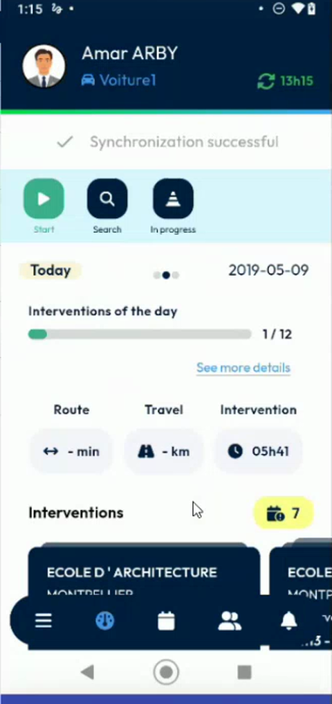<figcaption>
Synchronization successful
</figcaption></figure>


The data that you entered offline is sent to NFS only when you synchronize. Do not clear the cache before you synchronize. See [Refresh Your Data](../main-actions/refresh-your-data.md).


In NFS, the appointment is **Completed** and the answers of each survey form are saved, with the latest values that you entered.

<!-- REVIEW: the team asked to go back directly to the list of reports after a form is completed, without the thank-you page. Confirm whether this was done. The mandatory flag of the questions is not sent to the app yet, according to the presenter. Confirm the behavior of the synchronization after a long offline period and whether the intervention list is also updated. -->

## Related topics

* [Fill in the Report](report.md)
* [Start an Intervention](start-an-intervention.md)
* [Refresh Your Data](../main-actions/refresh-your-data.md)
* [Finish an Intervention](finish-an-intervention.md)
