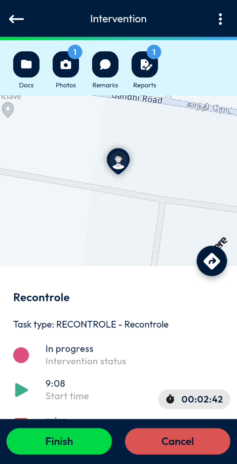
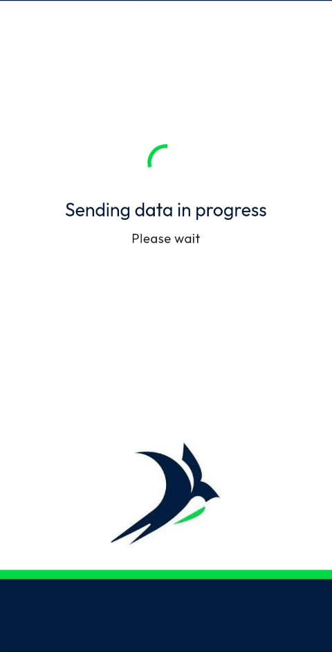
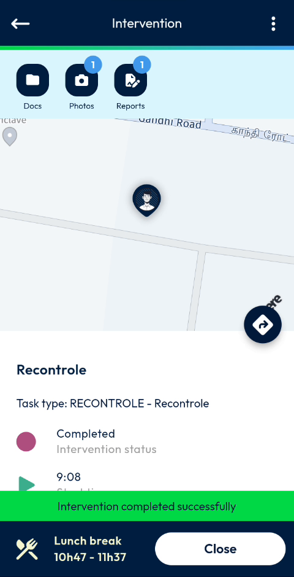

# Finish an Intervention

Finish the intervention and send your data to NFS.

## Overview

When your work is done, finish the intervention. NFS Mobile sends your report, photos and remarks, and the status of the intervention changes to **Completed**.

## Before you begin

* The intervention is in progress.
* You have filled in the mandatory fields of the [report](report.md).

## Finish the intervention

1. On the **Intervention** page, check the shortcuts: a number shows the photos and reports you have added.
2. Tap **Finish**.

<figure><figcaption>
Intervention ready to be finished
</figcaption></figure>

3. Wait while the message **Sending data in progress – Please wait** is displayed.

<figure><figcaption>
Sending data in progress
</figcaption></figure>

4. The message **Intervention completed successfully** is displayed. The status of the intervention is now **Completed**.

<figure><figcaption>
Intervention completed
</figcaption></figure>

At the bottom of the screen, the app shows what follows in your agenda, for example **Lunch break 10h47 - 11h37**.

5. Tap **Close** to leave the intervention.


Do not close the app while the data is being sent.


<!-- REVIEW: confirm what Cancel does on the Intervention page, what happens when there is no network while sending, and where Close leads. -->

## Related topics

* [Start an Intervention](start-an-intervention.md)
* [Fill in the Report](report.md)
* [Add Photos and Remarks](photos-and-remarks.md)
