# Mandatory Fields and Drop-Down Lists on Items

Choose a value in a drop-down list, and fill in the mandatory fields of the items that you used.

## Overview

The extra fields of an item now support two more behaviors:

* A **drop-down list**: the field offers a list of values to choose from.
* **Mandatory fields**: a red asterisk marks a field that you must fill in. The app does not let you finish the intervention until the fields of the items that you used are filled in.

Your administrator sets these behaviors. See [Extra Item Fields Setup](../configuration/extra-item-fields-setup.md#drop-down-lists-and-mandatory-fields). For the other field types, see [View and Edit the Extra Fields of an Item](edit-extra-item-fields.md).

## Before you begin

* You have started the intervention. You can edit the fields only after the start. See [Start an Intervention](start-an-intervention.md).
* The intervention has items, with extra fields. See [Add Items to an Intervention](add-items-to-an-intervention.md).

## Recognize a mandatory field

1. On the **Intervention** page, tap **Items**, then tap an item.
2. On the **Details** page, look at the labels of the extra fields. A red asterisk (*) after the label marks a mandatory field, for example **Logical 3***.

<figure>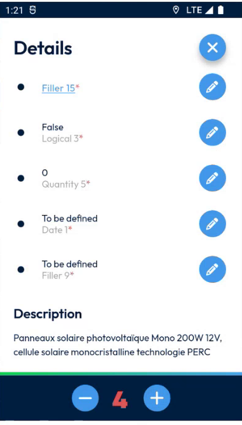<figcaption>
Mandatory extra fields
</figcaption></figure>

The **Serial number** of an item can also be mandatory. See [Scan or Enter a Serial Number](scan-a-serial-number.md).

<figure>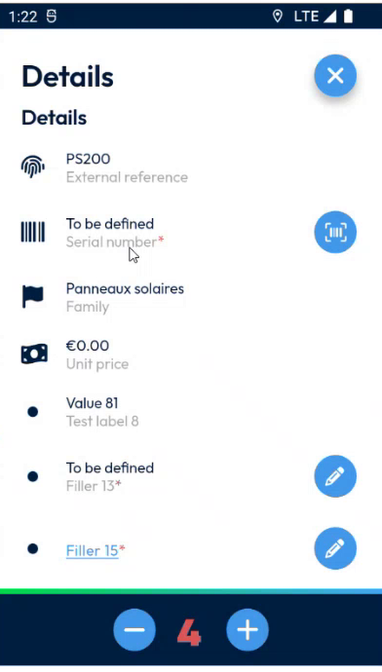<figcaption>
Mandatory serial number
</figcaption></figure>

## Choose a value in a drop-down list

1. Tap the pencil icon of the field, for example **Filler 9**.
2. On the **Modify information** page, tap **Choose a value**.

<figure>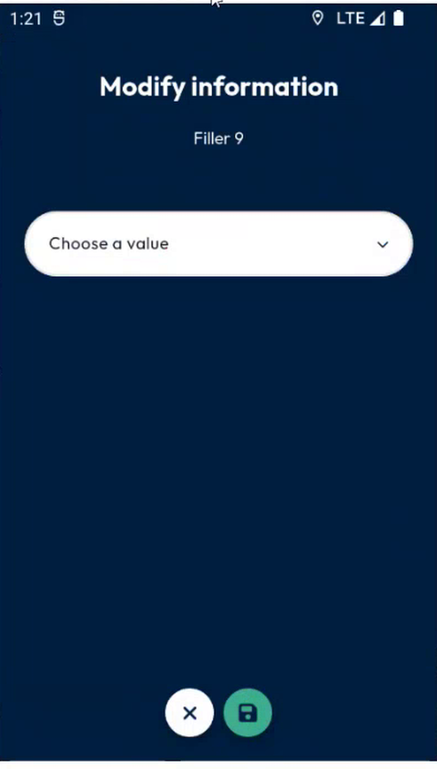<figcaption>
Drop-down field
</figcaption></figure>

3. Select a value in the list, for example **Option 2**.

<figure>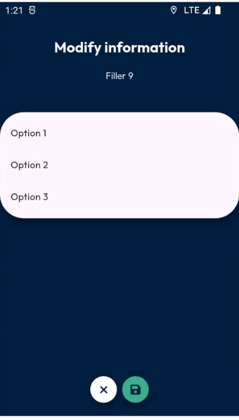<figcaption>
List of values
</figcaption></figure>

4. Tap the green save button.
5. The **Details** page shows the value that you chose.

<figure><figcaption>
Value selected
</figcaption></figure>

## Fill in the other fields

Enter a value in each mandatory field, as for the other types of fields.

* A text field: type the text.

<figure>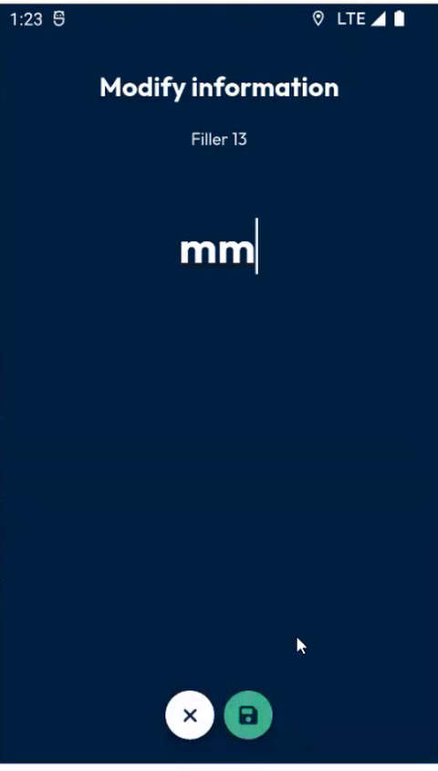<figcaption>
Text field
</figcaption></figure>

* A link field: type the address of the link.

<figure>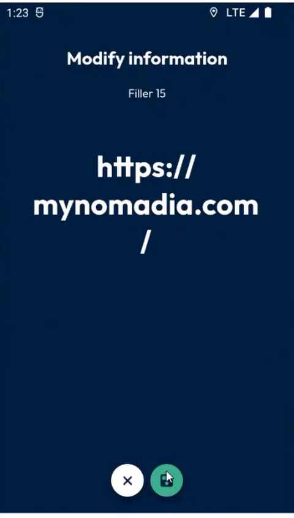<figcaption>
Link field
</figcaption></figure>

* A date field: select the date, then tap **Ok**.

<figure>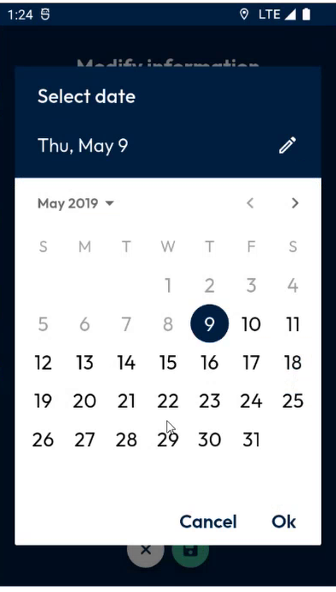<figcaption>
Date field
</figcaption></figure>

* The serial number: scan a code, or tap the keyboard button to type it. You can edit or remove it afterwards.

<figure><figcaption>
Serial number entry
</figcaption></figure>

<figure>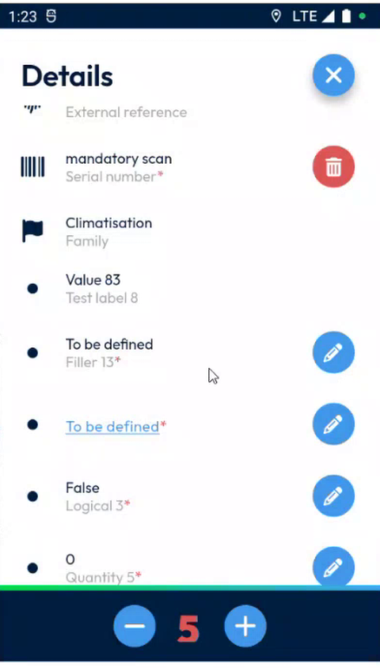<figcaption>
Serial number saved
</figcaption></figure>

## If a mandatory field is empty

1. On the **Intervention** page, tap **Finish**.
2. If a mandatory field of an item that you used is empty, the message **Items – Please fill in all required fields for the items used** is displayed.

<figure>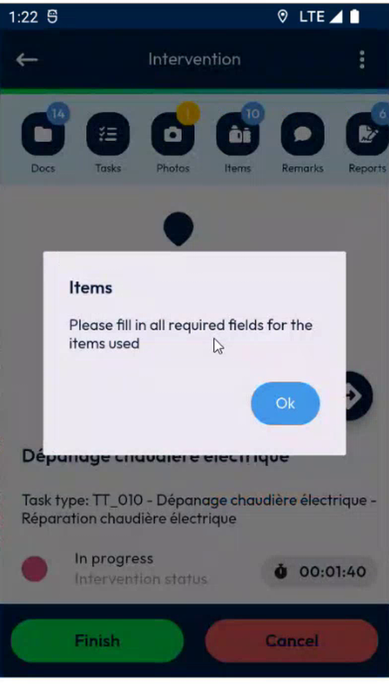<figcaption>
Message when mandatory fields are empty
</figcaption></figure>

3. Tap **Ok**.
4. Fill in the missing fields, then tap **Finish** again.

## Only the items that you used are checked

The check applies only to the items that you **used**, which means that their quantity is not zero. An item with a quantity of **0** is planned but not used, so its mandatory fields can stay empty.

In the example, the planned items are set to **0**, and only the item that was used is checked.

<figure>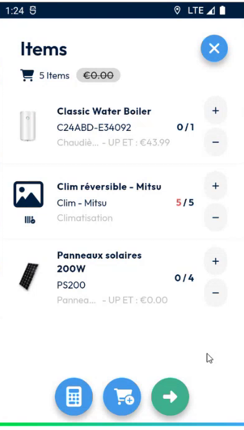<figcaption>
Items with a quantity of 0 are not checked
</figcaption></figure>

## Finish the intervention

When all the mandatory fields of the items that you used are filled in:

1. Tap **Finish**. Take the required photos and sign, if your company requires them.
2. In **Complete the intervention**, tap **Confirm**.

<figure>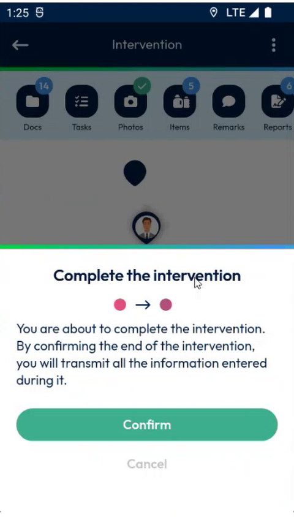<figcaption>
Complete the intervention
</figcaption></figure>

In NFS, the values of the fields appear in the product list for the items that you used.

<!-- REVIEW: at the end of the demo, the request to NFS failed for another status update, but the values of the mandatory fields were updated for the used item. The presenter planned to check the cause. Confirm the behavior when a request fails, and whether the check also applies to items added from the catalogue. -->

## Related topics

* [View and Edit the Extra Fields of an Item](edit-extra-item-fields.md)
* [Scan or Enter a Serial Number](scan-a-serial-number.md)
* [Extra Item Fields Setup](../configuration/extra-item-fields-setup.md)
* [Finish an Intervention](finish-an-intervention.md)
