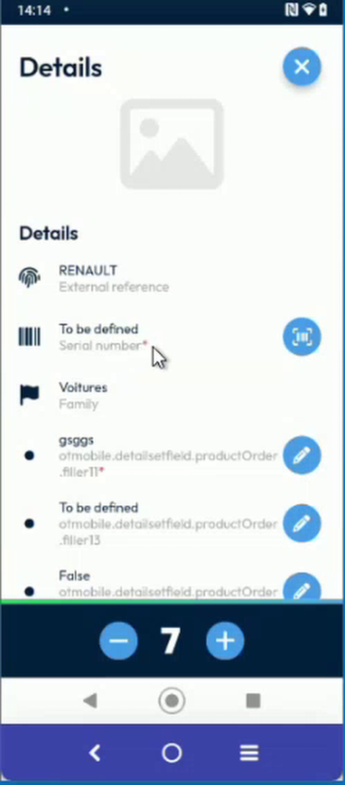
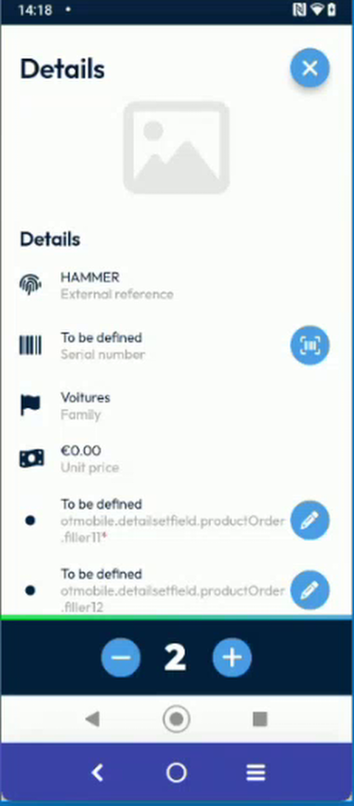
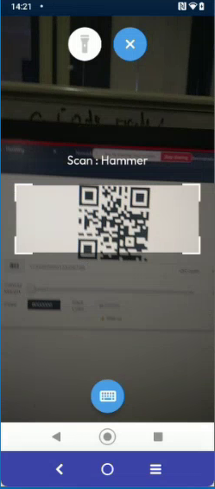
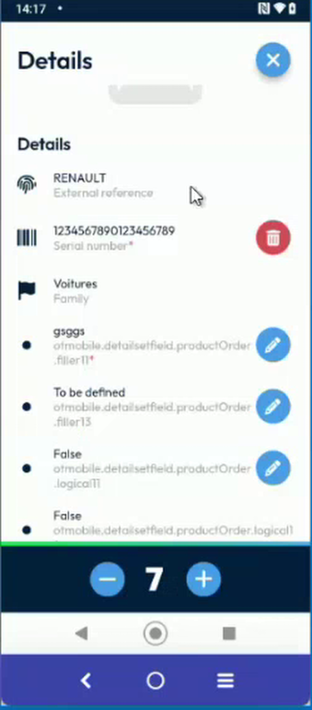
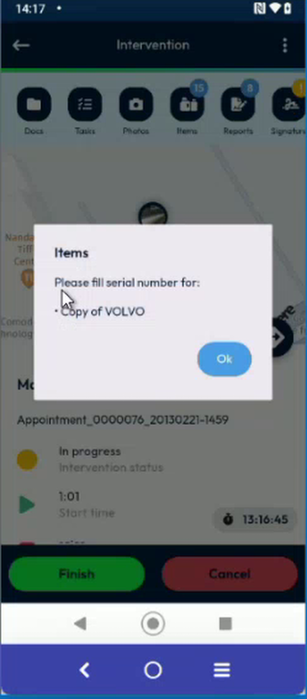
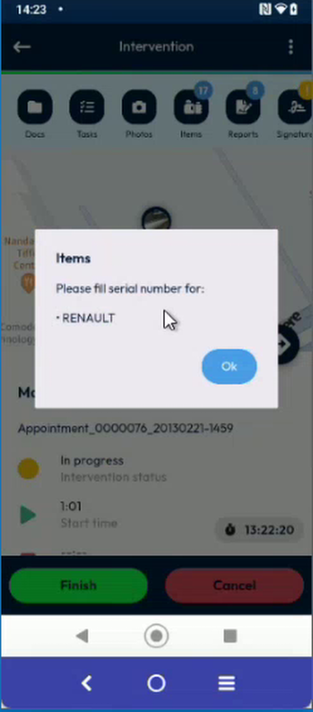
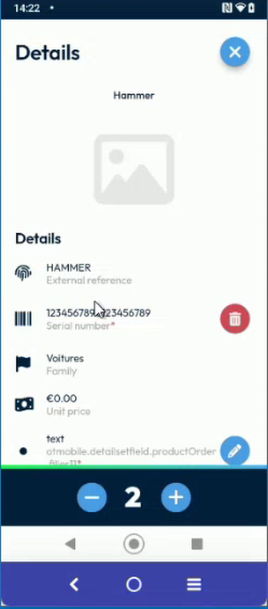
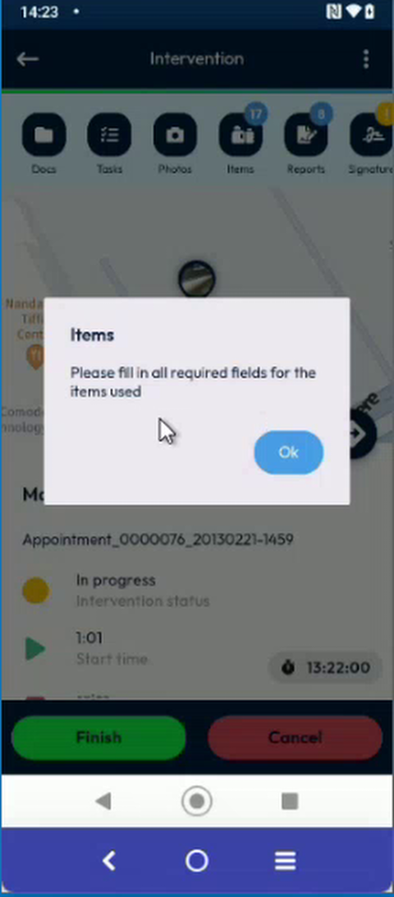

# Scan the Mandatory Serial Numbers

Scan the serial number of each item that your company marks as mandatory, before you finish the intervention.

## Overview

Your company can decide that the serial number of an item is **mandatory**. The app marks the field with a red asterisk (*). It does not let you finish the intervention until the serial number of each mandatory item is recorded. The rule can be different for each product: a product can require a serial number while another product does not.

## Before you begin

* You have started the intervention. See [Start an Intervention](start-an-intervention.md).
* Your administrator has set the serial numbers as mandatory. See [Mandatory Serial Number Setup](../configuration/mandatory-serial-number-setup.md).
* You have logged out and logged in again after your administrator changed the setting.
* The app is allowed to use the camera of your device.

## Recognize a mandatory serial number

1. On the **Intervention** page, tap **Items**, then tap an item.
2. On the **Details** page, look at the **Serial number** field.
   * A red asterisk (*) after the label means that the serial number is mandatory.
   * No asterisk means that you can finish the intervention without it.

<figure><figcaption>
Serial number with an asterisk: mandatory
</figcaption></figure>

<figure><figcaption>
Serial number without an asterisk: optional
</figcaption></figure>

## Record the serial number

1. Tap the scan button at the right of the **Serial number** field.
2. Point the camera at the barcode or the QR code. The title of the camera shows the name of the item, for example **Scan : Hammer**.

<figure><figcaption>
Scan the serial number
</figcaption></figure>

3. When the code is read, the **Details** page shows it in the **Serial number** field, with a red delete button at its right.

<figure><figcaption>
Serial number recorded
</figcaption></figure>

To type the number instead, or to scan a restricted code, see [Scan or Enter a Serial Number](scan-a-serial-number.md) and [Accept Only Valid Scan Codes](valid-scan-codes.md).

## If a serial number is missing

1. On the **Intervention** page, tap **Finish**.
2. If a serial number is missing, the message **Items – Please fill serial number for:** is displayed. It lists the items that still need one, for example **Copy of VOLVO**.

<figure><figcaption>
Message that lists the items to scan
</figcaption></figure>

3. Tap **Ok**.
4. Open each listed item and record its serial number. Then tap **Finish** again.

If several items are missing, the message lists them all.

<figure><figcaption>
Message for another item
</figcaption></figure>

## Items that you add yourself

An item that you add from the catalogue follows the rule of the setting for the serial number field. If its serial number field is mandatory, the app also asks for it.

<figure><figcaption>
Item added from the catalogue
</figcaption></figure>

If another mandatory field of an item that you used is empty, the message **Items – Please fill in all required fields for the items used** is displayed. See [Mandatory Fields and Drop-Down Lists on Items](mandatory-and-list-item-fields.md).

<figure><figcaption>
Message when other mandatory fields are empty
</figcaption></figure>


The check is for the items that you used. An item with a quantity of **0** is not checked. See [Mandatory Fields and Drop-Down Lists on Items](mandatory-and-list-item-fields.md#only-the-items-that-you-used-are-checked).


<!-- REVIEW: the team agreed to improve the message "Please fill in all required fields for the items used" so that it names the product and the field that are missing, as the serial number message does. Update this page when it is done. Confirm also whether a product that you added from the catalogue follows the serial number rule or only the rule of the dedicated filler. -->

## Related topics

* [Scan or Enter a Serial Number](scan-a-serial-number.md)
* [Mandatory Fields and Drop-Down Lists on Items](mandatory-and-list-item-fields.md)
* [Accept Only Valid Scan Codes](valid-scan-codes.md)
* [Mandatory Serial Number Setup](../configuration/mandatory-serial-number-setup.md)
* [Finish an Intervention](finish-an-intervention.md)
