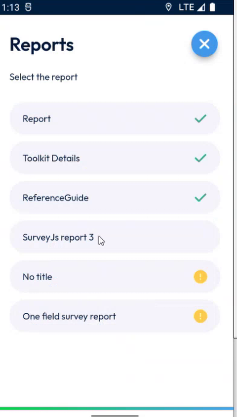
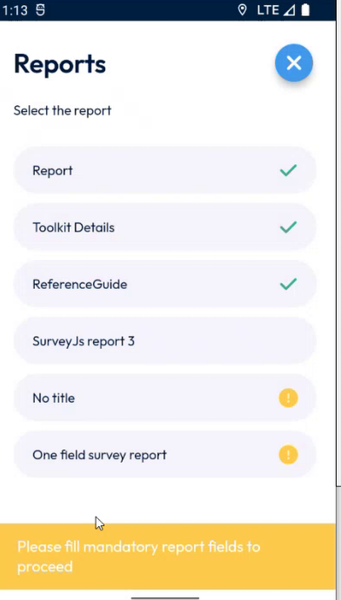
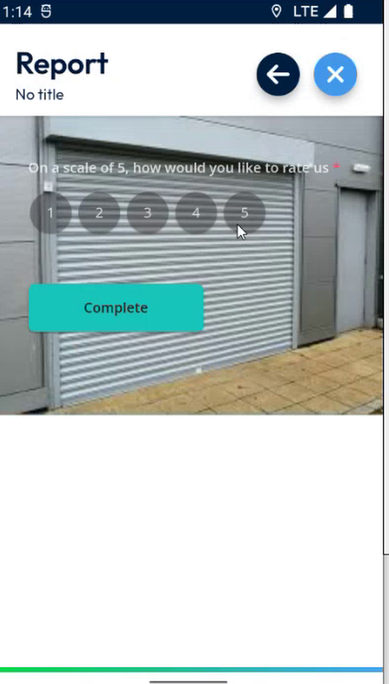
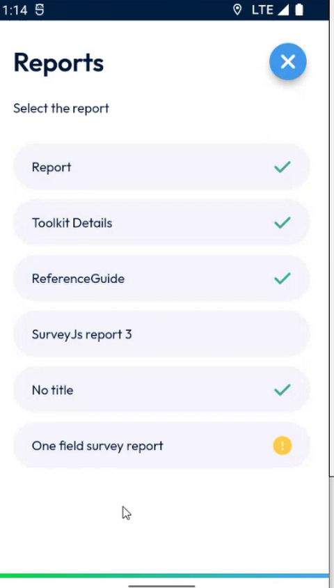
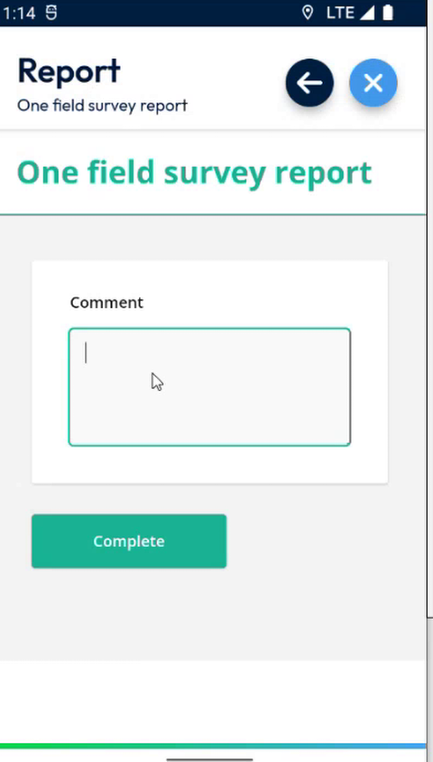
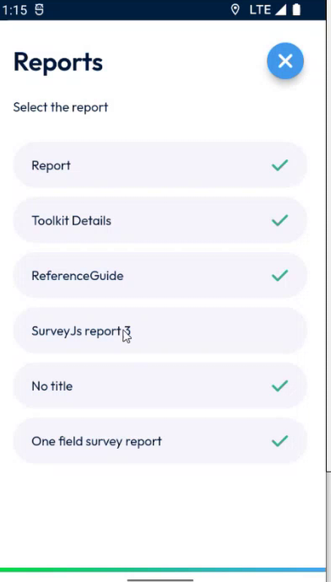
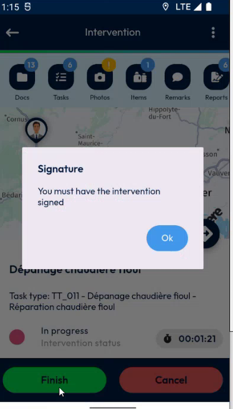
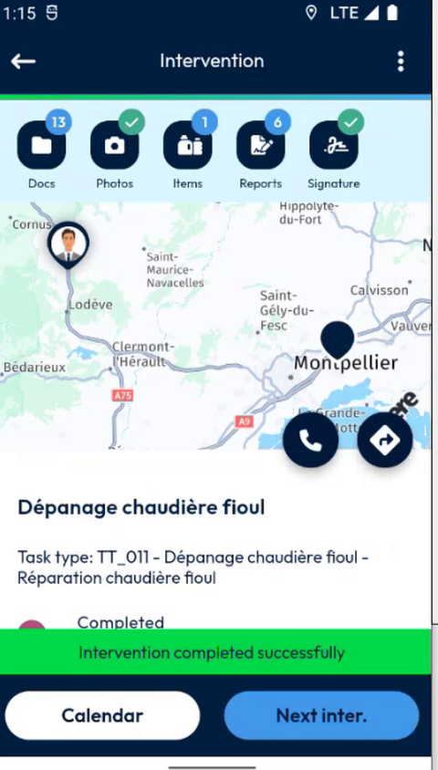

# Complete the Mandatory Survey Reports

Fill in the survey reports that your company requires before you can finish an intervention.

## Overview

Your company can decide that some survey reports are **mandatory**. The app marks them in the list of reports, and it does not let you finish the intervention until you complete them. A report that is not mandatory can stay empty.

When you complete a survey report, the app now returns to the list of reports at once.

## Before you begin

* Your administrator has marked the reports as mandatory. See [Mandatory Reports Setup](../configuration/mandatory-reports-setup.md).
* Your reports are in your device. Refresh your data if needed. See [Refresh Your Data](../main-actions/refresh-your-data.md).

## Recognize the mandatory reports

1. On the **Intervention** page, tap **Reports**.
2. In **Select the report**, look at the end of each line:
   * An **orange circle** marks a mandatory report that is not completed yet.
   * A **check mark** marks a report that is completed.
   * A report with no mark is not mandatory and not completed.

<figure><figcaption>
List of reports. The orange circles mark the mandatory reports.
</figcaption></figure>


The list shows only the reports that apply to the type of your intervention. In the example, the intervention is not an installation, so it shows three survey reports and not the reports of the installation group.


## If a mandatory report is missing

1. Tap **Finish**.
2. If a mandatory report is not completed, the message **Please fill mandatory report fields to proceed** is displayed in orange at the bottom of the screen.

<figure><figcaption>
Message when a mandatory report is missing
</figcaption></figure>

3. Complete the mandatory reports, as described below.

## Complete a survey report

1. In the list of reports, tap a mandatory report, for example **No title**.
2. Answer the questions.

<figure><figcaption>
Survey report
</figcaption></figure>

3. Tap **Complete**.
4. The app goes back to the list of reports. A check mark replaces the orange circle.

<figure><figcaption>
One mandatory report completed
</figcaption></figure>

5. Repeat the steps for the other mandatory reports, for example **One field survey report**.

<figure><figcaption>
Survey report with one field
</figcaption></figure>

When all the mandatory reports have a check mark, you can finish the intervention. A report that is not mandatory can stay empty.

<figure><figcaption>
All mandatory reports completed
</figcaption></figure>

## Finish the intervention

The other conditions of your company still apply, for example the signature and the photos.

1. Tap **Finish**.
2. If the signature is mandatory, the message **You must have the intervention signed** is displayed. Tap **Ok**, then sign. See [Sign an Intervention](sign-an-intervention/README.md).

<figure><figcaption>
Signature required
</figcaption></figure>

3. Take the required photos. See [Take the Required Photos](required-photos.md).
4. Tap **Finish**, then confirm.
5. The message **Intervention completed successfully** is displayed.

<figure><figcaption>
Intervention completed
</figcaption></figure>

In NFS, refresh the appointment to see the answers of the mandatory reports.


The mandatory survey reports also work offline. See [Fill In Survey Forms Offline](fill-in-forms-offline.md).


<!-- REVIEW: confirm the meaning of the orange circle (mandatory and not completed) and of the check mark, and whether a mandatory report that is only partly filled is still marked orange. -->

## Related topics

* [Fill in the Report](report.md)
* [Fill In Survey Forms Offline](fill-in-forms-offline.md)
* [Finish an Intervention](finish-an-intervention.md)
* [Mandatory Reports Setup](../configuration/mandatory-reports-setup.md)
