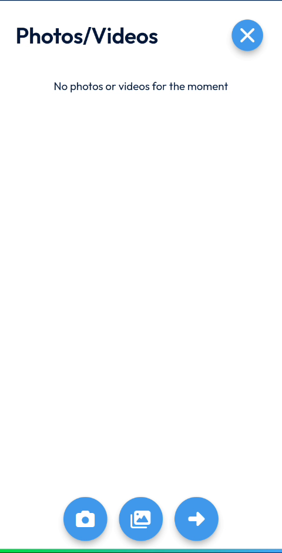
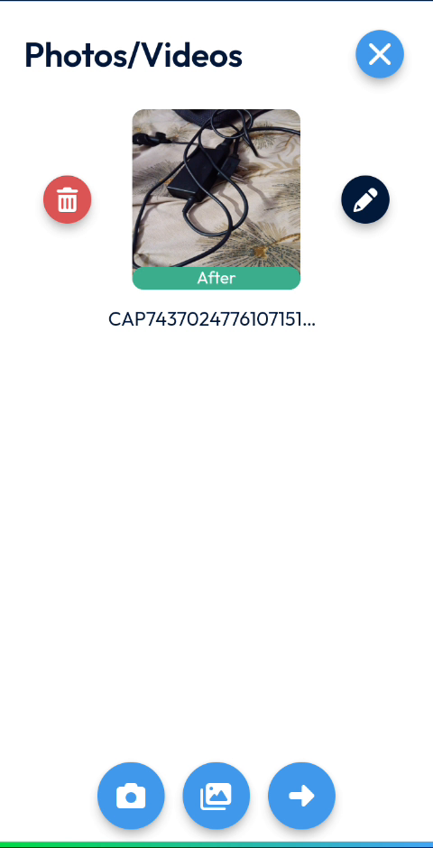
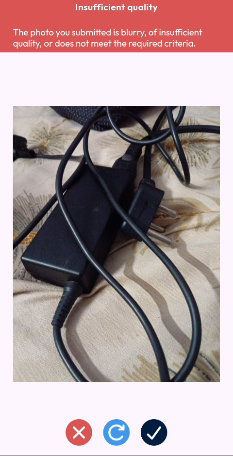
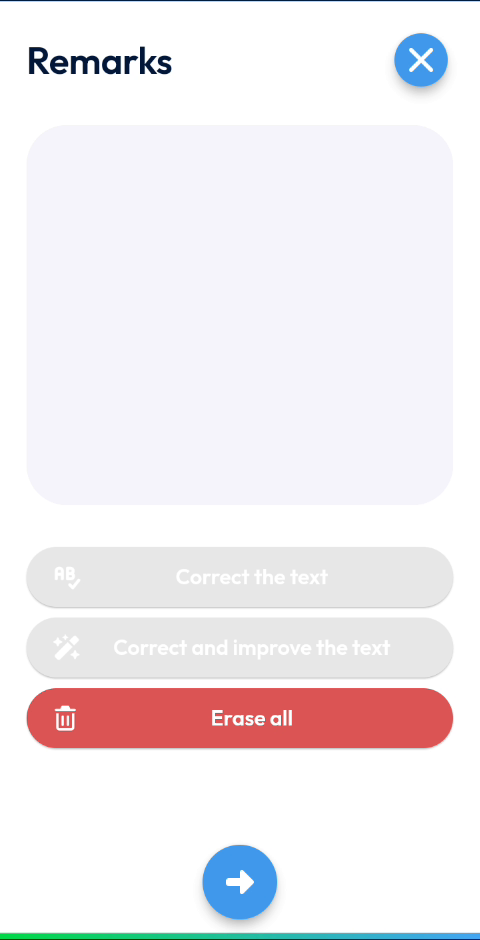

# Add Photos and Remarks

Add photos and remarks to an intervention in progress.

## Overview

You can add photos to document your work and write remarks about the intervention. A number on the **Photos** shortcut shows how many photos the intervention contains.

## Before you begin

* The intervention is in progress. See [Start an Intervention](start-an-intervention.md).
* The app is allowed to use the camera of your device.

## Add a photo

1. On the **Intervention** page, tap **Photos**.
2. The **Photos/Videos** page opens. If there is no photo yet, the message **No photos or videos for the moment** is displayed.
3. Tap the camera button at the bottom of the screen.
4. Take the photo.
5. Check the photo, then tap the check mark to keep it. Tap the red cross to delete it, or the blue arrow to take it again.

<figure><figcaption>
Photos/Videos page
</figcaption></figure>

The photo appears on the **Photos/Videos** page with a label, for example **After**, and its file name.

<figure><figcaption>
Photo added to the intervention
</figcaption></figure>

On the **Photos/Videos** page, you can also:

* Tap the middle button at the bottom of the screen to add a photo from your gallery.
* Tap the red bin icon next to a photo to delete it.
* Tap the pencil icon next to a photo to edit it.
* Tap the arrow button to continue.
* Tap the cross at the top right to close the page.

<!-- REVIEW: confirm the function of the arrow button, the pencil icon and the labels such as After. Confirm whether videos can be added. -->

### If the photo is rejected

If the photo is too blurry, the message **Insufficient quality** is displayed at the top of the screen: **The photo you submitted is blurry, of insufficient quality, or does not meet the required criteria.**

<figure><figcaption>
Insufficient quality message
</figcaption></figure>

1. Tap the retake button, in the middle, to take the photo again.
2. Tap the check mark to keep the new photo.

## Write remarks

1. On the **Intervention** page, tap **Remarks**.
2. In the **Remarks** page, enter your remarks in the text area.
3. To correct the spelling of your text, tap **Correct the text**.
4. To correct and improve your text, tap **Correct and improve the text**.
5. To delete your text, tap **Erase all**.
6. Tap the arrow button at the bottom of the screen to continue.

<figure><figcaption>
Remarks page
</figcaption></figure>

<!-- REVIEW: the video does not show text being entered in Remarks. Confirm how the correction buttons work (they are grayed out while the text area is empty). -->

## Next steps

* [Finish an Intervention](finish-an-intervention.md)

## Related topics

* [Fill in the Report](report.md)
