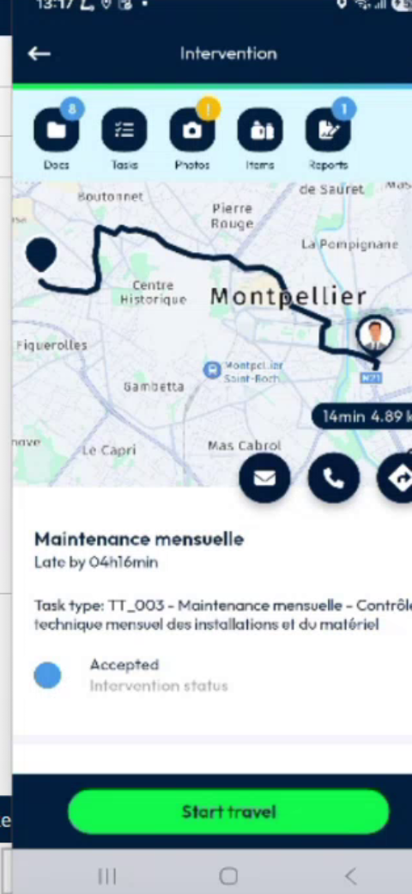
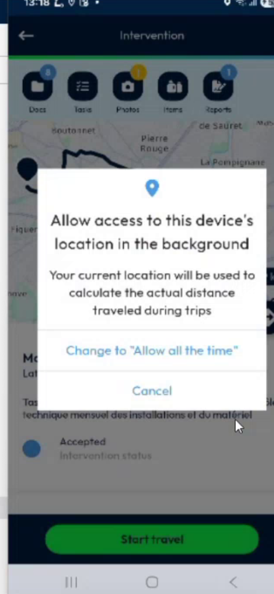
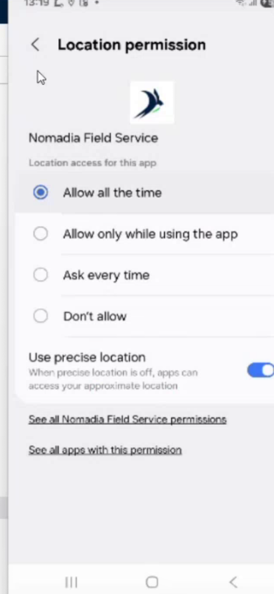
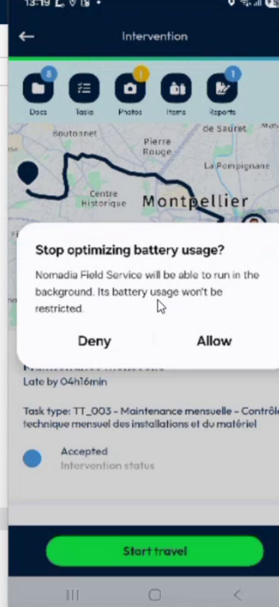
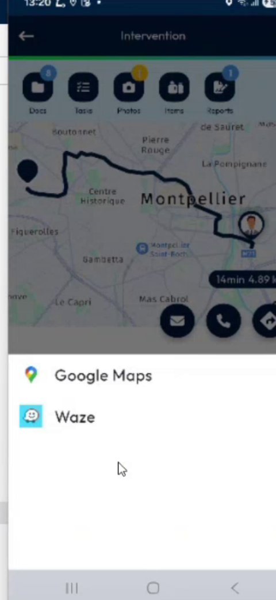
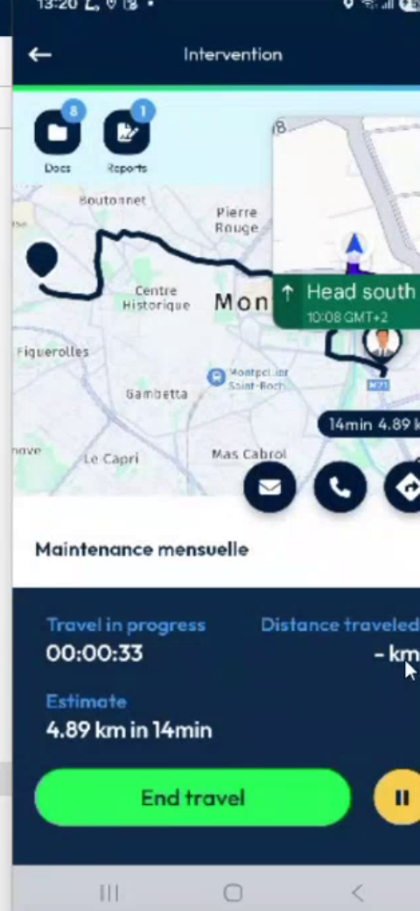
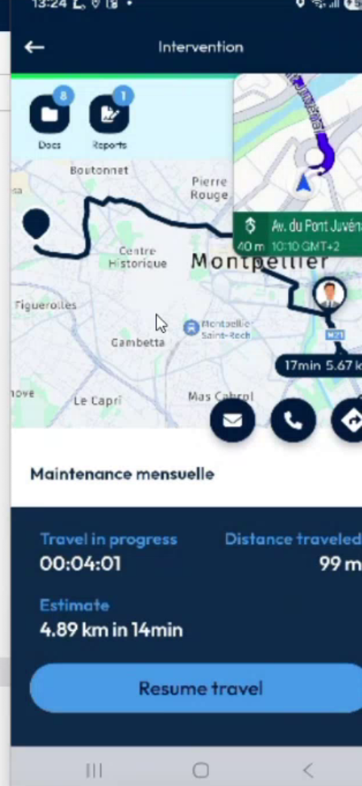
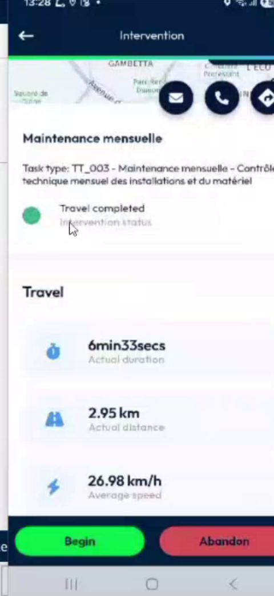
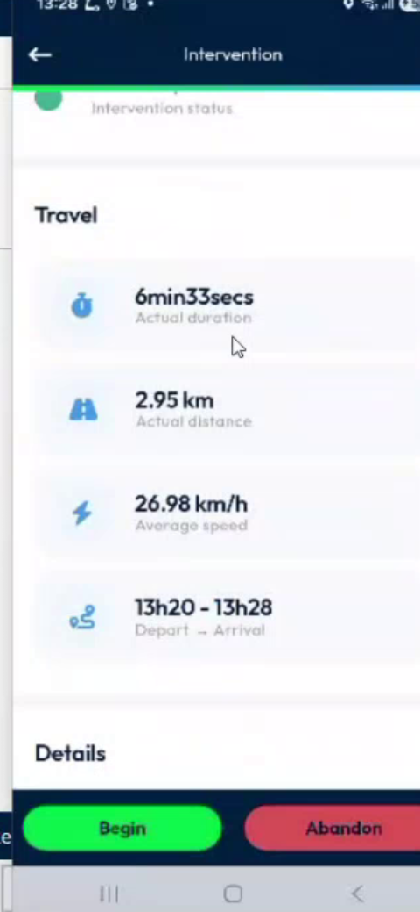
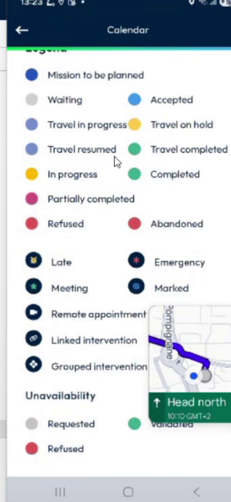

# Record a Mission Travel

## Overview

After you accept an intervention, you can record your travel to it. The app measures the time and the distance of the trip, while you navigate with another application such as Google Maps or Waze. The trip, with its pauses, is sent to the back office.

## Before you begin

* You accepted the intervention.
* Your administrator turned on the recording of the trips. Otherwise the **Start travel** button is not displayed. See [Mission Travel Setup](../configuration/mission-travel-setup.md).
* A navigation application is installed on your device.

## Start the travel

1. Open the intervention and accept it. See [Start an Intervention](start-an-intervention.md).
2. Tap **Start travel**, the button at the bottom of the screen.

<figure><figcaption>
Start travel button
</figcaption></figure>

3. The app asks for the access to your location in the background. Tap **Change to "Allow all the time"**.

<figure><figcaption>
Location permission message
</figcaption></figure>

4. In the settings of your device, choose **Allow all the time**, then return to the app.

<figure><figcaption>
Allow all the time
</figcaption></figure>

5. If the app asks to send you notifications, tap **Allow**.
6. When the question **Stop optimizing battery usage?** is displayed, tap **Allow**. The app can then measure your trip while it is in the background.

<figure><figcaption>
Battery optimization question
</figcaption></figure>

7. Choose the navigation application, for example **Google Maps** or **Waze**.

<figure><figcaption>
Navigation applications
</figcaption></figure>

8. The navigation application opens. Start your navigation there.


The travel starts only when you choose a navigation application. If you close the list without choosing, nothing happens. The app cannot read the distance and the time from the navigation application, so it measures them itself with the location of your device.


## Follow the travel

Return to NFS Mobile. The intervention shows the status **Travel in progress**, the time travelled, the distance travelled and the estimate, for example **4.89 km in 14min**. If the estimate fails, it shows a dash.

<figure><figcaption>
Travel in progress
</figcaption></figure>

You can use the other tabs of the app and go back to the home page while you travel.

## Pause and resume the travel

1. Tap the pause button, at the right of **End travel**. The status becomes **Travel on hold**.
2. When you want to go on, tap **Resume travel**. The status becomes **Travel resumed**.

<figure><figcaption>
Resume travel button
</figcaption></figure>

You can pause and resume as many times as you need.

## End the travel

1. When you arrive, return to NFS Mobile.
2. Tap **End travel**. The status becomes **Travel completed**, and the buttons of the intervention, for example **Begin** and **Abandon**, are displayed.

<figure><figcaption>
Travel completed
</figcaption></figure>

3. Scroll down to the **Travel** information:

| Information | Description |
| ----------- | ----------- |
| **Actual duration** | The time of the trip, without the pauses. |
| **Actual distance** | The distance that you travelled. |
| **Average speed** | The average speed of the trip. |
| **Depart - Arrival** | The times when the trip started and ended. |

<figure><figcaption>
Travel information
</figcaption></figure>


You cannot begin the intervention until you end the travel. The buttons **Begin** and **Abandon** stay hidden while the travel is in progress, on hold or resumed.


## Travel several interventions

You can start a travel for another intervention while the first travel is in progress, for example when two interventions are for the same customer. Each intervention has its own status.

## Travel statuses

The legend of the calendar explains the four statuses of a travel:

<figure><figcaption>
Legend of the calendar
</figcaption></figure>

| Status | Description |
| ------ | ----------- |
| **Travel in progress** | The travel started. |
| **Travel on hold** | You paused the travel. |
| **Travel resumed** | You resumed a paused travel. |
| **Travel completed** | You ended the travel. |

## In the back office

The status and the duration of the trip are updated in the back office when you start, pause, resume and end the travel. The appointment sheet shows the actual duration, rounded up to the minute, and the distance in meters. Each part of the trip, between a start or a resume and a pause or an end, is stored with its times.

<!-- REVIEW: confirm the names of the buttons and the statuses in each language, what happens to a travel that is not ended when the intervention is closed, and how the distance is displayed in miles. In the demo, the route is simulated, so the distance of the demo can jump. The team notes that a user who does not choose a navigation application gets no distance, and that a trip without navigation could still record the times in a later version. -->

## Next steps

* [Start an Intervention](start-an-intervention.md)

## Related topics

* [Start an Intervention](start-an-intervention.md)
* [Calendar](../main-actions/calendar.md)
* [Send Your Location Logs](../main-actions/send-location-logs.md)
* [Mission Travel Setup](../configuration/mission-travel-setup.md)