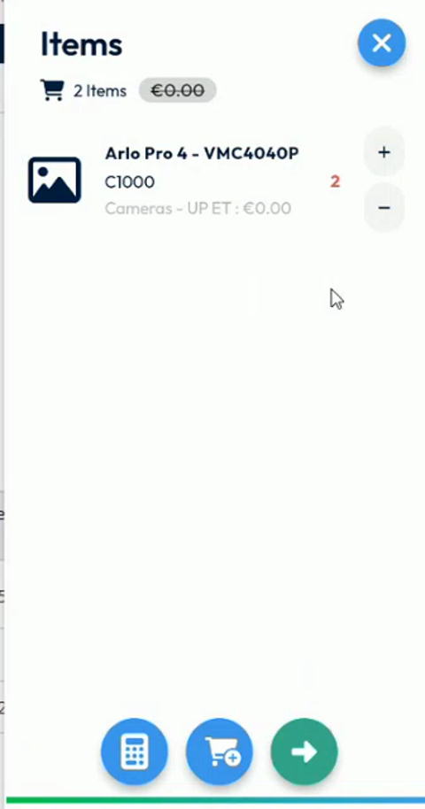
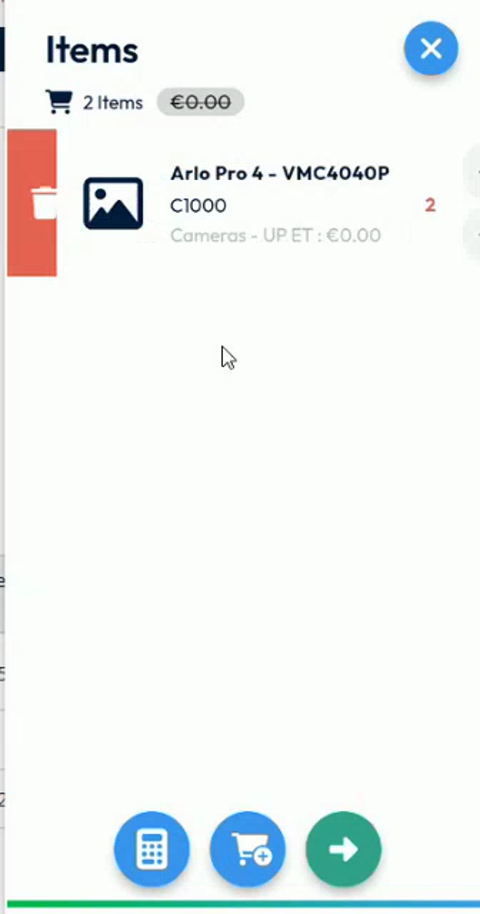
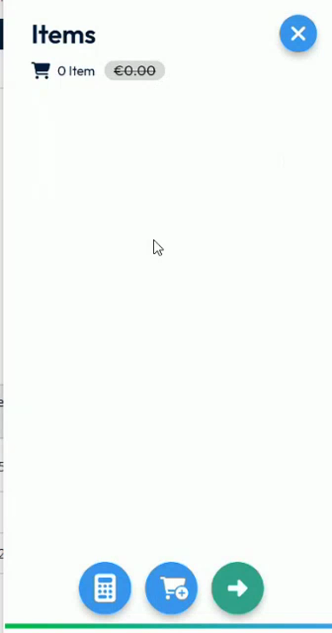

# Remove an Item

Swipe an item to remove it from the intervention.

## Overview

You can remove an item that you added by mistake, or that you did not use. You now remove it with a swipe. Before, you had to press the item for a long time.

## Before you begin

* You have opened the **Items** page of the intervention. See [Add Items to an Intervention](add-items-to-an-intervention.md#open-the-items-page).
* The intervention contains at least one item. To add one, see [Search the catalog](add-items-to-an-intervention.md#search-the-catalog).

<figure><figcaption>
Items page with one item
</figcaption></figure>

## Remove an item

1. On the **Items** page, put your finger on the item that you want to remove.
2. Swipe the item to the right. A red area with a trash icon appears at the left of the item.

<figure><figcaption>
Swiping an item to remove it
</figcaption></figure>

3. Release the item. It is removed from the list.
4. Check the counter at the top of the page. It shows the new number of items, for example **0 Item**.

<figure><figcaption>
Items page after the item is removed
</figcaption></figure>


To lower the quantity of an item without removing it, tap its minus button instead. See [Change the quantities](add-items-to-an-intervention.md#change-the-quantities).


<!-- REVIEW: the video shows the swipe and the result. Confirm the swipe direction, whether a confirmation message is displayed, and whether the removal can be undone. -->

## Related topics

* [Add Items to an Intervention](add-items-to-an-intervention.md)
* [View the Details of an Item](view-item-details.md)
