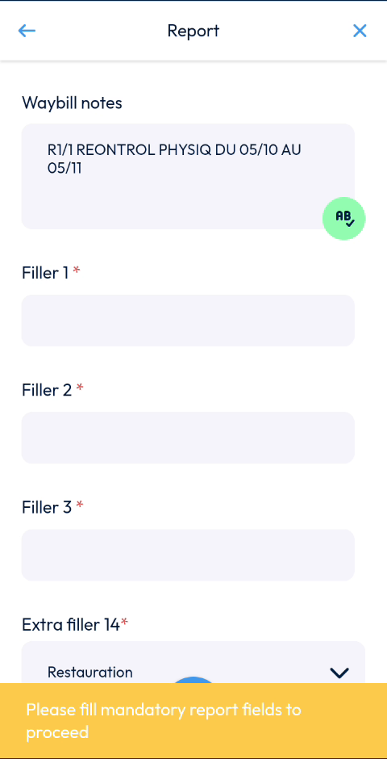
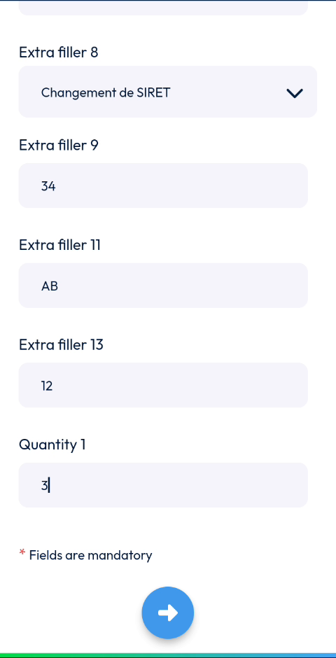
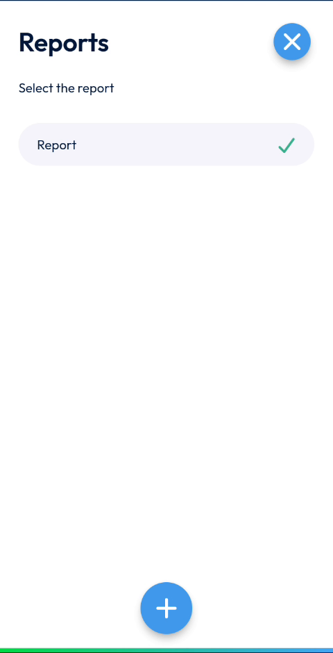

# Fill in the Report

Fill in the report of an intervention in progress.

## Overview

The report collects the information that your company needs about the intervention. Fields marked with an asterisk (*) are mandatory. You must fill in all mandatory fields before you can go on.

## Before you begin

* The intervention is in progress. See [Start an Intervention](start-an-intervention.md).

## Open the report

1. On the **Intervention** page, tap **Reports**.
2. The **Report** page opens.

<figure><figcaption>
Report page
</figcaption></figure>

If you tap the arrow button before all mandatory fields are filled, the message **Please fill mandatory report fields to proceed** is displayed.

## Fill in the report

1. In **Waybill notes**, check the text. It is filled in for you.
2. In each field marked with an asterisk, enter a value. In the video, the mandatory fields are **Filler 1**, **Filler 2**, **Filler 3**, **Extra filler 14** and **Extra filler 1**.
3. For a field with a list, tap the field and select a value in the list. For example, **Extra filler 14** offers **Restauration** and other categories, and **Extra filler 1** offers **A**, **B**, **C** and **D**.
4. For a switch such as **Logical 1**, tap it to turn it on or off.
5. Scroll down and fill in the other fields, for example **Filler 5**, **Extra filler 8**, **Extra filler 9**, **Extra filler 11**, **Extra filler 13** and **Quantity 1**.
6. Tap the arrow button at the bottom of the screen.

<figure><figcaption>
Report page with the fields filled in
</figcaption></figure>


Tap the **AB** button at the right of **Waybill notes** to correct the text of the field.


<!-- REVIEW: the fields in the report (Filler, Extra filler, Quantity) are configured by your company. Confirm the real names of the fields and which ones are mandatory. Also confirm the function of the AB button. -->

## Check the report

1. Return to the **Intervention** page. A number appears on the **Reports** shortcut.
2. To open your report again, tap **Reports**. The **Reports** page lists the reports and shows a check mark on the one you filled in.
3. To add another report, tap the plus button.

<figure><figcaption>
Reports page
</figcaption></figure>

## Next steps

* [Add Photos and Remarks](photos-and-remarks.md)
* [Finish an Intervention](finish-an-intervention.md)

## Related topics

* [Start an Intervention](start-an-intervention.md)
