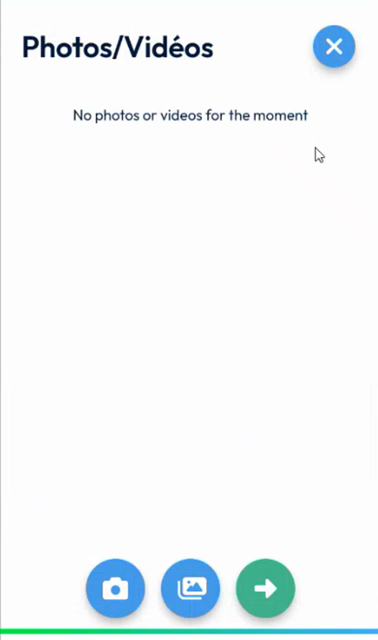
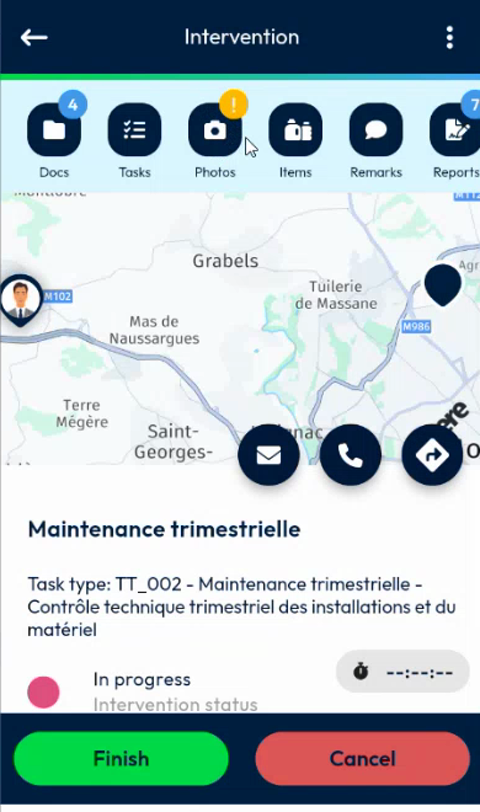
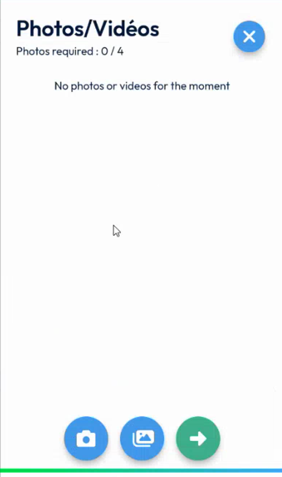
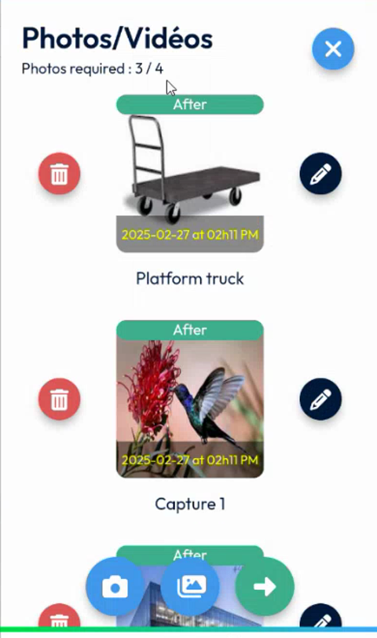
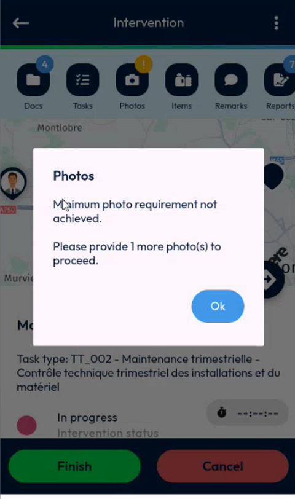
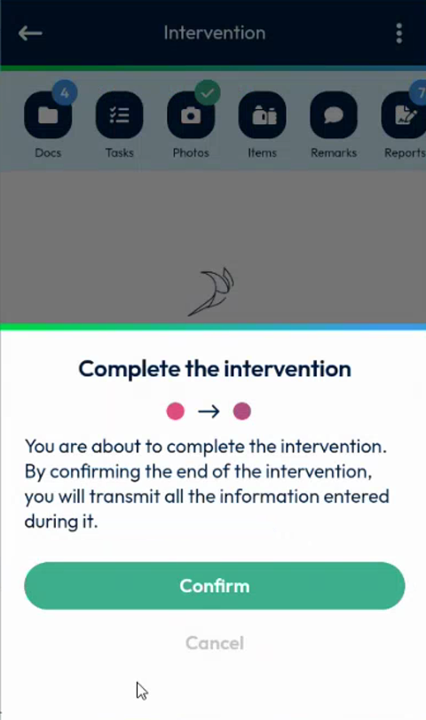

# Take the Required Photos

Take the minimum number of photos that your company requires before you finish an intervention.

## Overview

Your company can require a minimum number of photos for each intervention. When it does, the **Photos** shortcut shows an alert, the **Photos/Videos** page shows how many photos you have taken out of the number required, and the app blocks the end of the intervention until you reach the minimum.

By default, no photo is required. The number is set in the back office. See [Required Photos Setup](../configuration/required-photos-setup.md).

## Before you begin

* The intervention is in progress. See [Start an Intervention](start-an-intervention.md).
* You have logged out and logged in again after your administrator changed the number of required photos. The new value reaches your app at the next login.
* The app is allowed to use the camera of your device.

## When no photo is required

By default, the **Photos/Videos** page does not show a counter. You can finish the intervention without a photo.

<figure><figcaption>
Photos/Videos page when no photo is required
</figcaption></figure>

## Check the number of required photos

1. Open the intervention in progress. See [Start an Intervention](start-an-intervention.md#open-the-intervention).
2. On the **Intervention** page, look at the **Photos** shortcut. A yellow exclamation mark on the shortcut tells you that photos are mandatory.

<figure><figcaption>
Alert on the Photos shortcut
</figcaption></figure>

3. Tap **Photos**. The **Photos/Videos** page opens.
4. Read the counter under the title, for example **Photos required: 0 / 4**. The first number is the photos that you have taken and the second number is the photos required.

<figure><figcaption>
Photos required: 0 / 4
</figcaption></figure>

## Add the photos

1. At the bottom of the screen, tap the camera button to take a photo, or tap the gallery button to select images from your device.
2. If you use the gallery, you can select several images at once. The page shows the number selected, for example **2 selected**.
3. Confirm your choice. The photos appear in the list, each with its label, for example **After**.
4. Check the counter. It increases with each photo, for example **Photos required: 3 / 4**.

<figure><figcaption>
Photos required: 3 / 4
</figcaption></figure>

For the other actions of the page, see [Add Photos and Remarks](photos-and-remarks.md#add-a-photo).

## If you have not taken enough photos

1. Close the **Photos/Videos** page, then tap **Finish** on the **Intervention** page.
2. If you have not reached the minimum, the message **Photos** is displayed: **Minimum photo requirement not achieved. Please provide 1 more photo(s) to proceed.** The number tells you how many photos are missing.

<figure><figcaption>
Minimum photo requirement not achieved
</figcaption></figure>

3. Tap **Ok**.
4. Open **Photos** again and add the missing photos.

## Finish the intervention

1. Once the counter reaches the number required, close the **Photos/Videos** page. The **Photos** shortcut shows a green check mark instead of the alert.
2. Tap **Finish**.
3. In the **Complete the intervention** message, tap **Confirm**.

<figure><figcaption>
Complete the intervention message
</figcaption></figure>

You can take more photos than the minimum. In the demo, the counter shows **5 / 4** and the intervention can be finished.


The other conditions still apply. If the signature is mandatory, you must sign the intervention. If the report has mandatory fields, you must fill them in. See [Sign an Intervention](sign-an-intervention/README.md) and [Fill in the Report](report.md).


<!-- REVIEW: confirm that the alert and the counter appear only for interventions in progress, whether videos count as photos, and what happens to photos already taken before the setting was changed. The demo uses a requirement of 4 photos. -->

## Next steps

* [Finish an Intervention](finish-an-intervention.md)

## Related topics

* [Add Photos and Remarks](photos-and-remarks.md)
* [Required Photos Setup](../configuration/required-photos-setup.md)
