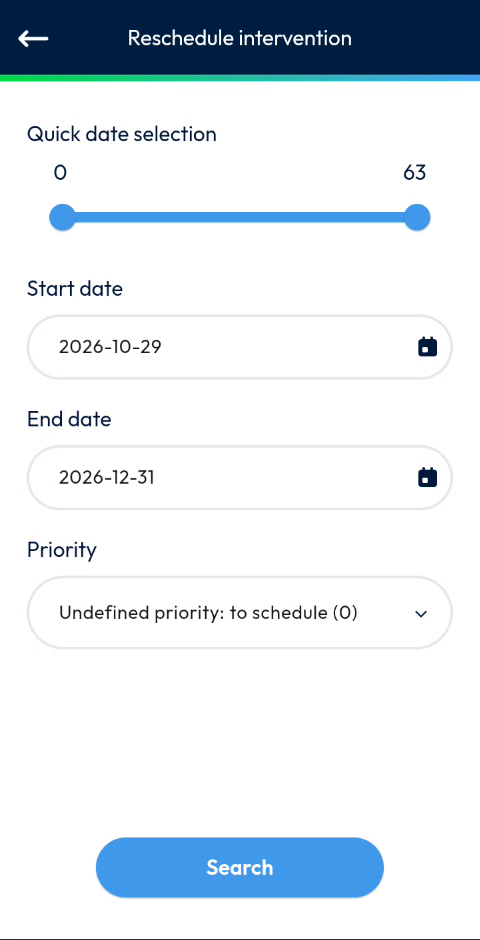
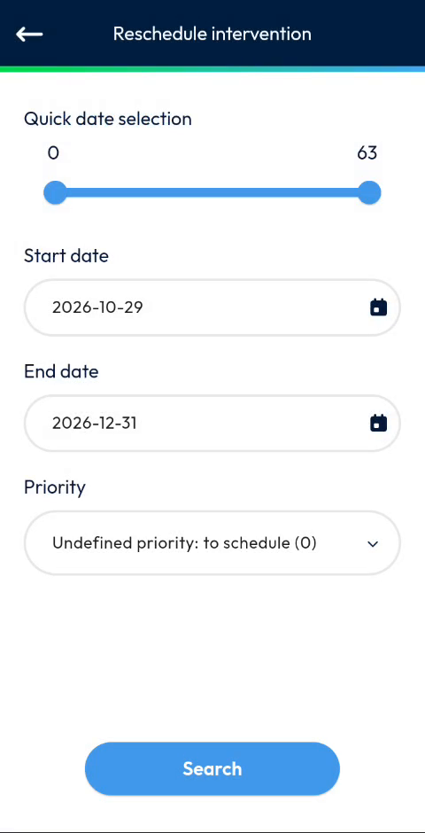
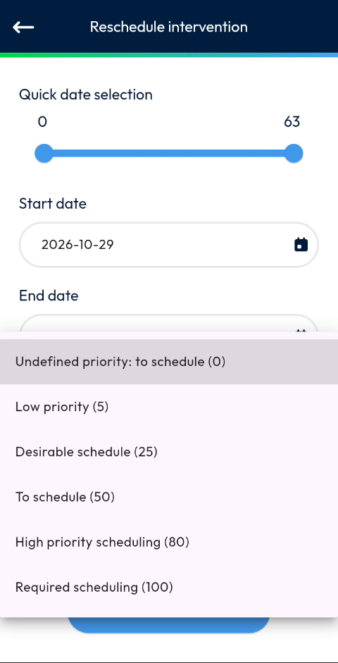
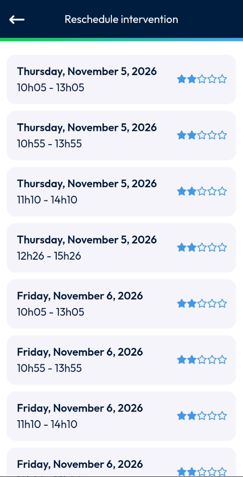
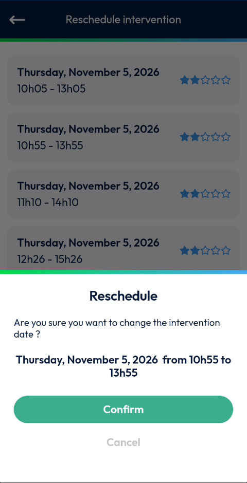
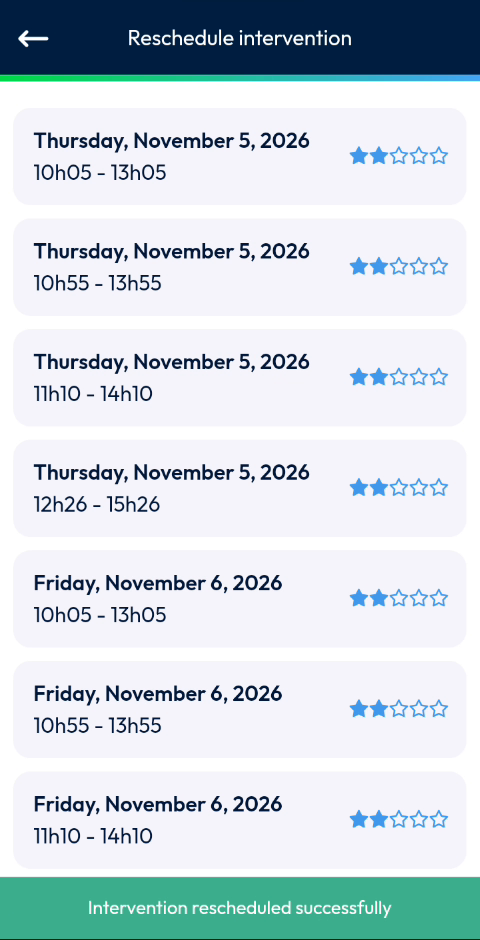

# Reschedule an Intervention

Move an intervention to another date and time.

## Overview

If you cannot carry out an intervention at the planned time, you can look for another slot and reschedule it. You choose a period and a priority, the app searches the available slots, and you select one.

## Before you begin

* The intervention is open. See [Start an Intervention](start-an-intervention.md#open-the-intervention).

## Open the Reschedule intervention page

1. At the top right of the **Intervention** page, tap the three-dot icon. The **Menu** opens.
2. Tap **Reschedule intervention**.
3. The **Reschedule intervention** page opens.

## Search for a slot

<figure><figcaption>
Reschedule intervention page
</figcaption></figure>

1. In **Quick date selection**, move the sliders to choose the period in days, from **0** to **63**.
2. In **Start date**, check the first date of the search. To change it, tap the calendar icon and select a date.

<figure><figcaption>
Select date window
</figcaption></figure>

3. In **End date**, check the last date of the search.
4. In **Priority**, tap the list and select a priority.

<figure><figcaption>
List of priorities
</figcaption></figure>

| Priority | Value |
| -------- | ----- |
| Undefined priority: to schedule | 0 |
| Low priority | 5 |
| Desirable schedule | 25 |
| To schedule | 50 |
| High priority scheduling | 80 |
| Required scheduling | 100 |

5. Tap **Search**.
6. Wait while the message **Searching slots** is displayed.

<!-- REVIEW: confirm how the sliders of Quick date selection relate to Start date and End date, and what the priority changes in the search. -->

## Choose a slot

1. In the list, find the slot that suits you. Each slot shows the date and the time range, for example **Thursday, November 5, 2026 - 10h55 - 13h55**, and a rating in stars.

<figure><figcaption>
List of slots
</figcaption></figure>

2. Tap the slot.
3. In the **Reschedule** message, read the question **Are you sure you want to change the intervention date?** and check the new date and time.

<figure><figcaption>
Reschedule confirmation message
</figcaption></figure>

4. Tap **Confirm**. To close the message without changing the date, tap **Cancel**.
5. Wait while the messages **Sending request in progress** and **Loading Data** are displayed.

The message **Intervention rescheduled successfully** is displayed.

<figure><figcaption>
Intervention rescheduled successfully
</figcaption></figure>

<!-- REVIEW: confirm the meaning of the stars next to each slot. -->

## Related topics

* [Create an Intervention](create-an-intervention/README.md)
* [Abandon an Intervention](abandon-an-intervention.md)
