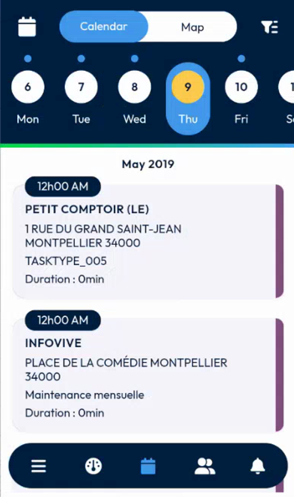
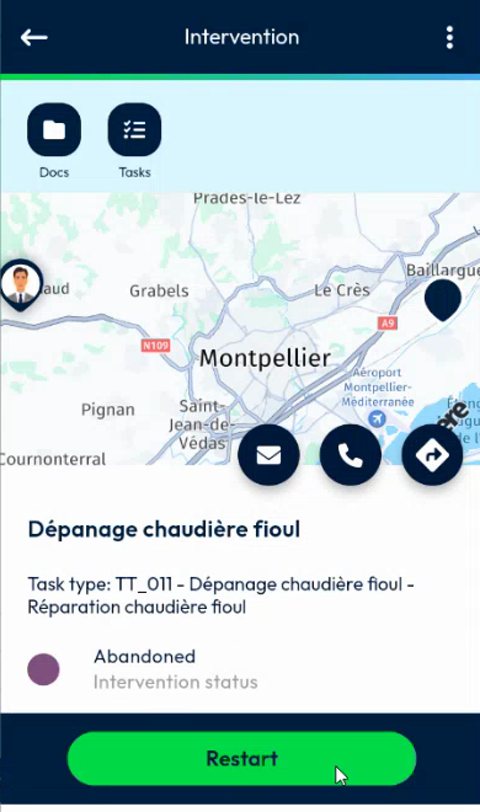
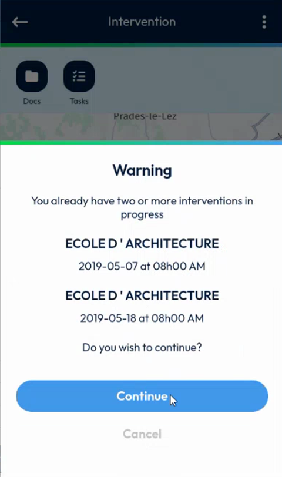
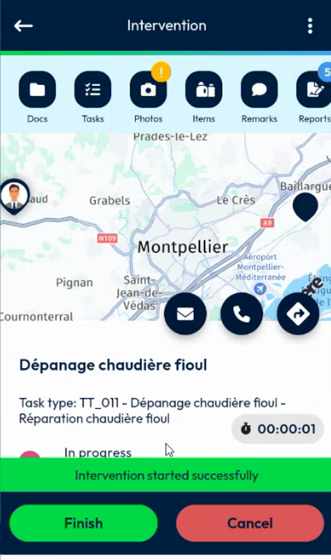

# Restart an Abandoned Intervention

Start again an intervention that was abandoned.

## Overview

Abandoned interventions are now displayed in your agenda. You can open one and restart it from the app. When you restart it, its status changes from **Abandoned** to **In progress**.

## Before you begin

* The intervention was abandoned. See [Abandon an Intervention](abandon-an-intervention.md).
* Your administrator has set up the back office to send abandoned interventions to the app. See [Abandoned Missions Setup](../configuration/abandoned-missions-setup.md).
* Your data is up to date. See [Refresh Your Data](../main-actions/refresh-your-data.md).

## Find the abandoned intervention

1. In the navigation bar at the bottom of the screen, tap the calendar icon.
2. Select the day of the intervention.
3. In the list of the day, tap the abandoned intervention.

<figure><figcaption>
Calendar with interventions of the day
</figcaption></figure>

You can also open it from the **Interventions** list of the [dashboard](../main-actions/main-actions.md).

## Restart the intervention

1. On the **Intervention** page, check the status **Abandoned**. A green **Restart** button is displayed at the bottom of the screen, in place of **Begin** and **Abandon**.

<figure><figcaption>
Abandoned intervention with the Restart button
</figcaption></figure>

2. Tap **Restart**.
3. If you already have two or more interventions in progress, a **Warning** message lists them and asks **Do you wish to continue?** Tap **Continue** to restart the intervention, or **Cancel** to keep it abandoned.

<figure><figcaption>
Warning about interventions in progress
</figcaption></figure>

4. Wait for the message **Intervention started successfully**. The status changes to **In progress**, a timer starts, and the **Finish** and **Cancel** buttons are displayed.

<figure><figcaption>
Intervention restarted
</figcaption></figure>

In NFS, the status of the appointment changes from **On hold** to **Ongoing**.

## Finish the intervention

Carry out the intervention as usual. Take the required photos, fill in the report, have it signed, and finish it. See [Take the Required Photos](required-photos.md), [Fill in the Report](report.md), [Sign an Intervention](sign-an-intervention/README.md) and [Finish an Intervention](finish-an-intervention.md).

After you finish it, refresh your data. The status of the appointment changes to **Happened / Done**.

## Refresh when nothing changes

If you refresh your data and the app shows **Request failed**, no new data may be available. Try again later.

<!-- REVIEW: during the demo, the Request failed message appeared when the refresh found nothing new. The team suggested replacing it with a clearer message such as "no new records". Confirm the final wording. Confirm also what the planner sees in NFS while the intervention is restarted, and whether the Abandon waybill notes are kept. -->

## Related topics

* [Abandon an Intervention](abandon-an-intervention.md)
* [Start an Intervention](start-an-intervention.md)
* [Abandoned Missions Setup](../configuration/abandoned-missions-setup.md)
* [Calendar](../main-actions/calendar.md)
