# Scan a Document

## Overview

You can scan a paper document with the camera of your device, improve the scan, and save it in the documents of the intervention as a PDF or a JPEG file.

## Before you begin

* The intervention is open. See [Start an Intervention](start-an-intervention.md).
* The app is allowed to use the camera of your device.

## Scan a document

1. On the **Intervention** page, tap **Docs**.
2. On the **Documents** page, tap the scan button, the first button at the bottom of the screen.

<figure>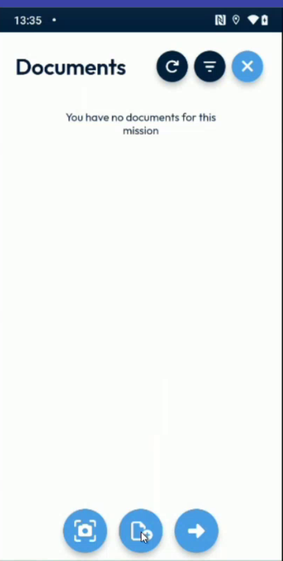<figcaption>
Documents page with the scan button
</figcaption></figure>

3. The message **Scanning is in progress** is displayed, then the camera opens.
4. At the bottom of the screen, choose **Manual** or **Auto capture**.
   * With **Auto capture**, hold your device steady in front of the document. The app takes the picture when the document is detected.
   * With **Manual**, tap the white round button to take the picture.

<figure>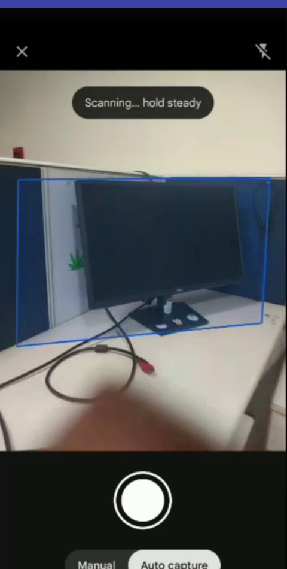<figcaption>
Camera in auto capture mode
</figcaption></figure>

5. The scan is displayed with the editing buttons.

<figure>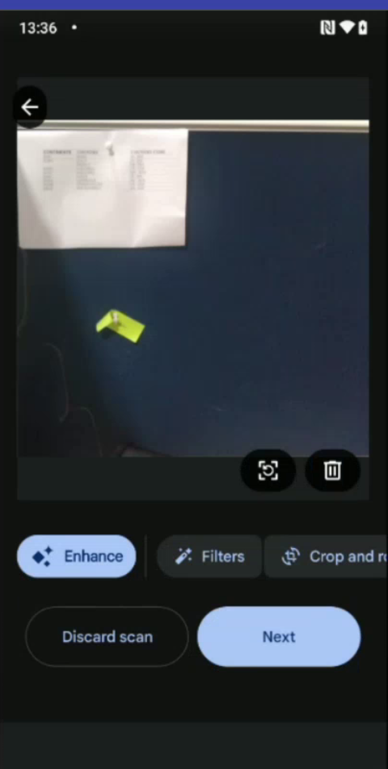<figcaption>
Scan with the editing buttons
</figcaption></figure>

## Improve the scan

| Button | What it does |
| ------ | ------------ |
| **Filters** | Changes the color of the scan: **Original**, **Auto** (the default), **Colour**, **Greyscale**, **B&W** and **Shadows**. Tap **Apply**. |
| **Crop and rotate** | Crops the scan with **Automatic crop** (the default) or **No crop** to keep the whole picture. You can also drag the corners to crop by hand. Use **Rotate** to turn the scan. Tap **Apply**. |
| **Erase** | Removes marks and stains. Draw on them with your finger. Tap **Apply**. |

<figure>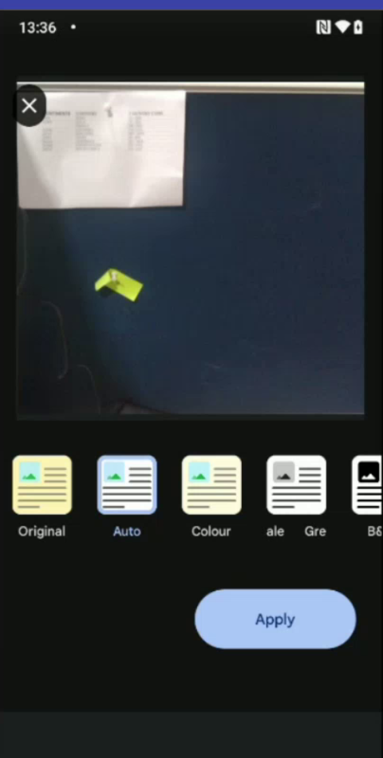<figcaption>
Filters of the scan
</figcaption></figure>

<figure>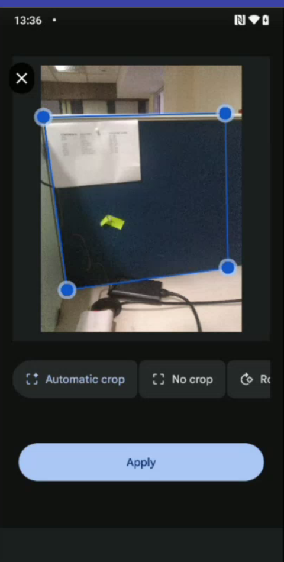<figcaption>
Crop of the scan
</figcaption></figure>

<figure>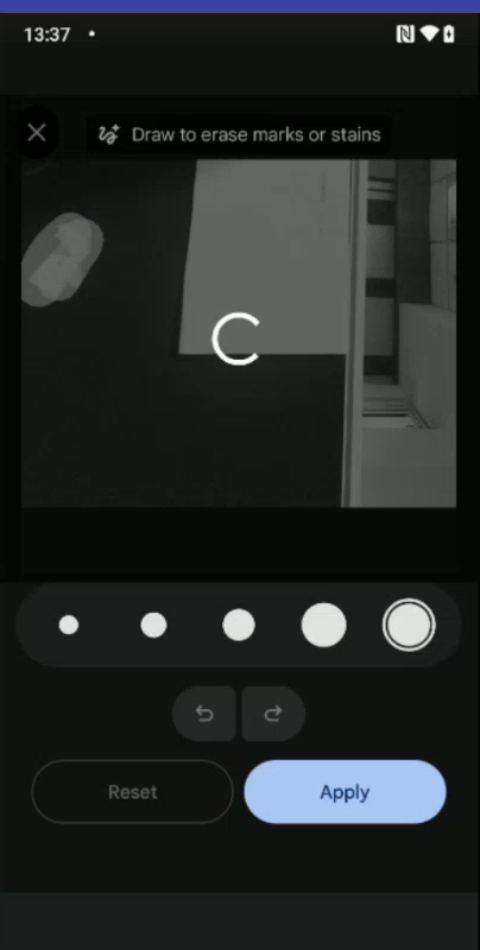<figcaption>
Erase marks and stains
</figcaption></figure>

To take the scan again, tap **Discard scan**.

## Save the scan

1. Tap **Next**.
2. In **Add scanned document**, enter the **Document name**.
3. Choose the **Format**: **PDF** or **JPG**.

<figure>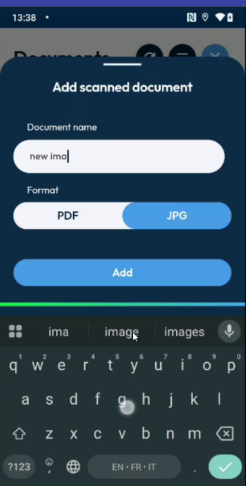<figcaption>
Name and format of the scanned document
</figcaption></figure>

4. Tap **Add**. The document is in the list of the **Documents** page, with the label **Intervention**.

<figure>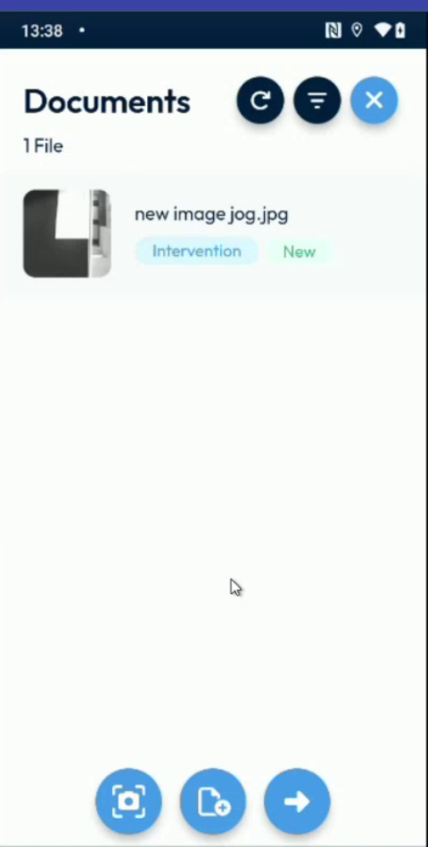<figcaption>
Scanned document in the list
</figcaption></figure>

5. To see the document, tap it.

You can scan several documents, one after the other. Choose **PDF** for some and **JPG** for others.

<figure>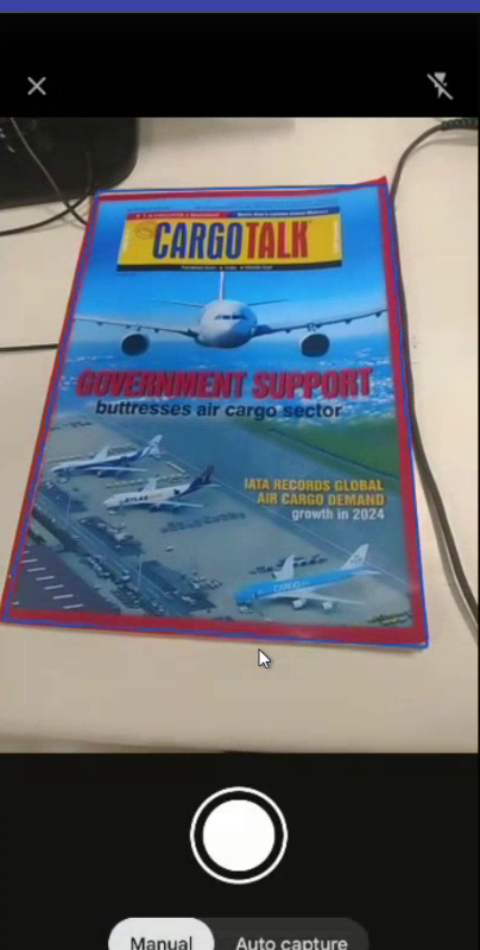<figcaption>
Scan of a printed document
</figcaption></figure>

<figure>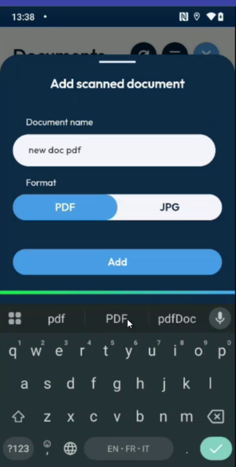<figcaption>
Scanned document saved as a PDF
</figcaption></figure>

## Send the documents

The scanned documents are sent to the back office when you complete the intervention. They appear in the documents of the intervention, with the signatures and the other files.

<figure>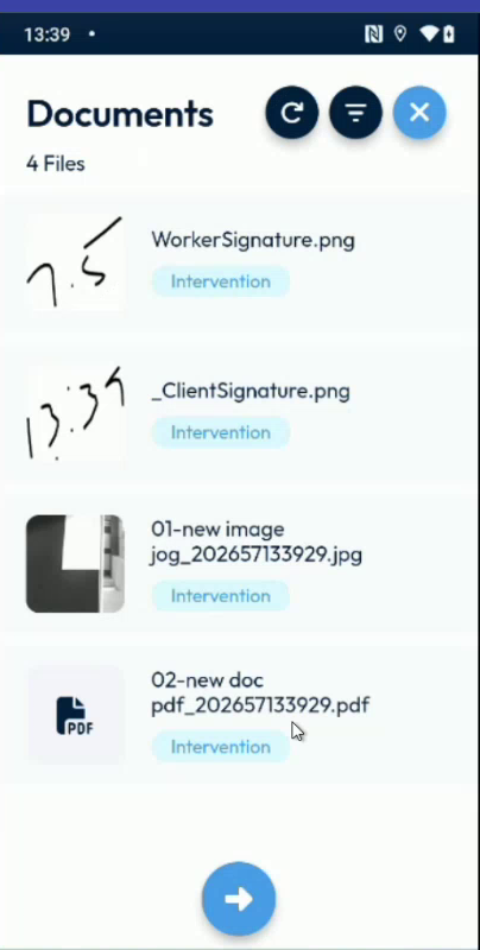<figcaption>
Documents of the completed intervention
</figcaption></figure>


The app does not recognize the text of a scan: you cannot search in it or copy it. The scan is saved as an image or as a PDF.


<!-- REVIEW: confirm the function of the Enhance button, and whether the size of the scan is reduced. -->

## Next steps

* [Finish an Intervention](finish-an-intervention.md)

## Related topics

* [View the Documents of an Intervention](documents.md)
* [Add Photos and Remarks](photos-and-remarks.md)