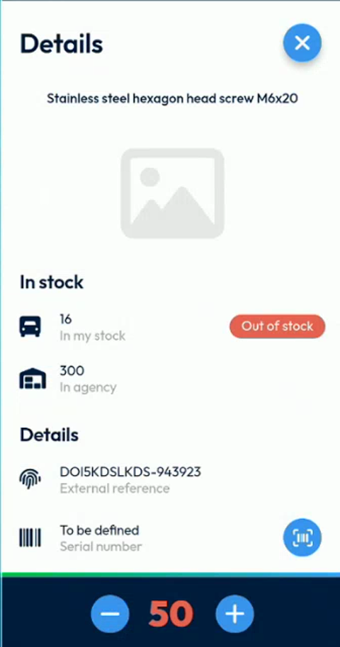
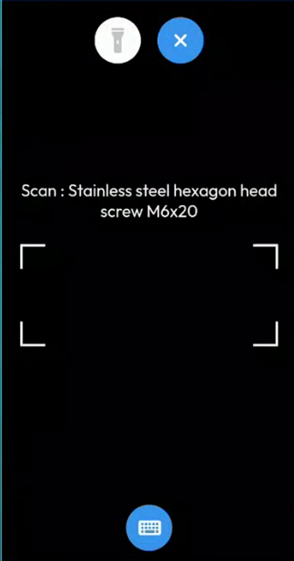
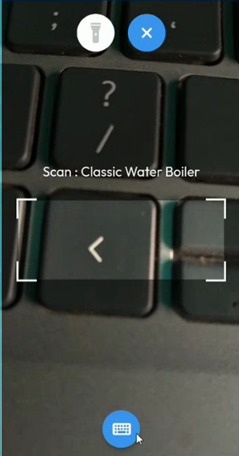
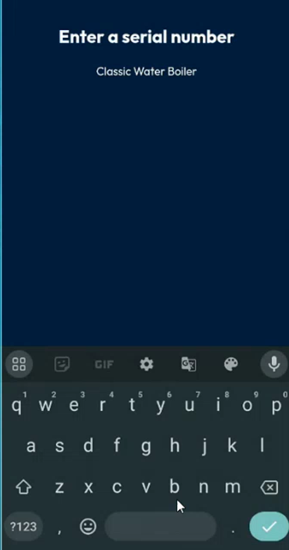
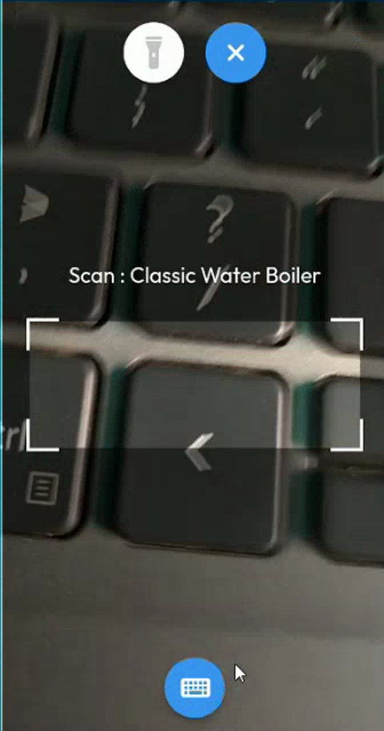
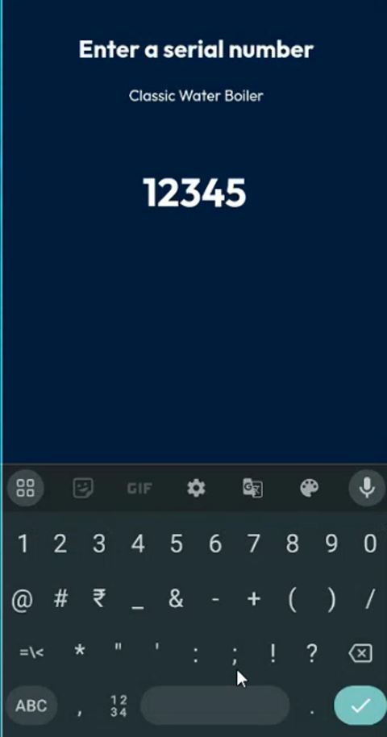
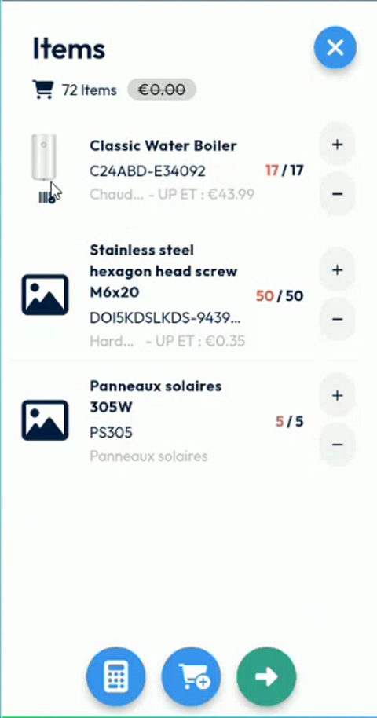

# Scan or Enter a Serial Number

Link a barcode or QR code, or a number you type, to an item of the intervention.

## Overview

For each item of an intervention, you can record a serial number. You can scan a barcode or a QR code with the camera of your device, or type the number by hand when the code cannot be scanned. The serial number is saved with the item and sent to NFS when you finish the intervention.

The serial number belongs to the item line of the intervention, not to the product itself. It does not change the product in the catalog. One item line has one serial number, even when its quantity is higher than one.

## Before you begin

* The intervention is started. Its status is **In progress**. See [Start an Intervention](start-an-intervention.md). Before the start, the **Serial number** field is not available.
* The app is allowed to use the camera of your device.
* The back office is set up to store the serial number. See [Serial Number Setup](../configuration/serial-number-setup.md).

## Open the serial number of an item

1. On the **Intervention** page, tap **Items**.
2. Tap the name or the photo of an item, for example **Classic Water Boiler**.
3. On the **Details** page, check the **Serial number** field. When no code is recorded, it shows **To be defined**.

<figure><figcaption>
Serial number to be defined
</figcaption></figure>

## Scan a code

1. At the right of the **Serial number** field, tap the scan button.
2. The scan view opens with the name of the item, for example **Scan : Stainless steel hexagon head screw M6x20**.

<figure><figcaption>
Scan view
</figcaption></figure>

3. Point the camera at the barcode or the QR code. Keep the code inside the four corners of the frame.
4. To light the code, tap the flashlight button at the top of the screen.
5. When the code is read, the **Details** page opens again. The scanned number is displayed in the **Serial number** field, for example **1599877**.

<figure><figcaption>
Scanning a code with the camera
</figcaption></figure>

To leave the scan view without a code, tap the blue cross at the top.

## Enter a code by hand

Type the number when the code is damaged or cannot be scanned.

1. In the scan view, tap the keyboard button at the bottom of the screen.
2. The **Enter a serial number** page opens, with the name of the item. The keyboard is displayed and the cursor is ready, so you can type at once.

<figure><figcaption>
Enter a serial number page
</figcaption></figure>

3. Type the number, for example **12345**.

<figure><figcaption>
Serial number typed
</figcaption></figure>

4. Tap the check mark at the bottom right of the keyboard to save it.
5. The **Details** page opens. The **Serial number** field shows the number that you typed.

<figure><figcaption>
Serial number saved on the Details page
</figcaption></figure>

## Replace a serial number

1. Open the **Details** page of the item.
2. Tap the scan button, then scan another code or tap the keyboard button to type a number.
3. The new number replaces the previous one. In the video, the scanned number **1599877** is replaced by the typed number **12345**.

## Check which items have a serial number

1. Close the **Details** page to return to the **Items** page.
2. Look under the photo of each item. A small barcode icon indicates that a serial number is recorded for the item.

<figure><figcaption>
Barcode icon under the photo of an item
</figcaption></figure>

An item without the icon has no serial number yet. In the example, the third item stays empty, and no icon is displayed for it.

## Send the serial numbers

1. Finish the intervention. See [Finish an Intervention](finish-an-intervention.md).
2. Fill in the mandatory fields of the report if the app asks for them, then sign and confirm.
3. Wait for the success message. The serial numbers are sent to NFS with the intervention.

In NFS, the serial number of each item is displayed in the field of the appointment details to which it is linked. Refresh the appointment sheet to see it. An item without a serial number has an empty field.


You can also scan a code to find a product in the catalog, and to find a task. The serial number is a different feature: it is recorded for the item of one intervention.


<!-- REVIEW: the presenter confirms that the serial number is stored in the appointment detail (Detail filler5 in the demo), not in the product, and that it is an attribute of one line of the product order. Confirm the wording for users, and whether the serial number is sent only at the end of the intervention or earlier. -->
<!-- REVIEW: for items that are single articles (for example a boiler), a project may require one line per item with a quantity of one, and hide the plus button. Confirm if this will be offered as a setting. -->

## Related topics

* [Add Items to an Intervention](add-items-to-an-intervention.md)
* [View the Details of an Item](view-item-details.md)
* [Serial Number Setup](../configuration/serial-number-setup.md)
* [Finish an Intervention](finish-an-intervention.md)
